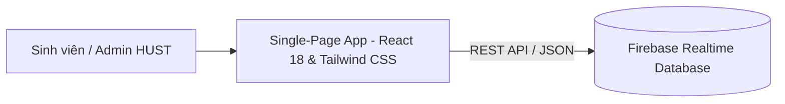
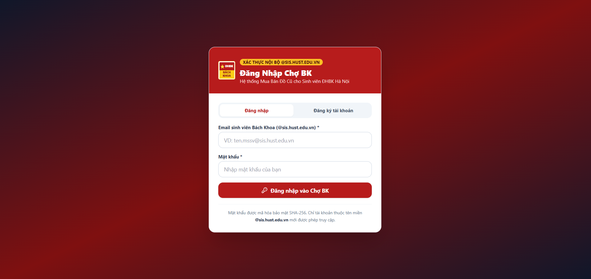
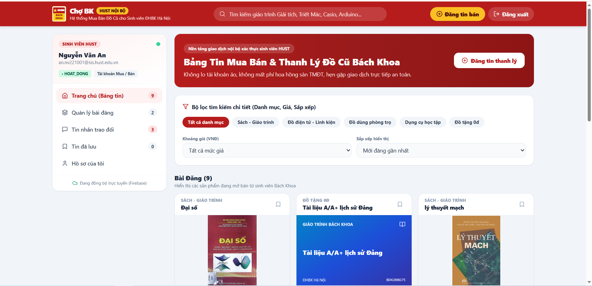

# Chợ BK — cho_bk_173820_n56

> Hệ thống mua bán, trao đổi và thanh lý đồ cũ nội bộ dành riêng cho sinh viên Đại học Bách Khoa Hà Nội.

## 1. Giới thiệu sản phẩm
- **Bài toán / người dùng đích:** Sinh viên ĐHBK Hà Nội có nhu cầu mua bán đồ cũ (giáo trình, đồ điện tử, đồ phòng trọ) nhưng gặp rủi ro tài khoản ảo trên mạng xã hội và phí cao trên sàn TMĐT.
- **Tính năng chính của MVP:**
  1. Đăng ký/Đăng nhập xác thực nội bộ bằng email `@sis.hust.edu.vn` (mã hóa mật khẩu SHA-256).
  2. Đăng tin, sửa, xóa và quản lý trạng thái bài đăng (Đang bán / Đã bán).
  3. Tìm kiếm theo từ khóa và lọc theo danh mục, khoảng giá, sắp xếp.
  4. Nhắn tin trao đổi trực tiếp giữa người mua và người bán; gửi báo cáo khiếu nại.
  5. Trang quản trị kiểm duyệt, khóa tài khoản, thống kê và xuất báo cáo Excel (.CSV).
- **Demo trực tuyến:**  https://vocal-babka-db2d30.netlify.app/
- **Ảnh chụp:** `docs/home.png`

## 2. Phạm vi MVP
| Trạng thái | Nội dung |
|---|---|
| ✅ Đã làm | Đăng nhập/đăng ký `@sis.hust.edu.vn`, Bảng tin, Bộ lọc tìm kiếm, Quản lý bài đăng, Tin nhắn trao đổi, Khiếu nại, Trang quản trị & Thống kê, Đồng bộ Firebase |
| 🚧 Đang làm | Kiểm thử tự động (Unit/Integration test), Tái cấu trúc mã nguồn sang React/Vite |
| ⬜ Chưa làm | Gửi mã OTP tự động mặc định qua email trường |
| 🚫 Ngoài phạm vi | Thanh toán trung gian, Tích hợp đơn vị vận chuyển |

## 3. Kiến trúc & công nghệ

- **Ngôn ngữ / Framework:** HTML5, React 18 (UMD), Tailwind CSS (CDN), Babel Standalone.
- **Cơ sở dữ liệu & Triển khai:** Firebase Realtime Database (REST API), Netlify.
- **Cấu trúc thư mục:**
  - `src/index.html`: Mã nguồn ứng dụng web Chợ BK
  - `report/`: Báo cáo phân tích thiết kế (SRS, C4, ERD)
  - `docs/`: Ảnh chụp màn hình giao diện

## 4. Cài đặt & cách sử dụng
**Yêu cầu:** Trình duyệt web hiện đại (Chrome, Edge, Firefox) và Python 3 (hoặc VS Code Live Server).

```bash
git clone [https://github.com/nguyennhuhienfpt718-svg/ktpmud-project.git](https://github.com/nguyennhuhienfpt718-svg/ktpmud-project.git)
cd ktpmud-project/submissions/cho_bk_173820_n56/src

# Chạy máy chủ cục bộ (không cần cài thư viện)
python -m http.server 8000
# Mở trình duyệt tại: http://localhost:8000
```

**Tài khoản mẫu (synthetic) có sẵn:**
- **Sinh viên:** `an.nv221001@sis.hust.edu.vn` — Mật khẩu: `123456`
- **Quản trị viên (Admin):** `admin.chobk@sis.hust.edu.vn` — Mật khẩu: `Admin@123`

**Kịch bản sử dụng:**
1. *Kịch bản 1 — Đăng nhập hệ thống:* Truy cập màn hình đăng nhập → Nhập email `@sis.hust.edu.vn` và mật khẩu → Hệ thống xác thực và chuyển vào Trang chủ Bảng tin.
   
2. *Kịch bản 2 — Tìm kiếm và lọc sản phẩm:* Tại Bảng tin, chọn danh mục `Sách - Giáo trình` hoặc nhập từ khóa vào thanh tìm kiếm → Hệ thống lọc và hiển thị sản phẩm phù hợp.
   
3. *Kịch bản 3 — Đăng tin & nhắn tin trao đổi:* Bấm `Đăng tin bán` để đăng sản phẩm mới, hoặc bấm `NHẮN TIN` trên bài đăng bất kỳ để mở khung chat trực tiếp với người bán.

## 5. Hướng phát triển Tuần 11–15
| Tuần | Mục tiêu | Đầu việc chính | Phụ trách (MSSV) | Tiêu chí hoàn thành | Trạng thái |
|:---:|---|---|---|---|:---:|
| 11 | Chốt MVP & nền tảng | Hoàn thiện MVP, README 6 mục, nộp PR #1 | 202414102, 202414162, 202413981 | Nộp PR #1 đúng hạn | 🚧 |
| 12 | Kiểm thử & tích hợp | Viết test luồng chính, chạy thử máy sạch, Test Report v1 | 202414162, 202413981 | Test chạy 1 lệnh, có Test Report v1 | ⬜ |
| 13 | Bảo mật & hiệu năng | Rà soát phân quyền, validate input, ẩn secret | 202414102, 202414162 | Không lộ secret, có báo cáo bảo mật | ⬜ |
| 14 | Review chéo & hoàn thiện | Peer review 1 nhóm khác, sửa lỗi, quay video demo 3–5 phút | 202414102, 202413981 | Code freeze, có video demo | ⬜ |
| 15 | Nghiệm thu & bảo vệ | Đóng gói `v1.0`, hoàn thiện báo cáo & slide | 202414102, 202414162, 202413981 | PR cuối đầy đủ, sẵn sàng bảo vệ | ⬜ |

## 6. Nhóm & tuân thủ
- **Mã nhóm:** `173820_n56`
- **Thành viên:**
  - `202414102` – Business Analysis / Architect
  - `202414162` – Backend Dev / Data Engineer, QA
  - `202413981` – Frontend / QA Engineer, Backend Dev
- ✅ **Zero PII/PHI:** Toàn bộ dữ liệu sản phẩm và tài khoản sử dụng trong hệ thống là dữ liệu mẫu (synthetic).
- **Công cụ AI đã dùng & phạm vi:** ChatGPT, Gemini (hỗ trợ gợi ý cấu trúc tài liệu, giao diện và mã nguồn; toàn bộ đã được nhóm kiểm tra lại).
