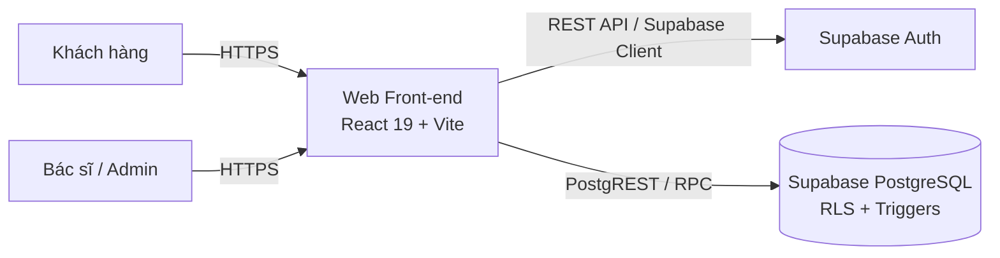

# Hệ thống đặt lịch khám trực tuyến Phòng khám Nha khoa Ngọc Diệu — dat_lich_nha_khoa_173820_n11

> Nền tảng Web hỗ trợ bệnh nhân chủ động tra cứu, đặt và quản lý lịch khám nha khoa trực tuyến theo thời gian thực; đồng thời giúp phòng khám nha khoa Ngọc Diệu tiếp nhận, điều phối lịch hẹn tập trung và hạn chế trùng lịch.

## 1. Giới thiệu sản phẩm
- **Bài toán / người dùng đích:**
  - *Bài toán:* Loại bỏ quy trình đặt lịch thủ công qua điện thoại/sổ sách dễ gây trùng giờ, mất thời gian trao đổi, bỏ sót lịch hẹn và thiếu minh bạch thông tin dịch vụ, giá cả.
  - *Người dùng đích:* Khách hàng có nhu cầu khám chữa răng miệng và Đội ngũ Bác sĩ/Nhân viên điều phối tại phòng khám Nha khoa Ngọc Diệu.
- **Tính năng chính của MVP:**
  1. *Tra cứu thông tin:* Xem danh mục dịch vụ nha khoa, bảng giá công khai, cơ sở vật chất và hồ sơ đội ngũ bác sĩ.
  2. *Đặt lịch trực tuyến:* Bệnh nhân chọn dịch vụ, bác sĩ phụ trách, ngày khám và khung giờ trống theo thời gian thực.
  3. *Quản lý lịch hẹn cá nhân & phân quyền:* Bệnh nhân tra cứu, đổi giờ, hủy lịch hẹn; Bác sĩ truy cập Dashboard duyệt lịch hẹn (`pending`, `confirmed`, `completed`, `cancelled`) và quản lý hồ sơ khám.
- **Demo:** [https://ngocdieu.vercel.app](https://ngocdieu.vercel.app) (Bản thử nghiệm trực tuyến MVP) · **Mã nguồn:** [https://github.com/phg-nam/NhaKhoa](https://github.com/phg-nam/NhaKhoa)

## 2. Phạm vi MVP
| Trạng thái | Nội dung |
|---|---|
| ✅ Đã làm | - Giao diện trang chủ, giới thiệu phòng khám, đội ngũ bác sĩ và bảng giá chi tiết.<br>- Luồng đặt lịch khám trực tuyến với validation chọn ngày, giờ và bác sĩ.<br>- Đăng ký, đăng nhập tài khoản khách hàng bằng Email / Số điện thoại.<br>- Phân quyền người dùng (`customer`, `subadmin`, `admin`).<br>- Bảng điều khiển dành cho Bác sĩ (AdminPanel) để duyệt, chuyển trạng thái và quản lý lịch hẹn.<br>- Trang Thành viên: xem danh sách lịch hẹn cá nhân, đổi lịch, hủy lịch và theo dõi điểm tích lũy.<br>- Khởi tạo cơ sở dữ liệu Supabase PostgreSQL với Row Level Security (RLS) và Database Triggers. |
| 🚧 Đang làm | - Hoàn thiện luồng gửi mã OTP xác minh Email lúc đăng ký (`REQUIRE_OTP` qua SMTP Supabase).<br>- Tự động gửi email/thông báo nhắc lịch hẹn cho khách hàng trước giờ khám. |
| ⬜ Chưa làm | - Tích hợp cổng thanh toán trực tuyến tiền cọc/phí khám.<br>- Đánh giá và phản hồi chất lượng dịch vụ sau khi hoàn thành ca khám. |
| 🚫 Ngoài phạm vi | - Hệ thống quản lý kho vật tư y tế và xuất nhập thiết bị phòng khám chuyên sâu.<br>- Bệnh án điện tử chẩn đoán hình ảnh X-quang/CT 3D chuyên sâu. |

## 3. Kiến trúc & công nghệ

- **Ngôn ngữ/framework:**
  - Frontend: React 19.3, Vite 8.3, React Router DOM v7.18, Lucide React 1.66.
  - Backend as a Service & Database: Supabase (PostgreSQL 15+, Supabase Auth, Row Level Security, PL/pgSQL Triggers & RPC functions).
  - Triển khai & CI/CD: Vercel (Auto-deploy).
- **Cấu trúc thư mục:**
  - `src/components/`: Header, Footer, AdminPanel, ApptTable, AuthLayout, Pager...
  - `src/pages/`: Home, Booking, Services, Prices, Doctors, Login, Register, Member...
  - `src/content/`: priceList.js, doctors.js, serviceInfo.js...
  - `src/lib/`: supabase.js (kết nối Supabase client).
  - `supabase/`: setup.sql (schema CSDL, bảng `profiles`, `appointments`, RLS policies, triggers).

## 4. Cài đặt & cách sử dụng
**Yêu cầu:** Node.js 18+ (khuyến nghị Node 20 LTS) / npm hoặc pnpm
```bash
# 1. Clone repository mã nguồn
git clone https://github.com/phg-nam/NhaKhoa.git
cd NhaKhoa

# 2. Cài đặt dependencies
npm install

# 3. Cấu hình biến môi trường
cp env.example .env.local     # Điền VITE_SUPABASE_URL và VITE_SUPABASE_ANON_KEY

# 4. Khởi chạy môi trường phát triển (chạy tại http://localhost:5173)
npm run dev

# 5. Build kiểm tra sản phẩm
npm run build
```
**Dữ liệu/tài khoản mẫu (synthetic):**
- Cơ sở dữ liệu mẫu: Khởi tạo bằng file `supabase/setup.sql` trong SQL Editor của Supabase.
- Tài khoản Bác sĩ/Quản trị mẫu (synthetic): `admin@example.com` (gán role `admin` qua lệnh: `UPDATE public.profiles SET role = 'admin' WHERE email = 'admin@example.com';`).
- Tài khoản Bệnh nhân mẫu: Tạo tài khoản mới trực tiếp từ giao diện trang Đăng ký.

**Kịch bản sử dụng:**
1. *Kịch bản 1 — Khách hàng đặt lịch khám:* Bệnh nhân truy cập trang "Đặt lịch khám" → chọn dịch vụ nha khoa, chọn bác sĩ, ngày và khung giờ còn trống → nhấn "Xác nhận đặt lịch" → Lịch hẹn được lưu với trạng thái `pending` và hiển thị trong trang "Thành viên".
2. *Kịch bản 2 — Bác sĩ tiếp nhận và xác nhận ca khám:* Bác sĩ đăng nhập tài khoản quản trị → vào bảng điều khiển AdminPanel → xem danh sách lịch hẹn chờ duyệt → nhấn "Xác nhận" → trạng thái lịch hẹn chuyển thành `confirmed`.
3. *Kịch bản 3 — Khách hàng điều chỉnh hoặc hủy lịch:* Bệnh nhân vào trang "Thành viên" → tại mục lịch hẹn đang chờ/đã duyệt, bấm "Đổi lịch" để chọn giờ khác hoặc bấm "Hủy lịch" → hệ thống gọi RPC `cancel_appointment` cập nhật trạng thái `cancelled`.

## 5. Hướng phát triển Tuần 11–15
| Tuần | Mục tiêu | Đầu việc chính | Phụ trách (MSSV) | Tiêu chí hoàn thành | Trạng thái |
|:---:|---|---|---|---|:---:|
| 11 | Hoàn thiện tính năng & Đối chiếu yêu cầu | Kiểm thử toàn diện 10 yêu cầu chức năng (FR-01 → FR-10), đối chiếu tiêu chí nghiệm thu | 202414275 | Bảng đối chiếu yêu cầu và tính năng đạt 100% | 🚧 |
| 12 | Tối ưu xác thực & Email thông báo | Bật luồng gửi mã OTP qua SMTP trong `Register.jsx`, hoàn thiện mẫu email nhắc hẹn | 202414215 | Nhận mã OTP qua email thực tế, kích hoạt tài khoản chuẩn | 🚧 |
| 13 | Tối ưu giao diện & Trải nghiệm người dùng | Rà soát responsive mobile, tối ưu tốc độ tải trang, hoàn thiện trang chính sách thành viên | 202414072 | Giao diện hiển thị tốt trên cả Desktop và Mobile | 🚧 |
| 14 | Kiểm thử hệ thống & Sửa lỗi (QA/Test) | Viết kịch bản kiểm thử biên, kiểm thử tải và kiểm tra chống đặt trùng lịch hẹn | 202414072 | Báo cáo kiểm thử đạt, không còn lỗi chặn trùng giờ | ⬜ |
| 15 | Hoàn thiện tài liệu & Báo cáo cuối kỳ | Tổng hợp báo cáo kỹ thuật, cập nhật slide thuyết trình, đóng gói sản phẩm | 202414275 | Báo cáo hoàn chỉnh nộp lên GitHub theo quy định | ⬜ |

## 6. Nhóm & tuân thủ
- Mã nhóm: `173820_n11` · Thành viên:
  - `202414275` – Product Owner & Lead Developer
  - `202414072` – Scrum Master & QA/Tester
  - `202414215` – Backend & Database Engineer
- ✅ **Zero PII/PHI:** Toàn bộ dữ liệu hiển thị, lịch hẹn và thông tin người dùng sử dụng là dữ liệu mô phỏng (synthetic data), tuyệt đối không chứa dữ liệu bệnh nhân thật.
- **Công cụ AI đã dùng & phạm vi:** Sử dụng GitHub Copilot và Google Gemini hỗ trợ sinh mã giao diện React và rà soát cú pháp SQL.
- **Dữ liệu lớn (>10MB):** Không có file vượt quá 10MB (các file báo cáo và slide trong bài nộp đều dưới 6MB).
