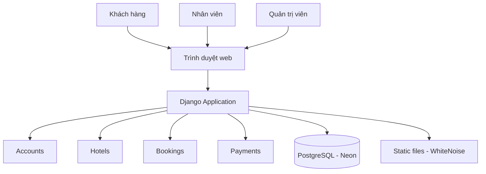

# Hệ thống đặt phòng trực tuyến — dat_phong_tt_n24

Hệ thống đặt phòng trực tuyến giúp khách hàng tìm kiếm cơ sở lưu trú, kiểm tra phòng trống và đặt phòng; đồng thời hỗ trợ nhân viên quản lý đơn đặt phòng và thanh toán.

## 1. Giới thiệu sản phẩm

- **Bài toán / người dùng đích:** Việc tìm kiếm và quản lý đặt phòng tại các cơ sở lưu trú có thể mất nhiều thời gian nếu thực hiện thủ công. Sản phẩm hướng đến khách hàng có nhu cầu đặt phòng trực tuyến, nhân viên lễ tân và quản trị viên hệ thống.
- **Tính năng chính của MVP (3–5):**
  1. Hiển thị danh sách cơ sở lưu trú và thông tin chi tiết.
  2. Tìm kiếm phòng trống theo ngày nhận phòng và trả phòng.
  3. Tạo đơn đặt phòng và giữ phòng trong 15 phút để chờ thanh toán.
  4. Tra cứu đơn đặt phòng bằng mã đặt phòng và số điện thoại.
  5. Quản lý đơn đặt phòng, xác nhận thanh toán và thực hiện check-in/check-out.
- **Demo:** https://dat-phongtt.onrender.com/ (website triển khai) · **Ảnh chụp:** `report/screenshot-01.png`

## 2. Phạm vi MVP

| Trạng thái | Nội dung |
|---|---|
| ✅ Đã làm | Đăng nhập, trang chủ, danh sách cơ sở lưu trú, trang chi tiết cơ sở, quản lý loại phòng và phòng. |
| ✅ Đã làm | Tìm kiếm phòng trống, tạo đơn đặt phòng, giữ chỗ 15 phút, tra cứu đơn và quy trình xác nhận thanh toán. |
| 🚧 Đang làm | Kiểm thử tổng thể quy trình đặt phòng, thanh toán, check-in/check-out và hoàn thiện tài liệu dự án. |
| ⬜ Chưa làm | Hóa đơn PDF, báo cáo thống kê, giá phòng theo mùa và gửi email thông báo tự động. |
| 🚫 Ngoài phạm vi | Tích hợp thanh toán trực tiếp qua cổng thanh toán ngân hàng trong phiên bản MVP hiện tại. |

## 3. Kiến trúc & công nghệ

**Sơ đồ kiến trúc tổng quan (Container):**



- **Ngôn ngữ/framework + phiên bản:** Python 3.13+, Django 6.1.3, HTML, CSS, Bootstrap 5.3.3.
- **Cơ sở dữ liệu:** SQLite trong môi trường phát triển cục bộ; PostgreSQL trên môi trường triển khai thông qua Neon.
- **Triển khai:** Render, Gunicorn, WhiteNoise.
- **Cấu trúc thư mục `src/`:**
  - `config/`: Cấu hình dự án, settings, URL và WSGI.
  - `accounts/`: Quản lý tài khoản và xác thực người dùng.
  - `hotels/`: Quản lý cơ sở lưu trú, loại phòng và phòng.
  - `bookings/`: Quản lý khách hàng, đơn đặt phòng, tìm phòng trống và giữ chỗ.
  - `payments/`: Xử lý thông tin thanh toán và xác nhận thanh toán.
  - `templates/`: Các giao diện HTML.
  - `static/`: CSS và tài nguyên giao diện.
  - `manage.py`: Công cụ quản lý dự án Django.

## 4. Cài đặt & cách sử dụng

**Yêu cầu môi trường:**
- Windows, Linux hoặc macOS.
- Python 3.13 trở lên.
- pip và Git.
- Các thư viện được khai báo trong `requirements.txt`.

**Cài đặt và khởi chạy trên Windows PowerShell:**

```powershell
# Tạo môi trường ảo
python -m venv venv

# Kích hoạt môi trường ảo
.\venv\Scripts\Activate.ps1

# Cài đặt thư viện
pip install -r requirements.txt

# Khởi tạo cơ sở dữ liệu
python manage.py migrate

# Tạo dữ liệu mẫu
python manage.py seed_demo

# Chạy kiểm thử
python manage.py test

# Khởi chạy website
python manage.py runserver
```

Truy cập website tại: http://127.0.0.1:8000

**Dữ liệu/tài khoản mẫu (synthetic):**

- Sử dụng lệnh `python manage.py seed_demo` để tạo dữ liệu mẫu phục vụ thử nghiệm.
- Dữ liệu mẫu được sử dụng cho mục đích phát triển và kiểm thử, không đại diện cho khách hàng hoặc cơ sở lưu trú thật.
- Tài khoản mẫu chỉ sử dụng trong môi trường thử nghiệm; không sử dụng mật khẩu mặc định trên môi trường triển khai thực tế.

**Kịch bản sử dụng (≥ 3):**

1. **Khách tìm kiếm phòng:** Truy cập trang chủ → chọn cơ sở lưu trú → nhập ngày nhận phòng và trả phòng → xem danh sách phòng trống → kết quả hiển thị các phòng phù hợp.
2. **Khách đặt phòng và tra cứu đơn:** Chọn phòng → nhập thông tin khách hàng → tạo đơn đặt phòng → nhận mã đặt phòng và thông tin chuyển khoản → sử dụng mã đặt phòng và số điện thoại để tra cứu đơn.
3. **Nhân viên xử lý đơn:** Đăng nhập tài khoản nhân viên → truy cập danh sách đơn đặt phòng → kiểm tra thông tin thanh toán → xác nhận thanh toán → thực hiện check-in/check-out cho khách.

## 5. Hướng phát triển Tuần 11–15

| Tuần | Mục tiêu | Đầu việc chính | Phụ trách (MSSV) | Tiêu chí hoàn thành | Trạng thái |
|:---:|---|---|---|---|:---:|
| 11 (từ 18/11) | Chốt MVP & CI | Hoàn thiện chức năng cốt lõi, cấu hình PostgreSQL và triển khai website lên Render. | Nhóm n24 | Website truy cập được, các chức năng chính hoạt động. | ✅ |
| 12 | Kiểm thử & tích hợp | Kiểm thử quy trình đặt phòng, thanh toán, tra cứu; hoàn thiện README và tài liệu nộp bài. | Nhóm n24 | README đủ 6 mục, cấu trúc bài nộp hợp lệ, kiểm tra CI đạt yêu cầu. | 🚧 |
| 13 | Bảo mật, hiệu năng & AI | Rà soát phân quyền, kiểm tra dữ liệu đầu vào, tối ưu truy vấn và đánh giá khả năng ứng dụng AI. | Nhóm n24 | Hoàn thành kiểm tra bảo mật, ghi nhận kết quả đánh giá. | ⬜ |
| 14 | Review chéo & code freeze | Kiểm tra mã nguồn, sửa lỗi, hoàn thiện tài liệu và chuẩn bị slide. | Nhóm n24 | Mã nguồn ổn định, tài liệu và slide hoàn chỉnh. | ⬜ |
| 15 | Nghiệm thu & bảo vệ | Tổng kiểm thử, hoàn thiện sản phẩm, chuẩn bị demo và thuyết trình. | Nhóm n24 | Sản phẩm chạy ổn định, trình bày được chức năng và kiến trúc. | ⬜ |

Cập nhật cột **Trạng thái** (⬜ chưa / 🚧 đang / ✅ xong) vào cuối mỗi tuần.

## 6. Nhóm & tuân thủ

- **Mã nhóm:** n24 · **Mã lớp:** 173820 · **Case study slug:** `dat_phong_tt`.
- **Thành viên:**
  - 202414457 – Backend Developer
  - [MSSV thành viên 2] – [Vai trò]
  - [MSSV thành viên 3] – [Vai trò]
- **Zero PII/PHI:** Dữ liệu minh họa và dữ liệu kiểm thử được sử dụng là dữ liệu synthetic, không đưa thông tin cá nhân hoặc dữ liệu nhạy cảm thật vào repository.
- **Công cụ AI đã dùng & phạm vi:** ChatGPT được sử dụng để hỗ trợ giải thích lỗi, tham khảo giải pháp kỹ thuật, rà soát mã nguồn và hỗ trợ hoàn thiện tài liệu. Nhóm chịu trách nhiệm kiểm tra, chỉnh sửa và xác nhận kết quả cuối cùng.
- **Dữ liệu lớn (>10MB):** Không sử dụng bộ dữ liệu lớn bên ngoài trong phiên bản hiện tại.

## Cấu trúc thư mục bài nộp

- `report/` — SRS, C4 Model, Test Report, báo cáo cuối kỳ và ảnh chụp giao diện.
- `src/` — Mã nguồn dự án Django.
- `slides/` — Slide thuyết trình của nhóm.