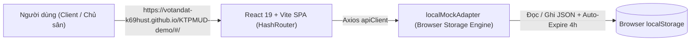

# Soccer Booker — dat_san_bong_da_173820_n04

> Hệ thống đặt sân bóng đá trực tuyến (chạy trực tiếp trên GitHub Pages, lưu trữ bền vững trên trình duyệt — không phụ thuộc database hay server bên thứ 3).

## 1. Giới thiệu sản phẩm
- **Bài toán / người dùng đích:** Giải quyết tình trạng trùng lịch sân giờ vàng, thiếu minh bạch khung giờ trống và thất lạc xác nhận đặt cọc khi đặt sân thủ công cho 2 vai trò: **Khách đặt sân (`CLIENT`)** và **Chủ sân (`PITCH_OWNER`)**.
- **Case study:** CS-18 (`dat_san_bong_da`) — Lớp `173820`, Nhóm `N04`.
- **Link Demo trực tuyến (GitHub Pages):** https://votandat-k69hust.github.io/KTPMUD-demo/#/
- **Tính năng chính của MVP (Nhánh 1, 2, 4):**
  1. Đăng ký tài khoản mới (`CLIENT` / `PITCH_OWNER`), đăng nhập (hỗ trợ điền nhanh tài khoản Demo), cập nhật hồ sơ & đổi mật khẩu.
  2. Tra cứu 10 cụm sân Hà Nội (15 sân con 5v5/7v7/11v11) theo từ khóa không dấu, quận/huyện và bản đồ GPS OpenStreetMap.
  3. Đặt sân theo 6 khung giờ chuẩn (`06:00–22:00`), chặn trùng lịch ngay trên trình duyệt, giữ chỗ 4 giờ kèm đồng hồ đếm ngược, gửi báo cáo chuyển khoản cọc.
  4. Cổng Chủ sân (`/#/admin`): quản lý cụm sân/sân con, cấu hình giá ngày thường/cuối tuần, xác nhận đơn cọc, chốt hóa đơn hoàn tất, xem lịch tuần, thống kê doanh thu & Audit Log.
  5. Đánh giá sau trận và hỏi đáp bình luận công khai trên trang chi tiết sân.

## 2. Phạm vi MVP
| Trạng thái | Nội dung |
|---|---|
| ✅ Đã làm | Nhánh 1 (Auth/Profile/Password), Nhánh 2 (Tìm sân Hà Nội, Bản đồ GPS, Đặt sân giữ chỗ 4h, Báo cọc CK, Đánh giá & Bình luận, Hủy/Đổi lịch), Nhánh 4 (Quản lý sân/giá, Duyệt đơn & Chốt hóa đơn, Lịch tuần, Doanh thu, Audit Log), tối ưu code-splitting + deploy thuần GitHub Pages (`HashRouter` + `localMockAdapter`) |
| 🚧 Đang làm | Mở rộng integration test đạt độ phủ ≥ 60% và quay video demo chính thức cho Tuần 12–14 |
| ⬜ Chưa làm | Báo cáo đánh giá bảo mật/hiệu năng tải cao (Tuần 13), Review chéo nhóm bạn (Tuần 14), Slide bản cuối (Tuần 15) |
| 🚫 Ngoài phạm vi | Nhánh 3 (Quản lý giải đấu, BXH, Ghép kèo đối thủ) tạm ẩn để tập trung chất lượng luồng đặt sân cốt lõi |

## 3. Kiến trúc & công nghệ


- **Ngôn ngữ / Framework:** React 19, TypeScript, Vite 8 (`base: "./"`, `React.lazy` code-splitting), Tailwind CSS v4, Leaflet OpenStreetMap, TanStack React Query, Zod, Vitest 4.
- **Cơ chế dữ liệu Zero-DB:** `src/frontend/src/shared/api/localMockAdapter.ts` khởi tạo sẵn dữ liệu synthetic (10 cụm sân Hà Nội, 15 sân con, 6 khung giờ chuẩn, tài khoản demo, đơn mẫu, review/comment) vào `localStorage` và xử lý toàn bộ API đặt sân/cọc/duyệt đơn trực tiếp trên trình duyệt.
- **Cấu trúc thư mục `src/`:**
  - `src/frontend/` — toàn bộ mã nguồn React/Vite & unit/integration tests
  - `report/` — tài liệu thiết kế kỹ thuật (`demo_technical_design.md`), kế hoạch thực hiện, test plan và bộ SQL tham chiếu ERD (`database_reference/`)

## 4. Cài đặt & cách sử dụng
**Yêu cầu môi trường:** Node.js >= 20 (không cần cài Database hay Docker).

```bash
# Chạy cục bộ trong ≤ 2 phút
cd submissions/dat_san_bong_da_173820_n04/src/frontend
cp .env.example .env    # Đã bật sẵn VITE_USE_MOCK_DB=true
npm install
npm run dev             # Mở http://localhost:5173/#/

# Chạy kiểm thử tự động & build kiểm tra
npm test
npm run build
```

**Dữ liệu / tài khoản mẫu (100% synthetic):**
- **Chủ sân (`PITCH_OWNER`):** `owner@soccerbooker.vn` / `Demo@123`
- **Khách hàng (`CLIENT`):** `client@soccerbooker.vn` / `Demo@123`

**Kịch bản sử dụng (≥ 3 kịch bản):**
1. *Kịch bản 1 — Tìm sân & Bản đồ GPS:* Mở `/#/booking` → gõ từ khóa không dấu (`"bach khoa"`, `"my dinh"`) hoặc chuyển tab Bản đồ → xem marker GPS và bấm *Đặt lịch*.
2. *Kịch bản 2 — Đặt sân giữ chỗ 4 giờ & Báo chuyển khoản cọc:* Đăng nhập bằng nút *Điền Khách hàng* → chọn 1 ca trống → xác nhận → chuyển sang `/#/checkout` xem đếm ngược 4h & STK ngân hàng → bấm *Xác nhận đã chuyển khoản cọc*.
3. *Kịch bản 3 — Chủ sân duyệt cọc & Thống kê:* Đăng nhập bằng nút *Điền Chủ sân* tại `/#/login` → vào `/#/admin/orders` duyệt đơn (`Xác nhận đơn`) → *Chốt hoá đơn* → xem doanh thu cập nhật trên `/#/admin`.

## 5. Hướng phát triển Tuần 11–15
> Hạn nộp tính tới `23:59` các ngày mốc; bảo vệ đồ án trong tuần 12–15 (`25/11–21/12/2026`).

| Đợt / Tuần | Mục tiêu | Đầu việc chính | Phụ trách (MSSV) | Tiêu chí hoàn thành | Trạng thái |
|:---:|---|---|---|---|:---:|
| Tuần 11–12 (PR #1 — `25/11`) | Chốt MVP, GitHub Pages & PR #1 | Triển khai Static SPA GitHub Pages (`HashRouter` + `localMockAdapter`), hoàn thiện `README.md` 6 mục & `submission.json` (`CS-18`) | `202414021`, `20233605`, `202414018` | Demo live chạy ổn định, `validate_submission.py` `[PASSED]` | ✅ |
| Tuần 13 (`30/11`) | Kiểm thử & tích hợp | Mở rộng integration test cho mọi luồng đặt/hủy/đổi lịch/duyệt cọc, test máy sạch ≤ 15 phút, viết `report/Test_Report_v1.md` | `202414018`, `202414021` | `npm test` pass 1 lệnh; có `report/Test_Report_v1.md` | ⬜ |
| Tuần 14 (`07/12`) | Bảo mật & đánh giá AI | Rà soát an toàn dữ liệu Zero PII/PHI, secret scan, tối ưu render & bundle, viết báo cáo bảo mật & đánh giá AI (Ch.9–10) | `202414021`, `20233605` | Đảm bảo 0 PII/secret, nộp báo cáo bảo mật & AI trong `report/` | ⬜ |
| Tuần 15 (`14/12`) | Review chéo, code freeze & video | Peer review 1 nhóm khác trên `ktpmud-project`, sửa góp ý, quay video demo 3–5 phút, đóng băng code | `20233605`, `202414018` | Hoàn thành comment review + video demo + code freeze | ⬜ |
| Tuần 16 (`20/12`) | Bản cuối & bảo vệ | Hoàn thiện báo cáo kỹ thuật, slide (`≤ 10MB`), `README.md` bản cuối, gắn tag `v1.0` và bảo vệ trực tiếp | `202414021`, `20233605`, `202414018` | PR cuối xanh (`tag v1.0`) + demo trực tiếp trên GitHub Pages | ⬜ |

## 6. Nhóm & tuân thủ
- **Mã nhóm:** `173820_n04`
- **Thành viên (chỉ dùng MSSV theo quy định repo công khai):**
  - `202414021` — Nhóm trưởng, Kiến trúc hệ thống & Storage Engine
  - `20233605` — Frontend React/Vite, Bản đồ GPS & Tối ưu giao diện
  - `202414018` — Phân tích nghiệp vụ (BA), Tài liệu đặc tả & Kiểm thử SQA
- **✅ Zero PII/PHI:** Toàn bộ người dùng, SĐT, tài khoản ngân hàng và giao dịch trong ứng dụng là dữ liệu synthetic lưu cục bộ trên trình duyệt. Không commit `.env` chứa khóa thật hay dữ liệu thật.
- **Công cụ AI đã dùng & phạm vi:** Sử dụng trợ lý AI hỗ trợ tối ưu code-splitting, xây dựng `localMockAdapter`, viết unit/integration tests và rà soát tài liệu kỹ thuật; mọi luồng và kết quả test đều được nhóm tự chạy kiểm chứng.
- **Dữ liệu lớn (>10MB):** Không có file > 10MB trong bài nộp.
