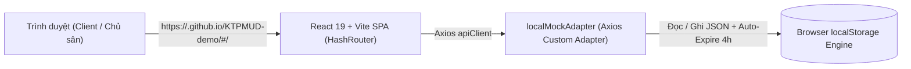

# TÀI LIỆU THIẾT KẾ KỸ THUẬT HỆ THỐNG BẢN DEMO (GITHUB PAGES STATIC SPA)
## Dự án: Soccer Booker – Hệ thống Đặt sân bóng đá trực tuyến & Quản lý Sân bóng (Phạm vi MVP: Nhánh 1, 2, 4)

**Phiên bản:** 2.0 (Static GitHub Pages Architecture — Không phụ thuộc Database hay dịch vụ bên thứ 3)  
**Nhóm thực hiện:** Nhóm 04 (`173820_n04`) — MSSV: `202414021`, `20233605`, `202414018`

---

## 1. PHẠM VI TRIỂN KHAI BẢN DEMO

| Nhánh | Tên phân hệ | Trạng thái Demo | Chức năng chính |
|:---:|---|:---:|---|
| **Nhánh 1** | **Quản lý tài khoản & Xác thực** | **Triển khai** | Đăng ký (`CLIENT` / `PITCH_OWNER`), đăng nhập (email/SĐT), cập nhật hồ sơ, đổi mật khẩu |
| **Nhánh 2** | **Đặt sân, Giữ chỗ 4h, Cọc & Cộng đồng** | **Triển khai** | Tìm 10 cụm sân Hà Nội (lọc không dấu, quận/huyện, bản đồ OpenStreetMap), 6 ca cố định (`06:00–22:00`), đặt giữ chỗ 4 giờ, báo chuyển khoản cọc, hủy/đổi lịch, đánh giá & bình luận |
| **Nhánh 4** | **Quản lý sân bóng, Khung giờ & Doanh thu** | **Triển khai** | Quản lý cụm sân/sân con (5v5/7v7/11v11), giá ngày thường & cuối tuần, quản lý đơn cọc, chốt hóa đơn, xem lịch tuần, thống kê doanh thu & Audit Log |
| **Nhánh 3** | **Quản lý giải đấu phong trào** | **Tạm hoãn** | Ngoài phạm vi MVP hiện tại |

---

## 2. KIẾN TRÚC KỸ THUẬT & CƠ CHẾ HOẠT ĐỘNG TRÊN GITHUB PAGES

### 2.1. Ngăn xếp công nghệ (Tech Stack)
* **Triển khai (Hosting):** **GitHub Pages** qua **GitHub Actions** (`.github/workflows/deploy-gh-pages.yml`) — 100% tĩnh, không cần server backend hay database bên ngoài, không chi phí vận hành, ổn định 24/7.
* **Routing tương thích GitHub Pages:** Dùng **`HashRouter`** (`/#/booking`, `/#/admin`, `/#/profile`, `/#/checkout`) và đường dẫn build tương đối (`base: "./"` trong `vite.config.ts`) để không bị lỗi `404` khi reload trang hoặc truy cập từ subpath `/KTPMUD-demo/`.
* **Frontend Core:** **React 19 + TypeScript + Vite 8** (`React.lazy` code-splitting theo route + lazy-load Leaflet `MapSearch`), **Tailwind CSS v4**, **TanStack React Query**, **Zod**.
* **Tầng dữ liệu mô phỏng bền vững (`frontend/src/shared/api/localMockAdapter.ts`):**
  * Chạy thay cho HTTP backend khi `VITE_USE_MOCK_DB=true` (tự động kích hoạt trên GitHub Pages).
  * Lưu trữ trạng thái tập trung dưới key `soccer_booker_static_db_v1` trong `localStorage`: `users`, `timeSlots`, `venues`, `pitches`, `bookings`, `reviews`, `comments`, `services`, `slotBlocks`, `activityLogs`, `notifications`.

### 2.2. Các cơ chế nghiệp vụ cốt lõi
1. **Phân quyền 2 vai trò (`CLIENT` & `PITCH_OWNER`):**
   - Kiểm tra token phiên `sb-local-<userId>` và role trước khi truy cập trang `/admin/**` (`AdminProtectedRoute`) hoặc gọi các API `/admin/**`.
2. **Chống đặt trùng lịch & Hết hạn giữ chỗ 4 giờ:**
   - Khi tạo booking (`POST /player/bookings`), adapter kiểm tra trực tiếp trong `localStorage` xem `(pitchId, bookingDate, timeSlotId)` có nằm trong `slotBlocks` hoặc có đơn đang giữ/đã đặt (`PENDING`, `WAITING_FOR_DEPOSIT`, `CONFIRMED`, `COMPLETED`, `NO_SHOW`) hay không; nếu trùng trả về **HTTP 409 Conflict**.
   - Hàm `expireHoldsInPlace()` tự động kiểm tra và chuyển các đơn `WAITING_FOR_DEPOSIT` quá `expiresAt` (4 giờ) sang `EXPIRED` mỗi khi đọc/ghi dữ liệu.
3. **Luồng Đặt cọc chuyển khoản ngoài hệ thống:**
   - Client đặt sân → nhận mã đơn (`SB-YYYYMMDD-XXXX`), đếm ngược 4 giờ, thông tin ngân hàng chủ sân (`MB Bank`) → gửi xác nhận đã chuyển khoản (`POST /bookings/:id/deposit-reports`) → phát sinh thông báo & Audit Log.
   - Chủ sân vào `/#/admin/orders` thấy số tiền khách báo CK → bấm **Xác nhận đơn** (`CONFIRMED`) → **Chốt hoá đơn** (`COMPLETED`) → Dashboard `/#/admin` tự cập nhật doanh thu & biểu đồ hiệu suất sân.
4. **Dữ liệu tham chiếu SQL (Design Reference):**
   - Bộ schema chuẩn `V1`–`V4` trong `submission/database/` được giữ lại làm tài liệu đặc tả ERD phục vụ thuyết trình thiết kế CSDL quan hệ của báo cáo.
