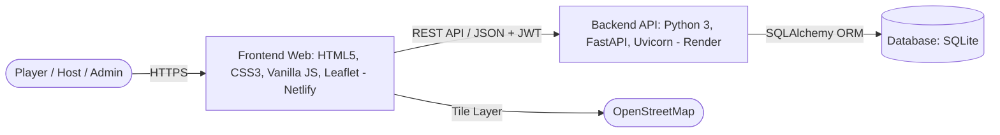

# Badminton Connect — ghep_san_cau_long_173820_n18

> Nền tảng kết nối và ghép nhóm người chơi cầu lông vãng lai theo khu vực, trình độ và khung giờ tại Hà Nội.

## 1. Giới thiệu sản phẩm

**Bài toán & người dùng đích:**
Hiện nay, việc tìm kèo đánh cầu lông vãng lai tại Hà Nội chủ yếu diễn ra thủ công trên các hội nhóm Facebook/Zalo với lượng tin đăng lớn, dễ trôi bài, thiếu bộ lọc theo bán kính/trình độ và thường xuyên xảy ra tình trạng "bùng kèo" sát giờ. Hệ thống hướng tới 3 nhóm người dùng: **Người chơi vãng lai (Player)** cần tìm sân gần nhà đúng trình độ; **Chủ sân / Chủ nhóm (Host)** cần tuyển thêm người lấp chỗ trống; và **Quản trị viên (Admin)** điều hành hệ thống.

**Tính năng chính của MVP:**
1. **Tìm kiếm & Lọc kèo nâng cao:** Lọc nhanh các ca đánh theo Quận/Huyện, Ngày thi đấu, Khung giờ và Trình độ yêu cầu (Newbie đến Giỏi).
2. **Bản đồ tương tác trực quan:** Hiển thị vị trí các cụm sân cầu lông tại Hà Nội kèm khung giờ chơi và định vị khoảng cách người dùng.
3. **Quản lý ca vãng lai & Ghép nhóm:** Cho phép Host đăng bài tuyển người (số slot, chi phí, tiền cọc) và Player đăng ký xin ghép trực tiếp.
4. **Cơ chế chống đặt lố chỗ (Anti-Overbooking):** Khóa giao dịch ở tầng cơ sở dữ liệu khi có nhiều người cùng đăng ký vào slot trống cuối cùng.
5. **Đánh giá uy tín sau trận:** Hệ thống tính điểm uy tín (thang 5 sao) giúp hạn chế tình trạng bùng kèo.

**Link triển khai trực tuyến (Live Demo):**
- **Backend API (Render):** [https://badminton-backend-xlwc.onrender.com](https://badminton-backend-xlwc.onrender.com) (Swagger Docs tại `/docs`)
- **Frontend Web (Netlify):** [https://eclectic-eclair-a19237.netlify.app/](https://eclectic-eclair-a19237.netlify.app/)
- **Tài khoản test (Synthetic):** Dữ liệu sân mẫu được khởi tạo tự động; người dùng có thể đăng ký trực tiếp tài khoản mới trên giao diện với vai trò Player hoặc Host để trải nghiệm đầy đủ luồng nghiệp vụ.

## 2. Phạm vi MVP

| Trạng thái | Nội dung |
|---|---|
| ✅ Đã làm | Đăng ký/Đăng nhập xác thực JWT + bcrypt; Tìm kiếm & lọc danh sách ca đánh; Hiển thị bản đồ sân Hà Nội (Leaflet/OpenStreetMap); Tạo ca vãng lai; Xin ghép sân & trừ slot tự động chống Overbooking; Triển khai thực tế lên Netlify & Render. |
| 🚧 Đang làm | Hoàn thiện bộ test tự động tích hợp (Integration Test) và bổ sung báo cáo kiểm thử chi tiết (Test Report v1). |
| ⬜ Chưa làm | Tích hợp cổng thanh toán cọc tự động qua Webhook (MoMo/VNPay sandbox) và thông báo đẩy nhắc lịch trước giờ chơi. |
| 🚫 Ngoài phạm vi | Quản lý bán hàng căn-tin tại sân, đặt lịch thuê sân cố định theo quý/năm cho doanh nghiệp. |

## 3. Kiến trúc & công nghệ



- **Ngôn ngữ & Framework:** Python 3.11+, FastAPI, Uvicorn, SQLAlchemy ORM, Pydantic, Passlib (bcrypt), PyJWT; Frontend sử dụng HTML5, CSS3, Vanilla JavaScript, thư viện bản đồ Leaflet.js.
- **Cơ sở dữ liệu:** SQLite (dữ liệu mô phỏng/synthetic).
- **Cấu trúc thư mục mã nguồn (`src/`):**
  - `src/main.py`: Điểm khởi chạy ứng dụng FastAPI, cấu hình CORS và đăng ký routers.
  - `src/models.py`, `src/schemas.py`, `src/database.py`: Định nghĩa bảng dữ liệu, lược đồ kiểm tra đầu vào và kết nối DB.
  - `src/routers/`: Các nhóm API xử lý xác thực, sân bãi, đặt chỗ và đánh giá.
  - `src/services.py`, `src/rules.py`, `src/security.py`: Xử lý nghiệp vụ, chống Overbooking và bảo mật JWT.
  - `src/seed.py`: Khởi tạo dữ liệu sân cầu lông mẫu (synthetic) tại Hà Nội.
  - `src/frontend/`: Giao diện người dùng (`index.html`, `login.html`, `style.css`, `main.js`, `host.js`, `common.js`).

## 4. Cài đặt & cách sử dụng

**Yêu cầu môi trường:** Python 3.10 trở lên (khuyến nghị Python 3.11) và trình duyệt web hiện đại.

```bash
# 1. Di chuyển vào thư mục mã nguồn của nhóm
cd submissions/ghep_san_cau_long_173820_n18/src

# 2. Tạo môi trường ảo và cài đặt thư viện
python -m venv .venv
# Trên Windows PowerShell:
.venv\Scripts\Activate.ps1
# Trên Linux/macOS:
# source .venv/bin/activate

pip install -r requirements.txt

# 3. Khởi chạy máy chủ Backend (tự động nạp dữ liệu mẫu synthetic)
uvicorn main:app --reload
# Backend chạy tại: http://127.0.0.1:8000 (Tài liệu API: http://127.0.0.1:8000/docs)
```

*Để chạy Frontend cục bộ:* Mở trực tiếp file `src/frontend/index.html` bằng tiện ích Live Server trên VS Code (hoặc truy cập trực tiếp đường link Web đã deploy trên Netlify: [https://eclectic-eclair-a19237.netlify.app/](https://eclectic-eclair-a19237.netlify.app/)).

**Dữ liệu & tài khoản mẫu (Synthetic):**
Hệ thống tự động sinh sẵn các ca đánh cầu lông mô phỏng tại các quận ở Hà Nội (Bách Khoa, Cầu Giấy, Thanh Xuân, Hà Đông) thông qua `seed.py`. Người kiểm thử có thể tạo nhanh tài khoản mới ở màn hình Đăng nhập với vai trò `Player` hoặc `Host`.

**Kịch bản sử dụng:**
1. *Kịch bản 1 — Tìm kiếm và lọc sân theo khu vực/giờ:* Người chơi mở trang chủ → Chọn bộ lọc Quận (ví dụ: Hai Bà Trưng) và ngày chơi → Hệ thống trả về danh sách các ca đánh phù hợp dưới 0.5 giây kèm vị trí ghim trên bản đồ.
2. *Kịch bản 2 — Đăng ký ghép sân & trừ slot tự động:* Người chơi đăng nhập → Chọn ca đánh còn chỗ trống (ví dụ: `4/6 chỗ trống`) → Bấm **"Xin ghép sân"** → Hệ thống xác nhận đặt chỗ và cập nhật số chỗ trống giảm xuống còn `3/6`.
3. *Kịch bản 3 — Chủ sân tạo ca vãng lai mới:* Người dùng đăng nhập với vai trò Host → Mở mục tạo ca vãng lai → Nhập thông tin sân, tọa độ, thời gian, số slot và chi phí → Bấm lưu → Ca đánh mới xuất hiện ngay trên danh sách tìm kiếm và bản đồ.

## 5. Hướng phát triển Tuần 11–15

| Tuần | Mục tiêu | Đầu việc chính | Phụ trách (MSSV) | Tiêu chí hoàn thành | Trạng thái |
|:---:|---|---|---|---|:---:|
| 11 | Chốt MVP & triển khai Cloud | Đóng băng phạm vi MVP; deploy Frontend lên Netlify và Backend FastAPI lên Render; hoàn thiện README 6 mục | `202414384`, `202414276` | Web chạy ổn định trực tuyến; README đầy đủ 6 mục | ✅ |
| 12 | Kiểm thử & tích hợp | Viết kịch bản kiểm thử các luồng chính (đăng nhập, lọc sân, đặt chỗ, chống Overbooking); lập Test Report v1 | `202414276` | Hoàn thành bộ test và báo cáo kiểm thử trong `report/` | 🚧 |
| 13 | Bảo mật & tối ưu hiệu năng | Rà soát phân quyền JWT, kiểm tra lỗ hổng đầu vào, tối ưu tốc độ truy vấn lọc sân và bản đồ | `202414276`, `202414384` | Không còn lỗi bảo mật mức cao; phản hồi API < 500ms | ⬜ |
| 14 | Review chéo & video demo | Thực hiện peer review 1 nhóm khác; tiếp thu chỉnh sửa; đóng băng code (code freeze) và quay video demo 3–5 phút | `202414384`, `202414276` | Có nhận xét review chéo và video demo hoàn chỉnh | ⬜ |
| 15 | Nghiệm thu & bảo vệ cuối kỳ | Hoàn thiện báo cáo kỹ thuật, slide bảo vệ và bảng tổng kết phạm vi; gắn tag v1.0 | `202414384`, `202414276` | Đầy đủ mã nguồn, báo cáo, slide sẵn sàng bảo vệ | ⬜ |

## 6. Nhóm & tuân thủ

- **Mã nhóm:** `173820_n18`
- **Thành viên:**
  - `202414384` – Phân tích nghiệp vụ (BA), Phát triển Frontend (HTML/CSS/JS, Leaflet Map), Tài liệu & Slide.
  - `202414276` – Phân tích nghiệp vụ (BA), Phát triển Backend (FastAPI, SQLAlchemy, Deploy Render), Kiểm thử & Tài liệu.
- **Xác nhận Zero PII/PHI:** Toàn bộ dữ liệu người dùng, lịch sử đặt sân và thông tin ca đánh trong hệ thống đều là dữ liệu mô phỏng (synthetic), không chứa thông tin định danh cá nhân thật.
- **Công cụ AI đã sử dụng & phạm vi:** Sử dụng trợ lý AI (Gemini / GitHub Copilot) để hỗ trợ rà soát cấu trúc RESTful API, gợi ý giao diện Responsive, tối ưu hóa truy vấn xử lý đồng thời và chuẩn hóa tài liệu kỹ thuật; toàn bộ mã nguồn và thiết kế đều được nhóm kiểm thử và làm chủ.