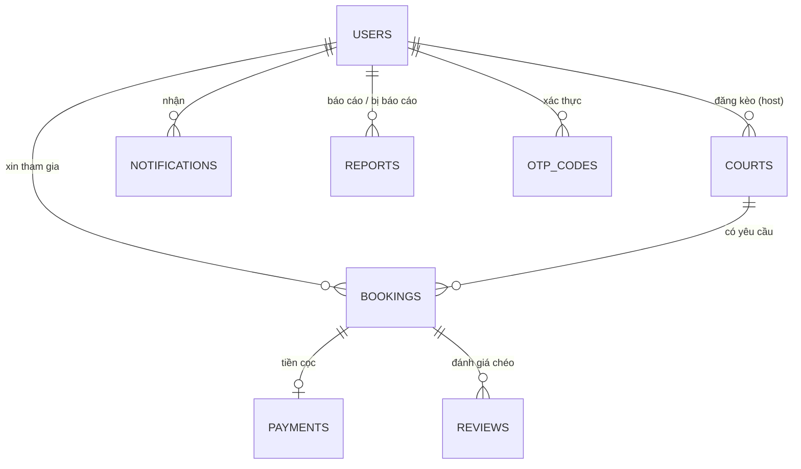

# Badminton Connect – Nền tảng ghép sân cầu lông

Hệ thống được nâng cấp theo báo cáo phân tích thiết kế **N18-18** (Trần Thị Thu Thảo – Trần Duy Nam):
3 tác nhân **Người chơi / Chủ nhóm (Host) / Quản trị viên**, đủ **FR-01 → FR-11**, **NFR-01 → NFR-04** và **UC-01, UC-02**.

## 1. Chạy ứng dụng

```bash
python -m venv .venv
.venv\Scripts\activate            # Windows      |  source .venv/bin/activate   (macOS / Linux)
pip install -r requirements.txt
uvicorn main:app --reload
```

Mở **http://127.0.0.1:8000** (giao diện) – **http://127.0.0.1:8000/docs** (tài liệu API, thử trực tiếp).

* Lần chạy đầu tiên tự tạo `badminton.db`, tài khoản quản trị và dữ liệu demo.
* **Có sẵn `badminton.db` cũ?** Chép nó vào thư mục dự án trước khi chạy. Hệ thống tự nhận ra cấu trúc cũ, **sao lưu** thành
  `badminton.db.legacy-<thời gian>.bak` rồi chuyển người dùng (giữ nguyên mật khẩu), sân và lượt ghép sang cấu trúc mới.
  Sân cũ chưa có ngày giờ nên được đặt tạm 19:00–21:00 ở những ngày sắp tới; chủ nhóm sửa lại sau.
* Muốn bỏ dữ liệu demo: đặt biến môi trường `SEED_DEMO=0`. Muốn làm lại từ đầu: `python seed.py --reset`.

### Tài khoản demo

| Vai trò | Tên đăng nhập | Mật khẩu |
|---|---|---|
| Quản trị viên | `admin` | `admin123` (đổi bằng biến `ADMIN_PASSWORD`) |
| Chủ nhóm (đã xác thực) | `host_hung`, `host_lan` | `123456` |
| Người chơi | `thao`, `nam`, `minh`, `linh`, `quang` | `123456` |

Gợi ý xem nhanh: đăng nhập `nam` → tab **Lịch chơi → Cần đánh giá**; đăng nhập `host_hung` → **Kèo của tôi** để duyệt yêu cầu của `thao`;
xem hồ sơ `quang` để thấy cảnh báo "thường xuyên bùng kèo".

## 2. Đối chiếu với báo cáo

| Mã | Nội dung báo cáo | Cài đặt |
|---|---|---|
| FR-01 | Đăng ký/đăng nhập bằng Email hoặc SĐT, xác thực OTP | `routers/auth.py`, `services.issue_otp`, `frontend/login.*` – OTP 6 số, hết hạn 5 phút, tối đa 5 lần nhập sai, chỉ lưu bản băm |
| FR-02 | Hồ sơ: họ tên, SĐT, khu vực thường chơi, tự đánh giá trình độ (Newbie → Giỏi) | `routers/users.py`, tab **Cá nhân** |
| FR-03 | Lịch sử kèo đã tạo / đã tham gia | tab **Kèo của tôi** (`/api/host/courts`) và **Lịch chơi** (`/api/my-bookings`) |
| FR-04 | Host đăng kèo: sân + địa chỉ (có bản đồ), ngày giờ, trình độ Min–Max, số người, chi phí/cọc, ghi chú | `routers/courts.py`, `frontend/host.js` (ghim vị trí bằng cách bấm bản đồ hoặc tìm địa chỉ) |
| FR-05 | Host xem danh sách xin tham gia, xem hồ sơ + uy tín, duyệt/từ chối | `GET /api/courts/{id}/requests`, `POST /api/bookings/{id}/approve｜reject` |
| FR-06 | Đóng kèo ("Đã đủ người"), sửa kèo khi còn ≥ 2 tiếng | `PUT /api/courts/{id}`, `/close`, `/reopen`, `/cancel` |
| FR-07 | Tìm kiếm + lọc: Quận/Huyện, ngày, khung giờ, trình độ (cộng giá, từ khóa không phân biệt dấu) | `GET /api/courts` |
| FR-08 | "Gửi yêu cầu tham gia" tạo Booking chờ duyệt, báo cho Host | `POST /api/bookings` |
| FR-09 | Theo dõi trạng thái (Chờ duyệt/Đã duyệt/Bị từ chối), nhắc nhở trước giờ chơi | `GET /api/my-bookings`, `services.run_scheduled_jobs` (chạy mỗi phút) |
| FR-10 | Đánh giá chéo sau trận (Host→Player: thái độ, bùng kèo, đúng trình độ; Player→Host: sân, nhiệt tình, minh bạch chi phí) | `routers/reviews.py` – chỉ mở khóa sau khi trận kết thúc, mỗi lượt đánh giá 1 lần |
| FR-11 | Điểm uy tín = trung bình các đánh giá; nhãn "Uy tín" hoặc cảnh báo "thường xuyên bùng kèo" | `services.recalc_reputation`, `rules.reputation_label` |
| NFR-01 | Tải/lọc < 1 giây; slot cập nhật thời gian thực | WebSocket `/ws` (`realtime.py`): slot và thông báo tự cập nhật, không cần tải lại trang |
| NFR-02 | Mobile-first, thông tin nổi bật, ≤ 3 chạm | giao diện responsive (thanh điều hướng dưới trên điện thoại); *chạm 1* "Xin ghép sân" → *chạm 2* "Gửi yêu cầu" (cọc mặc định chọn sẵn) |
| NFR-03 | Khóa dữ liệu chống overbooking | `services.reserve_slots`: `UPDATE … WHERE slot_trong >= n` nguyên tử trong DB + chỉ mục duy nhất chống gửi trùng; có test 12 luồng tranh 3 slot |
| NFR-04 | Không hiện SĐT cho tới khi được duyệt | serializer không bao giờ trả email/SĐT; chỉ lộ hai chiều khi Booking = Đã duyệt |
| UC-01 | Xin ghép sân; ngoại lệ "Đã kín chỗ" | `services.create_booking` – trừ slot → tạo Booking → cọc → báo Host, rollback toàn bộ nếu lỗi |
| UC-02 | Host tạo ca vãng lai; chặn ngày giờ quá khứ; Host phải được xác thực | `require_verified_host`, `_clean_court_payload` |
| Admin | Quản lý dữ liệu, xử lý báo cáo vi phạm, khóa tài khoản, hỗ trợ tranh chấp | `routers/admin.py`, tab **Quản trị** (xác thực chủ sân, khóa/mở khóa, xử lý báo cáo, hủy kèo vi phạm) |

**Chính sách có thể chỉnh** trong `rules.py`: sửa kèo trước giờ chơi ≥ 2h; hủy ≥ 2h trước giờ chơi được hoàn cọc (hủy sát giờ mất cọc);
nhắc nhở 120 phút trước giờ chơi; tối đa 4 chỗ/yêu cầu; ngưỡng nhãn uy tín (≥ 3 đánh giá và ≥ 4.0 điểm; cảnh báo khi bùng kèo ≥ 2 lần và ≥ 25%).

### Tính năng bổ sung (ngoài báo cáo)

| Nhóm | Tính năng | Cách dùng |
|---|---|---|
| Tìm kèo | **Dải chọn ngày** 8 ngày tới; chip **Khu vực của tôi** / **Hợp trình độ của tôi**; **Xem thêm** (phân trang 24 kèo/lần) | Tab *Tìm sân* |
| Chia sẻ | Nút **Chia sẻ** trong chi tiết kèo: mở hộp thoại chia sẻ của điện thoại hoặc sao chép liên kết `index.html#court=ID` (mở thẳng kèo đó) | Chi tiết kèo → Chia sẻ |
| Chủ nhóm | **Nhân bản kèo** (dời sang tuần sau, giữ cả vị trí ghim) · **thống kê nhanh** · **sao chép danh sách đã duyệt** để dán vào nhóm Zalo (chỉ tên + trình độ, không kèm SĐT) | *Kèo của tôi* |
| Người chơi | **Thêm vào lịch** (file `.ics`, có nhắc trước 2 giờ, dùng được trên Google Calendar / Lịch iPhone) · đếm ngược "Bắt đầu sau…" · cảnh báo **trùng giờ** khi xin ghép · bật **thông báo của trình duyệt** | *Lịch chơi*, *Thông báo* |
| Tài khoản | **Quên mật khẩu** (OTP) · **Đổi mật khẩu** · **chống dò mật khẩu** (sai 5 lần trong 10 phút thì tạm khóa) | Trang đăng nhập; *Cá nhân* |
| Giao diện | Logo quả cầu, favicon, `manifest.json` (thêm vào màn hình chính điện thoại), giữ phím Tab trong hộp thoại | |

## 3. Những phần đang GIẢ LẬP (cần thay khi triển khai thật)

* **Gửi OTP**: mã được in ra console và (khi `OTP_DEV_MODE=1`, mặc định) trả về trong phản hồi API để demo không cần SMS/Email.
  Khi triển khai: đặt `OTP_DEV_MODE=0` và gọi nhà cung cấp SMS/Email trong `services.issue_otp`.
* **Thanh toán cọc**: ghi nhận `Payment` (paid → refunded/forfeited) nhưng không gọi cổng thật (MoMo/VNPay/…).
  Điểm thay thế: bước "3) Thanh toán cọc" trong `services.create_booking` và `services.settle_payment` (hoàn/giữ cọc).
* **Thông báo & nhắc nhở (FR-09)**: hiện trong ứng dụng và được đẩy tức thời qua WebSocket khi đang mở; chưa gửi SMS/Email/push.
  Muốn được nhắc cả khi không mở ứng dụng, người chơi bấm **Thêm vào lịch** (file `.ics` có nhắc trước 2 giờ).
  Điểm mở rộng: `services.notify` (một nơi duy nhất tạo thông báo).
* Đặt `SECRET_KEY` bằng biến môi trường khi triển khai (mặc định chỉ dùng để phát triển).

## 4. Cấu trúc dự án

```
main.py            ứng dụng FastAPI, WebSocket, tác vụ định kỳ, phục vụ giao diện
ratelimit.py       giới hạn đăng nhập sai (chống dò mật khẩu), có unit test
database.py        kết nối SQLite (WAL, khóa ngoại), init_db + tự chuyển dữ liệu từ bản cũ
models.py          users, courts (kèo), bookings, payments, reviews, notifications, reports, otp_codes
rules.py           luật nghiệp vụ thuần Python (chính sách, nhãn uy tín, trạng thái kèo...) - có unit test
services.py        ghép sân + khóa luồng, cọc, thông báo, uy tín, serializer, tác vụ định kỳ
security.py        băm mật khẩu (bcrypt), JWT, phân quyền
routers/           auth, users, courts, bookings, reviews, notifications, reports, admin
legacy_migration.py  chuyển dữ liệu từ badminton.db phiên bản cũ
seed.py            admin + dữ liệu demo
frontend/          index.html, login.html, style.css, common.js, main.js, host.js, extras.js, login.js, favicon.svg, manifest.json
tests/             test_rules.py, test_legacy_migration.py, test_ratelimit.py, test_api.py
```



## 5. Kiểm thử

```bash
pytest -q                                        # toàn bộ (cần đã pip install -r requirements.txt)
python -m unittest tests.test_rules tests.test_legacy_migration tests.test_ratelimit -v   # chỉ phần logic thuần, không cần cài thư viện
```

`tests/test_api.py` phủ: OTP, phân quyền, tạo kèo + validate, lọc/tìm kiếm, luồng ghép sân – duyệt – từ chối – hủy, hoàn cọc, ẩn/lộ SĐT,
**chống overbooking đa luồng**, sửa/đóng/hủy kèo, đánh giá chéo + nhãn uy tín, nhắc nhở, khóa tài khoản, xử lý báo cáo,
chống dò mật khẩu, quên/đặt lại/đổi mật khẩu.

## 6. Thay đổi so với bản cũ

* Giao diện đặt trong `frontend/` và được FastAPI phục vụ tại `/`; chạy uvicorn ở cổng nào cũng được (giao diện tự gọi API cùng địa chỉ). Nếu mở bằng Live Server hoặc `file://` thì tự chuyển sang gọi `http://127.0.0.1:8000`.
* Bỏ lớp chọn "Người chơi / Chủ sân" lưu ở trình duyệt: vai trò nay gắn với tài khoản và được **máy chủ** kiểm tra.
  Người chơi muốn đăng kèo bấm "Đăng ký làm chủ sân" ở tab Cá nhân, chờ Quản trị viên xác thực.
* `/api/register` không còn nhận `role=admin` từ client. Thay `passlib` bằng `bcrypt` trực tiếp (băm cũ vẫn dùng được, tránh lỗi tương thích bcrypt ≥ 4.1).
* Mọi nội dung người dùng nhập đều được escape khi hiển thị (bản cũ chèn thẳng vào `innerHTML`).
* Danh sách Quận/Huyện nằm ở `rules.QUAN_HUYEN`, chỉnh tại đó nếu cần.

## 7. Gỡ lỗi nhanh

* **Chấm "Trực tiếp" không sáng / log báo `No supported WebSocket library`**: chạy `pip install "uvicorn[standard]"`. Khi WebSocket không dùng được, danh sách kèo vẫn tự làm mới mỗi 30 giây.
* **Bản đồ trắng**: cần Internet để tải Leaflet và ô bản đồ OpenStreetMap. Các chức năng khác vẫn hoạt động.
* **`bcrypt`/`passlib` báo lỗi khi đăng ký**: bản này dùng `bcrypt` trực tiếp, hãy chạy lại `pip install -r requirements.txt`.
* **Quên mật khẩu admin**: xóa dòng `admin` trong bảng `users` (hoặc chạy `python seed.py --reset`) rồi khởi động lại.

## 8. Giới hạn đã biết

* SQLite phù hợp demo/1 máy chủ. Kênh WebSocket nằm trong bộ nhớ một tiến trình; chạy nhiều worker cần thêm Redis pub/sub.
* Đổi số điện thoại/email ở hồ sơ chưa yêu cầu OTP lại.
* Đổi hoặc đặt lại mật khẩu chưa thu hồi các vé đăng nhập (JWT) đã cấp; chúng hết hạn sau 12 giờ (`ACCESS_TOKEN_EXPIRE_MINUTES`).
* Bộ đếm đăng nhập sai nằm trong bộ nhớ một tiến trình (khởi động lại là xóa).
* Bản đồ và tìm địa chỉ dùng OpenStreetMap/Nominatim (cần Internet, phù hợp lưu lượng nhỏ).
