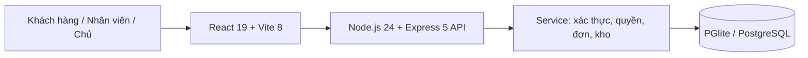

# Component Lab — Website tra cứu, mua bán và quản lý linh kiện điện tử (Nhóm 31)

> Component Lab hỗ trợ người học điện tử tra cứu thông số, so sánh linh kiện, lập danh sách vật tư (BOM), đặt hàng và hỗ trợ cửa hàng quản lý tồn kho, đơn hàng.

## 1. Giới thiệu sản phẩm

- **Bài toán:** Thông số kỹ thuật, giá và tồn kho linh kiện thường nằm ở nhiều nơi; người học khó đối chiếu và lập danh sách mua cho dự án. Cửa hàng cần quản lý hàng, chứng từ và quyền thao tác nhất quán.
- **Người dùng đích:** Khách hàng/học sinh–sinh viên kỹ thuật, nhân viên kho/bán hàng và chủ cửa hàng.
- **Các tính năng MVP:** (1) Tìm kiếm, lọc, xem chi tiết và so sánh linh kiện; (2) Quản lý BOM và giỏ hàng; (3) Đặt hàng COD, theo dõi/hủy đơn chờ; (4) Quản lý phiếu nhập/xuất, tồn theo vị trí và lịch sử; (5) Phân quyền, nhật ký và báo cáo bán hàng.
- **Website demo:** https://website-linh-kien.onrender.com/
- **Mã nguồn gốc:** https://github.com/tranlam592006-beep/website-linh-kien (bản nộp được đồng bộ trong `src/`)
- **Tài liệu nội bộ:** [Đối chiếu yêu cầu với mã nguồn](https://github.com/tranlam592006-beep/website-linh-kien/blob/main/docs/TRACEABILITY.md) và [biên bản kiểm thử đã thực hiện](https://github.com/tranlam592006-beep/website-linh-kien/blob/main/docs/TEST-RESULTS.md).

## 2. Phạm vi MVP

| Trạng thái | Nội dung |
|---|---|
| ✅ Đã triển khai trong mã nguồn | Danh mục/tìm kiếm/so sánh; BOM; giỏ hàng; đặt COD; quản lý sản phẩm, danh mục, nhà cung cấp, vị trí, phiếu kho; xác thực, quyền, nhật ký và báo cáo |
| 🚧 Cần nghiệm thu bổ sung | Kiểm thử trên nhiều trình duyệt/kích cỡ màn hình, hiệu năng dữ liệu lớn, PostgreSQL server độc lập, kế hoạch sao lưu tự động và khôi phục ở môi trường triển khai |
| ⬜ Hướng phát triển | Phân trang/tìm kiếm phía máy chủ khi dữ liệu lớn; hoàn thiện kiểm thử bảo mật và khả năng dùng |
| 🚫 Ngoài phạm vi hiện tại | Thanh toán trực tuyến, API vận chuyển, hóa đơn điện tử, quản lý công nợ, hoàn trả sau giao và chatbot/AI |

Các trạng thái mô tả **phạm vi mã nguồn hiện có và kế hoạch**, không mặc nhiên xác nhận hệ thống đã vượt qua nghiệm thu của giảng viên.

## 3. Kiến trúc & công nghệ

Ứng dụng được chia thành giao diện React, API Express, tầng nghiệp vụ và CSDL PostgreSQL/PGlite. Kiểm tra quyền, đặt hàng, ghi chứng từ và thay đổi tồn được xử lý ở phía máy chủ.



- **Công nghệ:** JavaScript/Node.js >=24, React 19.3.1, React DOM 19.3.1, Vite 8.3.5, Express 5.3.0, PGlite 0.5.12; có adapter `pg` cho PostgreSQL.
- **Tổ chức mã nguồn:** `frontend/src/` chứa giao diện; `server/app.js` định tuyến API; `server/service.js` thực hiện nghiệp vụ; `server/schema.sql` khai báo 14 bảng; `tests/` chứa kiểm thử; `scripts/` có tiện ích chạy và sao lưu.
- **Lưu trữ mặc định:** PGlite, dữ liệu thử trong `data/` bị loại khỏi Git. Mật khẩu và dữ liệu người dùng thật không được đưa lên repository.

## 4. Cài đặt & cách sử dụng

**Yêu cầu:** Node.js 24 trở lên, npm, trình duyệt web. Máy cần Internet để cài dependencies lần đầu.

```bash
git clone https://github.com/fossbk-spec/ktpmud-project.git
cd ktpmud-project/submissions/linh_kien_31/src
npm ci
npm run dev
```

Mở `http://localhost:5173/`. Để chạy bản build hoặc kiểm thử:

```bash
npm run build
npm test
npm start
```

Khi dùng `npm start` sau khi build, mở `http://localhost:3001/`. Không chạy hai tiến trình backend cùng dùng một thư mục `data/`.

**Dữ liệu/tài khoản mẫu:** Lần chạy đầu tạo một số linh kiện, danh mục và dữ liệu kho minh họa. Tài khoản chủ `owner@nhom31.local` có mật khẩu ngẫu nhiên trong `data/first-login.txt` trên máy đang chạy; không đưa tệp này lên Git. Khách đăng ký tài khoản qua giao diện; chủ tạo tài khoản nhân viên và cấp quyền.

**Kịch bản kiểm tra:**
1. Vào danh mục → tìm PIC16F877A → xem chi tiết/so sánh → lưu BOM cho dự án.
2. Đăng ký/đăng nhập khách → thêm sản phẩm vào giỏ → nhập địa chỉ nhận → đặt hàng COD → xem đơn Chờ xác nhận.
3. Đăng nhập chủ/nhân viên có quyền → xác nhận đơn → lập và xác nhận phiếu xuất → cập nhật Đang giao/Hoàn thành → đối chiếu báo cáo.
4. Lập phiếu nhập kho → xác nhận → kiểm tra tồn tại vị trí và lịch sử biến động.

**Kết quả kiểm thử trước đây:** Tài liệu `docs/TEST-RESULTS.md` ghi 31/31 ca backend đạt trong đợt 26–27/10/2026; cần chạy lại `npm test` trên commit dùng để nộp, không coi kết quả cũ là CI hiện tại.

## 5. Hướng phát triển Tuần 11–15

| Tuần | Mục tiêu | Đầu việc | Phụ trách | Tiêu chí | Trạng thái |
|---|---|---|---|---|
| 11 (từ 18/11) | Chuẩn hóa MVP | Rà soát chức năng, tài liệu, cấu trúc repository | Nhóm 31 | Có bản MVP và README rõ cách chạy | 🚧 |
| 12 | Kiểm thử tích hợp | Chạy lại test, kiểm tra đặt đơn và kho từ đầu đến cuối | Nhóm 31 | Test/CI xanh, có bằng chứng | ⬜ |
| 13 | Bảo mật và hiệu năng | Kiểm tra quyền, thử dữ liệu nhiều hơn, tối ưu truy vấn nếu cần | Nhóm 31 | Báo cáo đo lường và lỗi đã khắc phục | ⬜ |
| 14 | Review chéo & đóng băng mã | Sửa lỗi, rà soát tài liệu, chốt phiên bản | Nhóm 31 | Mã nguồn và báo cáo thống nhất | ⬜ |
| 15 | Nghiệm thu & bảo vệ | Demo sản phẩm, tổng hợp kiểm thử và chuẩn bị thuyết trình | Nhóm 31 | Có bản demo và minh chứng nghiệm thu | ⬜ |

Bảng trên là **kế hoạch**, chưa khẳng định các tuần tương lai đã hoàn thành.

## 6. Nhóm & tuân thủ

- **Nhóm:** 31. Thành viên theo báo cáo của nhóm: `202414205`, `202414265`, `202414410` (MSSV). Không ghi họ tên đầy đủ trong bài nộp công khai.
- **Quyền riêng tư:** Chỉ sử dụng dữ liệu minh họa/synthetic cho demo; không commit `.env`, `data/`, `backups/`, mật khẩu phát sinh, khóa API hay thông tin người dùng thật.
- **Công cụ hỗ trợ:** ChatGPT được sử dụng để hỗ trợ rà soát và soạn tài liệu hướng dẫn nộp; nhóm chịu trách nhiệm đối chiếu mã nguồn, kết quả kiểm thử và nội dung.
- **Dữ liệu lớn:** Không có bộ dữ liệu tải ngoài được khai báo cho bản demo hiện tại.
- **Lưu ý quy trình:** Nhóm xác nhận thầy đã cho phép đề tài tự chọn. Tuy nhiên, repository `fossbk-spec/ktpmud-project` hiện kiểm tra `case_study_slug` theo danh sách cố định; đề tài linh kiện điện tử chưa có slug hợp lệ trong danh sách. Cần có hướng dẫn/chấp thuận của giảng viên trước khi tạo Pull Request nộp bài chính thức.