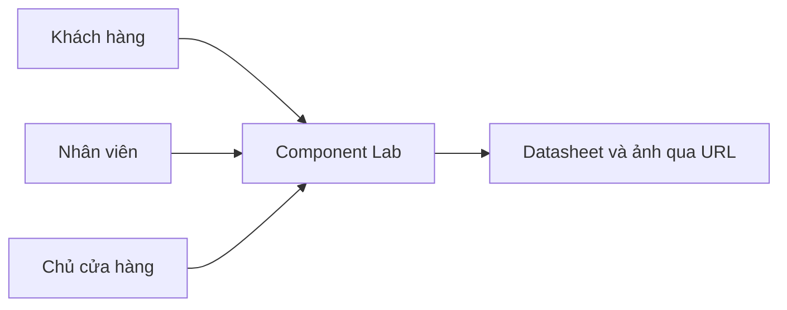
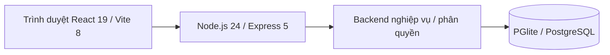

# Kiến trúc C4 — Component Lab
## Context

## Container

## Components
- `src/frontend/src/`: trang công khai, tài khoản, khách hàng, quản lý.
- `src/server/app.js`: HTTP API, phiên và CSRF.
- `src/server/service.js`: kiểm tra quyền, giao dịch đơn hàng và kho.
- `src/server/db.js`: lớp truy cập dữ liệu.
- `src/server/schema.sql`: cấu trúc và ràng buộc.
