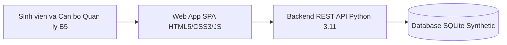

# Hệ thống Quản lý Ký túc xá B5 HUST — quan_ly_ky_tuc_xa_173820_n62

> Ứng dụng web số hóa quy trình quản lý phòng ở, sinh viên nội trú, báo hỏng cơ sở vật chất kèm ảnh, thanh toán VietQR và bảng tin cho Cán bộ Quản lý và Sinh viên nội trú tòa nhà KTX B5 HUST (dữ liệu 100% synthetic — Zero PII/PHI).

## 1. Giới thiệu sản phẩm
- **Bài toán / người dùng đích:** Công tác quản lý ký túc xá tòa B5 HUST hiện còn phụ thuộc vào sổ sách, tệp Excel rời rạc và tiếp nhận báo hỏng thiết bị qua tin nhắn Zalo nên dễ trôi thông tin, khó theo dõi tiến độ sửa chữa và tốn thời gian đối soát công nợ. Hệ thống phục vụ hai nhóm người dùng với phân quyền tách biệt: Cán bộ Quản lý tòa nhà B5 (`manager`) và Sinh viên nội trú tòa nhà B5 (`student`).
- **Tính năng chính của MVP:**
  1. **Xác thực & phân quyền RBAC:** Đăng nhập tách vai trò `manager` và `student`, băm mật khẩu an toàn và hỗ trợ khôi phục mật khẩu qua email miền `@sis.hust.edu.vn`.
  2. **Quản lý phòng, CSVC & nhập danh sách sinh viên hàng loạt:** Theo dõi trạng thái 18 phòng (`B5-101` đến `B5-306`), nạp danh sách sinh viên từ tệp `.xlsx`/`.csv` tự động phân phòng và rollback giao dịch nếu có dòng lỗi.
  3. **Báo hỏng CSVC kèm ảnh & theo dõi tiến độ:** Sinh viên gửi phiếu báo hỏng kèm ảnh hiện trạng; Cán bộ Quản lý tiếp nhận và cập nhật trạng thái xử lý (`Đang chờ` → `Đang xử lý` → `Hoàn thành`).
  4. **Thanh toán VietQR & thống kê vận hành:** Tự động sinh mã VietQR động đúng số tiền và cú pháp phòng (tài khoản demo giả lập), duyệt công nợ, xem Dashboard KPI và xuất báo cáo `.xlsx`/`.csv`.
- **Demo:** Sẽ cập nhật liên kết video demo vào Tuần 14–15 theo lộ trình · **Ảnh chụp:** Cập nhật trong thư mục `docs/` cùng gói mã nguồn MVP.

## 2. Phạm vi MVP
| Trạng thái | Nội dung |
|---|---|
| ✅ Đã làm | Khảo sát nghiệp vụ KTX B5, hoàn thiện đặc tả SRS (12 yêu cầu chức năng FR-01 đến FR-12, yêu cầu phi chức năng chuẩn ISO 25010, ma trận truy vết RTM), thiết kế sơ đồ Use Case, DFD, C4 và giao diện MVP bản đầu. |
| 🚧 Đang làm | Hoàn thiện mã nguồn ứng dụng web chạy cục bộ từ clean checkout, bộ kiểm thử tự động tích hợp và nhật ký Audit Trail để cập nhật ở PR tiếp theo. |
| ⬜ Chưa làm | Lập báo cáo kiểm thử `Test Report v1` (Tuần 13), báo cáo rà soát bảo mật và đánh giá AI (Tuần 14), review chéo một nhóm khác và quay video demo 3–5 phút (Tuần 15). |
| 🚫 Ngoài phạm vi | Kết nối API đối soát tự động với ngân hàng thật; mở rộng quản lý sang các tòa nhà KTX khác ngoài tòa B5; sử dụng dữ liệu sinh viên hoặc giao dịch thật. |

## 3. Kiến trúc & công nghệ

- Ngôn ngữ/framework: Python 3.11+ (REST API & SQLite), HTML5 / CSS3 / Vanilla JavaScript ES6+ (giao diện SPA màu đỏ nhận diện HUST `#B71C1C`), `openpyxl >= 3.1.0`, `pytest >= 8.0.0`.
- Cấu trúc thư mục: `submission.json`, `README.md`, `report/` (tài liệu đặc tả SRS, C4, báo cáo kiểm thử và bảo mật), `src/` (mã nguồn backend, giao diện web, dữ liệu mẫu synthetic và `src/tests/`), `slides/` (slide thuyết trình bảo vệ).

## 4. Cài đặt & cách sử dụng
**Yêu cầu:** Python 3.11+ (hoặc Python 3.10+), pip và trình duyệt web hiện đại.
```bash
git clone [https://github.com/fossbk-spec/ktpmud-project.git](https://github.com/fossbk-spec/ktpmud-project.git) && cd ktpmud-project/submissions/quan_ly_ky_tuc_xa_173820_n62/src
cp .env.example .env     # KHÔNG commit .env thật
pip install -r requirements.txt
python app.py            # ứng dụng chạy tại [http://localhost:5000/](http://localhost:5000/)
pytest -q
```
**Dữ liệu/tài khoản mẫu (synthetic):** Toàn bộ dữ liệu 18 phòng (`B5-101`–`B5-306`), danh sách sinh viên, phiếu sửa chữa và hóa đơn đều được sinh giả lập tự động khi khởi chạy. Tài khoản Quản lý mẫu: `manager_b5` / `ManagerB5@2026`; tài khoản Sinh viên mẫu phòng B5-101: `202490001` / `SvDemo@2026`.

**Kịch bản sử dụng:**
1. *Kịch bản 1 — Nhập danh sách sinh viên hàng loạt từ Excel/CSV:* Đăng nhập bằng tài khoản `manager_b5` → mở mục Quản lý Sinh viên và chọn tệp `data/synthetic_students_sample.csv` → bấm tải lên để hệ thống kiểm tra định dạng, phân bổ phòng trống và cập nhật sĩ số phòng tự động.
2. *Kịch bản 2 — Báo hỏng thiết bị CSVC kèm ảnh và cập nhật tiến độ:* Đăng nhập bằng tài khoản sinh viên `202490001` → gửi phiếu báo hỏng thiết bị kèm ảnh hiện trạng → đăng nhập lại bằng tài khoản `manager_b5` để tiếp nhận và chuyển trạng thái phiếu sang `Hoàn thành`.
3. *Kịch bản 3 — Thanh toán hóa đơn qua VietQR và duyệt thu phí:* Đăng nhập bằng tài khoản `202490001` → mở hóa đơn phòng `B5-101` và xem mã VietQR động được tạo sẵn số tiền cùng cú pháp chuyển khoản → bấm xác nhận đã chuyển khoản → đăng nhập `manager_b5` để duyệt chuyển trạng thái hóa đơn sang `Đã thanh toán`.

## 5. Hướng phát triển Tuần 11–15
| Tuần | Mục tiêu | Đầu việc chính | Phụ trách (MSSV) | Tiêu chí hoàn thành | Trạng thái |
|:---:|---|---|---|---|:---:|
| 11 | Chốt MVP và nền tảng chất lượng (Hạn 25/11) | Hoàn thiện `README.md` bản đầu đủ 6 mục, `submission.json`, chốt phạm vi MVP và vượt qua kiểm tra CI | `202414174`, `202414138` | PR #1 đạt `[PASSED]` với `validate_submission.py` | ✅ |
| 12 | Kiểm thử và tích hợp (Hạn 30/11) | Hoàn thiện mã nguồn MVP trong `src/`, viết unit/integration test đạt độ phủ ≥ 60% module cốt lõi, bổ sung Audit Trail và lập `Test Report v1` | `202414138`, `202414174` | Chạy được MVP và test bằng 1 lệnh trên máy sạch; có `Test Report v1` trong `report/` | 🚧 |
| 13 | Bảo mật, hiệu năng và đánh giá AI (Hạn 07/12) | Rà soát bảo mật phân quyền RBAC, kiểm tra dữ liệu đầu vào, không lộ secret; đo hiệu năng nạp 100 sinh viên Excel; viết báo cáo đánh giá AI | `202414138`, `202414174` | Hoàn thành báo cáo bảo mật và đánh giá AI trong `report/` | ⬜ |
| 14 | Review chéo và hoàn thiện (Hạn 14/12) | Peer review mã nguồn của một nhóm khác trên PR/Issue; chỉnh sửa theo góp ý; đóng băng code (code freeze); quay video demo 3–5 phút | `202414174`, `202414138` | Hoàn thành review chéo, code freeze và có video demo 3–5 phút | ⬜ |
| 15 | Nghiệm thu và bảo vệ (Hạn 20/12) | Nộp PR cuối gắn tag `v1.0`; hoàn thiện báo cáo kỹ thuật ẩn danh, slide bảo vệ và `README.md` bản cuối | `202414174`, `202414138` | Bản `v1.0` hoàn chỉnh (mã nguồn, báo cáo, slide, video và README cuối) | ⬜ |

## 6. Nhóm & tuân thủ
- Mã nhóm: `173820_n62` · Thành viên: `202414174 – PM, BA, Frontend, Báo cáo/Slide`, `202414138 – BA, Backend, Kiểm thử tự động, Báo cáo/Slide`
- ✅ Zero PII/PHI: toàn bộ dữ liệu là synthetic.
- Công cụ AI đã dùng & phạm vi: Nhóm sử dụng trợ lý AI (Gemini) để hỗ trợ rà soát đặc tả yêu cầu (ISO 25010, RTM), chuẩn hóa cấu trúc tài liệu kiến trúc và sinh bộ dữ liệu giả lập synthetic; toàn bộ nội dung đều được nhóm kiểm tra và xác nhận trực tiếp trước khi nộp.
- Dữ liệu lớn (>10MB): Không có (toàn bộ mã nguồn, tài liệu và dữ liệu mẫu synthetic đều dưới 10MB).