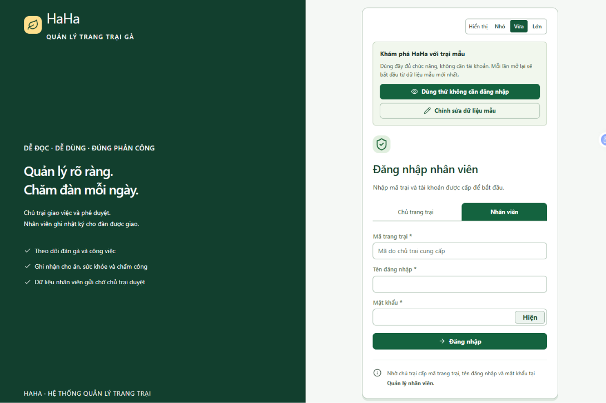
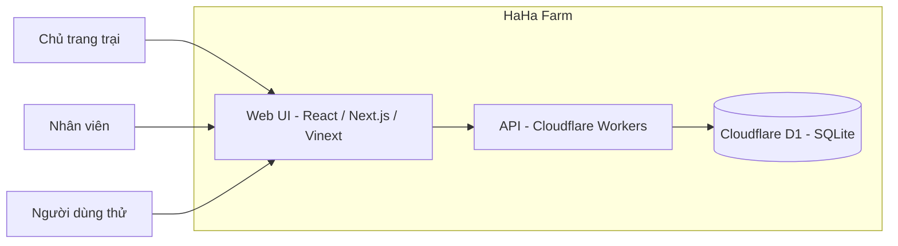
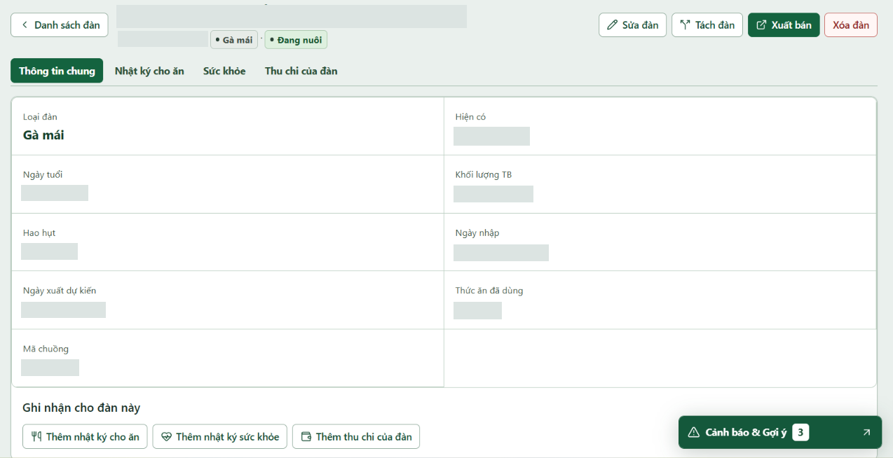
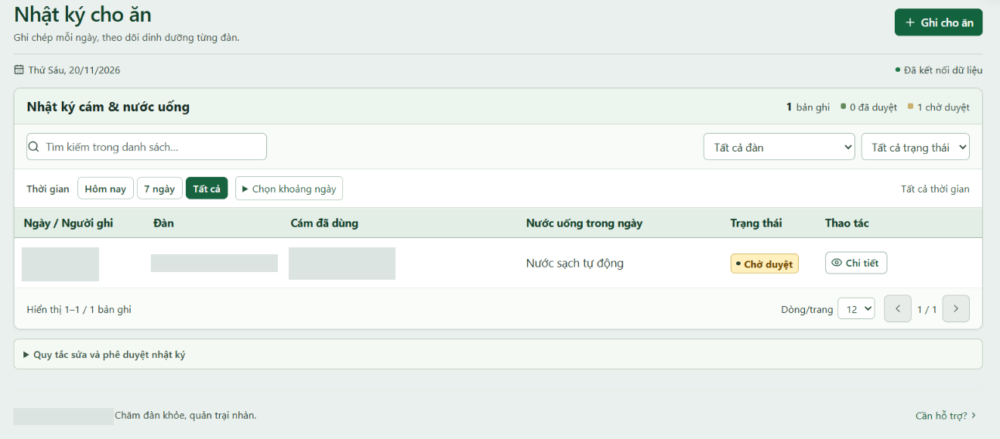
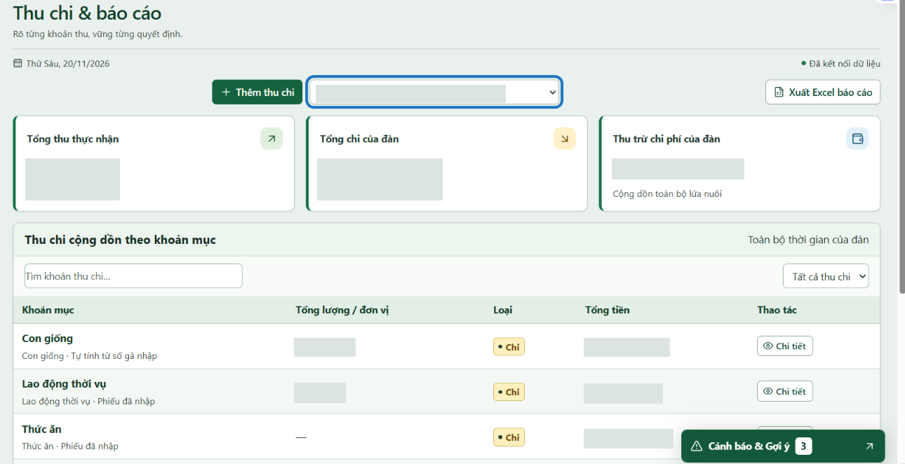

# HaHa Farm — quan_ly_trang_trai_173820_n29

> Website hỗ trợ chủ trang trại và nhân viên quản lý hoạt động chăn nuôi gà, thay thế việc ghi chép thủ công bằng dữ liệu tập trung.

## 1. Giới thiệu sản phẩm

- **Case study:** `quan_ly_trang_trai`.
- **Bài toán / người dùng đích:** Chủ trang trại và nhân viên cần theo dõi đàn, chuồng, vật tư, công việc và chi phí. HaHa Farm được xây dựng từ nhu cầu khảo sát tại trang trại gà ở khu vực Quảng Bình cũ, nhằm giảm ghi chép phân tán và công sức tổng hợp số liệu.
- **Tính năng chính của MVP:**
  1. Đăng ký, đăng nhập, phân quyền chủ trang trại/nhân viên và dùng thử không cần tài khoản.
  2. Quản lý đàn gà, chuồng nuôi, nhật ký cho ăn và sức khỏe.
  3. Quản lý kho vật tư và phê duyệt nghiệp vụ.
  4. Quản lý nhân viên, phân công công việc, chấm công và tiền lương.
  5. Quản lý thu chi và tổng hợp báo cáo.
- **Demo:** [HaHa Farm trực tuyến](https://ha-ha-farm.hahafarm29.workers.dev/).
- **Ảnh chụp:** Giao diện truy cập hệ thống (trích từ báo cáo triển khai). Các ảnh nghiệp vụ bên dưới đã che thông tin nhận dạng và số liệu chưa xác nhận là giả lập; không phải kết quả test mới.



## 2. Phạm vi MVP

| Trạng thái | Nội dung |
|---|---|
| ✅ Đã làm | Website trực tuyến; đăng ký, đăng nhập, dùng thử; quản lý đàn, chuồng, nhân viên, nhật ký cho ăn và sức khỏe, kho vật tư, chấm công, phê duyệt, thu chi và báo cáo. |
| 🚧 Đang làm | Chuẩn hóa README, hoàn thiện hồ sơ nộp PR và chuẩn bị minh chứng kiểm thử, bảo mật. |
| ⬜ Chưa làm | Tích hợp cảm biến IoT, ứng dụng di động riêng và cảnh báo khi người dùng không mở website. |
| 🚫 Ngoài phạm vi | Chẩn đoán bệnh thay cho chuyên gia thú y; tự động điều khiển thiết bị chăn nuôi trong MVP hiện tại. |

## 3. Kiến trúc & công nghệ

Sơ đồ C4 mức Container khái quát theo mô tả triển khai: giao diện và API trên Cloudflare Workers, dữ liệu nghiệp vụ trên Cloudflare D1.



Phiên bản ứng dụng trong gói mã nguồn: **2.3.2** (`src/package.json`).

| Thành phần | Công nghệ | Phiên bản |
|---|---|---|
| Runtime | Node.js | >= 22.13.0 |
| Ngôn ngữ | TypeScript, JavaScript, CSS | TypeScript 5.9.3 |
| Frontend | React, React DOM, Next.js | 19.2.6; Next.js 16.3.4 |
| Framework build | Vinext, Vite | 1.0.0-beta.5; 8.0.13 |
| Giao diện | Tailwind CSS | 4.2.1 |
| API / vận hành | Cloudflare Workers, Wrangler | Wrangler 4.92.0 |
| Cơ sở dữ liệu | Cloudflare D1 (SQLite), Drizzle ORM | Drizzle ORM 0.45.2; Drizzle Kit 0.31.10 |
| Quản lý gói | pnpm | 11.25.0 |

**Cấu trúc thư mục mã nguồn thực tế:**

```text
src/
  app/             Giao diện và API routes
  components/      Thành phần giao diện
  farm/            Nghiệp vụ, các trang quản lý, báo cáo và test
  server/          Xác thực và xử lý request
  worker/          Điểm vào Cloudflare Worker
  db/              Kết nối và schema cơ sở dữ liệu
  drizzle/         Migration SQL
  scripts/         Khởi động local, schema và chuẩn bị deploy
  public/          Tài nguyên tĩnh
  hooks/, lib/     Tiện ích dùng chung
  package.json, pnpm-lock.yaml
  CHAY_HAHA_LOCAL.bat
```

## 4. Cài đặt & cách sử dụng

**Yêu cầu sử dụng trực tuyến:** Trình duyệt web hiện đại và kết nối Internet.

1. Mở [HaHa Farm](https://ha-ha-farm.hahafarm29.workers.dev/).
2. Chọn dùng thử không cần đăng nhập để xem dữ liệu mẫu.
3. Mở các mục quản lý và thực hiện nghiệp vụ trên dữ liệu minh họa.

**Yêu cầu local:** Node.js từ 22.13.0 (khuyến nghị Node.js 22 LTS), npm/npx, Internet để tải thư viện lần đầu. Bản local không yêu cầu tài khoản Cloudflare, không dùng D1 trực tuyến.

Từ thư mục nhóm, chạy các lệnh sau (sau khi tải/clone branch bài nộp):

```bash
cd src
npx --yes pnpm@11.25.0 install --frozen-lockfile
node scripts/run-local.mjs
```

Mở http://127.0.0.1:8787 nếu trình duyệt không tự mở. Trên Windows có thể nhấp đúp `src/CHAY_HAHA_LOCAL.bat` để tự cài thư viện, build, khởi tạo D1 local và mở web. Dữ liệu nằm trong `src/.local-data/`, không commit thư mục này. Dừng bằng Ctrl+C. Xem thêm [hướng dẫn local](src/HUONG_DAN_CHAY_LOCAL.md).

**Lệnh kiểm thử** (chạy trong thư mục `src` sau khi cài thư viện):

```bash
npx --yes pnpm@11.25.0 test
npx --yes pnpm@11.25.0 typecheck
npx --yes pnpm@11.25.0 build
```

**Kết quả xác minh ngày 25/11/2026:** `node --test farm/workflows.test.mjs` đạt 19/19 trên Node.js 22.16.0. Test giao diện `farm/views.test.mjs` chưa chạy được trong môi trường rà soát vì thiếu TypeScript và các dependency chưa được cài; chưa xác nhận kết quả toàn bộ test, build, typecheck hoặc thời gian chạy trên máy sạch. Nhóm cần thực hiện lại trên máy đã cài đầy đủ dependency và lưu minh chứng trong Test Report v1.

**Dữ liệu/tài khoản mẫu (synthetic):** Chế độ dùng thử không cần tài khoản thật. Theo báo cáo, dữ liệu demo được khôi phục khi mở lại và không làm thay đổi dữ liệu nghiệp vụ của các trang trại. Chỉ sử dụng dữ liệu giả lập khi trình diễn.

**Kịch bản sử dụng:** Các ảnh dưới đây được trích từ báo cáo, đã che thông tin nhận dạng và số liệu chưa xác minh là dữ liệu giả lập. Đây là minh họa giao diện, không thay thế kết quả kiểm thử tự động; khi kiểm thử dùng dữ liệu demo hoặc tài khoản giả lập.

1. **Quản lý đàn gà:** Mở chế độ dùng thử → vào quản lý đàn → chọn một đàn → xem thông tin, số lượng và lịch sử chăm sóc. Kết quả mong đợi: hiển thị chi tiết đúng đàn đã chọn.

   

2. **Ghi nhật ký cho ăn:** Nhân viên được phân công chọn đàn → ghi nhận lượng thức ăn → gửi yêu cầu → chủ trang trại phê duyệt. Kết quả mong đợi: nhật ký chuyển trạng thái, vật tư được cập nhật sau phê duyệt. Để thử luồng phân quyền đầy đủ cần tạo tài khoản thử nghiệm với dữ liệu giả lập.

   

3. **Xem báo cáo thu chi:** Mở mục thu chi và báo cáo → chọn đàn cần theo dõi → xem số liệu tổng hợp. Kết quả mong đợi: hiển thị tổng thu, chi và chênh lệch theo đàn.

   

## 5. Hướng phát triển Tuần 11–15

Lộ trình dưới đây theo các mốc trong slide giảng viên ngày 25/11. Phân công là kế hoạch đề xuất của bản README, cần nhóm đối chiếu với công việc thực tế và lịch sử commit/Issue.

| Tuần | Mục tiêu | Đầu việc chính | Phụ trách (MSSV) | Tiêu chí hoàn thành | Trạng thái |
|:---:|---|---|---|---|:---:|
| 11 | Chốt MVP | Hoàn thiện các luồng chính, triển khai demo | 202414241, 202414434, 202414422 | Website trực tuyến, có thể trình diễn nghiệp vụ chính | ✅ |
| 12 | PR đầu | Hoàn thiện README, submission.json, kiểm tra CI và tạo PR | 202414241, 202414434, 202414422 | PR trước 23:59 ngày 25/11, CI PASSED | 🚧 |
| 13 | Kiểm thử | Unit/integration test, E2E, kiểm tra README trên máy sạch, lập Test Report v1 | 202414241, 202414422 | Test Report v1 trước 30/11; luồng chính không lỗi nghiêm trọng; hướng tới độ bao phủ 60% module cốt lõi | ⬜ |
| 14 | Bảo mật và AI | Kiểm tra phân quyền, đầu vào, secret, hiệu năng và đánh giá việc dùng AI | 202414241, 202414422 | Báo cáo bảo mật và AI trước 07/12, có minh chứng kiểm tra | ⬜ |
| 15 | Review và code freeze | Review chéo một nhóm, xử lý góp ý, quay demo | 202414241, 202414434, 202414422 | Review chéo, đóng băng mã nguồn và video 3–5 phút trước 14/12 | ⬜ |

**Tuần 16:** Nộp bản cuối gồm mã nguồn, báo cáo, slide, video, README và tag v1.0 trước 23:59 ngày 20/12/2026. Cập nhật trạng thái lộ trình hằng tuần.

## 6. Nhóm & tuân thủ

- **Mã nhóm:** `173820_n29`.
- **Thành viên:** `202414241`, `202414434`, `202414422`. Theo slide phân công của nhóm: 202414241 – BA, frontend, backend, báo cáo và sơ đồ; 202414434 – backend, frontend, test, báo cáo và sơ đồ; 202414422 – phân tích yêu cầu, frontend, slide và báo cáo.
- **Zero PII/PHI:** Chỉ sử dụng dữ liệu giả lập khi demo và kiểm thử. Gói nguồn không chứa database local, file .env hay dữ liệu người dùng xuất ra. Ảnh báo cáo đã che thông tin cá nhân và số liệu chưa xác minh; nhóm cần kiểm tra lại trước khi công khai để xác nhận tuân thủ đầy đủ.
- **Công cụ AI đã dùng & phạm vi:** ChatGPT, Gemini và Claude được báo cáo là công cụ hỗ trợ nghiên cứu, phát triển và hoàn thiện dự án. Cần ghi nhận chi tiết phần việc do AI hỗ trợ và cách thành viên kiểm chứng kết quả.
- **Dữ liệu lớn (>10MB):** Chưa có liên kết tài liệu/dữ liệu lớn đã được rà soát và xác nhận chia sẻ công khai. Không đưa file vượt giới hạn lên repository.
- Không commit khóa API, token, mật khẩu, file .env thật hoặc thông tin cá nhân.
