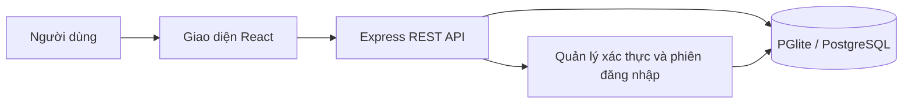

# PinkBook Manager — sach_173820_n33

Hệ thống quản lý cửa hàng bán sách, hỗ trợ chủ cửa hàng và nhân viên quản lý sách, nhập hàng, bán hàng, khách hàng, nhân sự và theo dõi hoạt động kinh doanh trên một nền tảng tập trung.

## 1. Giới thiệu sản phẩm

- **Bài toán / người dùng đích:** Các cửa hàng sách vừa và nhỏ thường quản lý hoạt động kinh doanh bằng sổ sách hoặc các bảng tính rời rạc, dẫn đến khó kiểm soát số lượng tồn kho, dễ sai sót khi thanh toán và mất nhiều thời gian tổng hợp doanh thu. PinkBook Manager hướng đến chủ cửa hàng, người quản lý và nhân viên bán hàng, giúp số hóa và đồng bộ các nghiệp vụ quản lý cửa hàng sách.

- **Tính năng chính của MVP:**
  1. **Quản lý sách:** Thêm, sửa, xóa, tra cứu thông tin sách; quản lý thể loại, giá bán và số lượng tồn kho.
  2. **Quản lý bán hàng và nhập hàng:** Hỗ trợ lập hóa đơn bán hàng, quản lý nhà cung cấp, nhập hàng và theo dõi hóa đơn đầu vào.
  3. **Quản lý khách hàng và nhân viên:** Lưu trữ, tra cứu thông tin khách hàng, quản lý thành viên, nhân viên và các thông tin liên quan.
  4. **Thống kê hoạt động kinh doanh:** Theo dõi doanh thu, tình hình bán hàng, tồn kho, khách hàng và nhân viên.
  5. **Quản lý tài khoản:** Hỗ trợ đăng nhập, đăng xuất và kiểm soát quyền truy cập hệ thống.

- **Demo:** Chưa có link video/GIF demo công khai.  
- **Ảnh chụp:** `docs/screenshot-01.png`

## 2. Phạm vi MVP

| Trạng thái | Nội dung |
|---|---|
| ✅ Đã làm | Xây dựng giao diện quản lý; các phân hệ quản lý sách, bán hàng, khách hàng, nhân viên và thống kê; xây dựng API phía máy chủ; kết nối và quản lý dữ liệu; chức năng đăng nhập, đăng xuất. |
| 🚧 Đang làm | Hoàn thiện kiểm thử tổng thể; rà soát tính nhất quán dữ liệu giữa bán hàng, nhập hàng và tồn kho; cải thiện trải nghiệm người dùng và xử lý lỗi. |
| ⬜ Chưa làm | Tích hợp máy quét mã vạch, máy in hóa đơn; thanh toán trực tuyến; triển khai đồng bộ dữ liệu nhiều chi nhánh. |
| 🚫 Ngoài phạm vi | Xây dựng sàn thương mại điện tử bán sách; quản lý vận chuyển và giao hàng; tích hợp hệ thống kế toán chuyên sâu trong phiên bản MVP. |

## 3. Kiến trúc & công nghệ



- **Ngôn ngữ/framework:**
  - JavaScript (ES Modules).
  - Frontend: React 19, Vite 8.
  - Backend: Node.js, Express 5.
  - Cơ sở dữ liệu: PGlite; hỗ trợ kết nối PostgreSQL thông qua cấu hình `DATABASE_URL`.
  - Kiểm thử: Node.js Test Runner.
- **Cấu trúc thư mục:**
  - `src/frontend`: Giao diện người dùng và các phân hệ quản lý.
  - `src/server`: API, xử lý nghiệp vụ, xác thực, cơ sở dữ liệu và quản lý phiên.
  - `src/scripts`: Các tập lệnh hỗ trợ chạy, sao lưu, khôi phục và quản lý dữ liệu.
  - `src/tests`: Các chương trình kiểm thử.
  - `src/package.json`: Khai báo thư viện và các lệnh chạy dự án.

## 4. Cài đặt & cách sử dụng

**Yêu cầu:**
- Node.js phiên bản 22.12.0 trở lên.
- npm đi kèm Node.js.
- Git.

**Các bước cài đặt:**

```bash
git clone https://github.com/daohailinh10-code/ktpmud-project.git
cd ktpmud-project/submissions/sach_173820_n33/src

npm ci
```

Tạo file `.env` từ cấu hình mẫu:

```bash
cp .env.example .env
```

Trên Windows PowerShell có thể dùng:

```powershell
Copy-Item .env.example .env
```

**Chạy ứng dụng:**

```bash
npm run dev
```

Mở địa chỉ được Vite hiển thị trong terminal, thông thường là:

```text
http://localhost:5173
```

Để chạy máy chủ theo chế độ production:

```bash
npm run build
npm start
```

**Chạy kiểm thử:**

```bash
npm test
```

Lệnh kiểm thử thực hiện kiểm tra runtime và build frontend.

**Lưu ý:** Không đưa file `.env` chứa thông tin bí mật hoặc dữ liệu cấu hình thực tế lên GitHub.

**Dữ liệu/tài khoản mẫu (synthetic):**

- Sử dụng dữ liệu sách, thể loại, khách hàng, nhân viên và hóa đơn mẫu phục vụ quá trình phát triển, trình diễn và kiểm thử.
- Dữ liệu mẫu được sử dụng nhằm minh họa các nghiệp vụ quản lý cửa hàng sách, không đại diện cho thông tin cá nhân hoặc giao dịch thực tế.
- Tài khoản quản trị được khởi tạo theo cấu hình seed của hệ thống. Mật khẩu cần được thiết lập theo cấu hình môi trường hoặc quy trình khởi tạo tài khoản; không công khai mật khẩu trong tài liệu.

**Kịch bản sử dụng:**

1. *Kịch bản 1 — Quản lý sách:* Người quản lý đăng nhập → mở phân hệ quản lý sách → tìm kiếm hoặc thêm/cập nhật thông tin sách → hệ thống lưu và hiển thị thông tin sách tương ứng.

2. *Kịch bản 2 — Bán hàng:* Nhân viên đăng nhập → mở phân hệ bán hàng → tìm kiếm và chọn sách → nhập số lượng → lập hóa đơn → hệ thống ghi nhận giao dịch và cập nhật dữ liệu tồn kho theo nghiệp vụ.

3. *Kịch bản 3 — Quản lý khách hàng:* Nhân viên mở phân hệ khách hàng → tìm kiếm khách hàng hoặc thêm khách hàng mới → cập nhật thông tin và quản lý thành viên → hệ thống lưu thông tin để phục vụ tra cứu và hoạt động bán hàng.

4. *Kịch bản 4 — Theo dõi hoạt động kinh doanh:* Người quản lý mở phân hệ thống kê → lựa chọn nội dung cần theo dõi → xem báo cáo doanh thu, bán hàng, tồn kho, khách hàng hoặc nhân viên.

## 5. Hướng phát triển Tuần 11–15

| Tuần | Mục tiêu | Đầu việc chính | Phụ trách (MSSV) | Tiêu chí hoàn thành | Trạng thái |
|:---:|---|---|---|---|:---:|
| 11 | Hoàn thiện các chức năng quản lý cốt lõi | Rà soát quản lý sách, khách hàng, nhân viên và bán hàng; xử lý lỗi giao diện và nghiệp vụ | 202414217, 202413991 | Các chức năng chính hoạt động ổn định, không còn lỗi nghiêm trọng đã biết | 🚧 |
| 12 | Hoàn thiện xử lý dữ liệu và nghiệp vụ | Kiểm tra luồng nhập hàng, bán hàng, hóa đơn và cập nhật tồn kho; rà soát tính nhất quán dữ liệu | 202414217, 202413991 | Dữ liệu giữa các phân hệ được cập nhật đúng theo nghiệp vụ | ⬜ |
| 13 | Kiểm thử và nâng cao độ tin cậy | Bổ sung kiểm thử chức năng, kiểm thử API, kiểm tra xác thực và xử lý các trường hợp lỗi | 202414217, 202413991 | Các trường hợp kiểm thử chính được thực hiện và có báo cáo kết quả | ⬜ |
| 14 | Hoàn thiện giao diện và tài liệu | Cải thiện trải nghiệm người dùng; bổ sung ảnh chụp màn hình, tài liệu cài đặt, kiến trúc và hướng dẫn sử dụng | 202414217, 202413991 | Giao diện nhất quán, tài liệu đầy đủ và có thể cài đặt theo hướng dẫn | ⬜ |
| 15 | Tổng kiểm tra và hoàn thiện sản phẩm | Kiểm tra toàn bộ hệ thống, sửa lỗi cuối cùng, chuẩn bị demo và hoàn thiện hồ sơ bàn giao | 202414217, 202413991 | Ứng dụng chạy được, các chức năng MVP được trình diễn và hồ sơ nộp bài đầy đủ | ⬜ |

## 6. Nhóm & tuân thủ

- **Mã nhóm:** `173820_n33`
- **Thành viên:**
  - `202414217` – Đào Thị Hải Linh: Phân tích yêu cầu, phát triển và tích hợp hệ thống, kiểm thử và hoàn thiện tài liệu.
  - `202413991` – Nguyễn Ngọc Bích: Phân tích nghiệp vụ, thiết kế, phát triển chức năng, kiểm thử và hoàn thiện tài liệu.
- **Giảng viên hướng dẫn:** Th.S. Hoàng Quang Huy.
- ✅ **Zero PII/PHI:** Dữ liệu minh họa sử dụng trong quá trình phát triển và kiểm thử là dữ liệu mẫu (synthetic), không sử dụng hồ sơ sức khỏe hoặc dữ liệu cá nhân thực tế của khách hàng.
- **Công cụ AI đã dùng & phạm vi:** ChatGPT và Gemini được sử dụng để hỗ trợ tham khảo, giải thích kiến thức, gợi ý cấu trúc tài liệu, rà soát nội dung và hỗ trợ xử lý lỗi trong quá trình phát triển. Nhóm chịu trách nhiệm kiểm tra, điều chỉnh và xác nhận sản phẩm cuối cùng.
- **Dữ liệu lớn (>10MB):** Không sử dụng bộ dữ liệu lớn bên ngoài trong phiên bản MVP.
