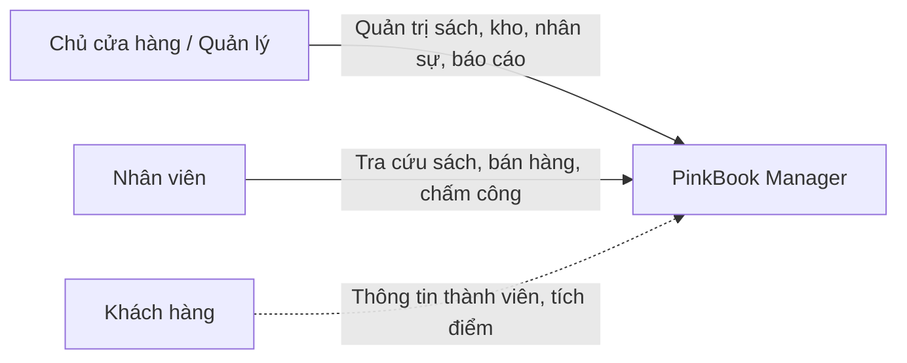
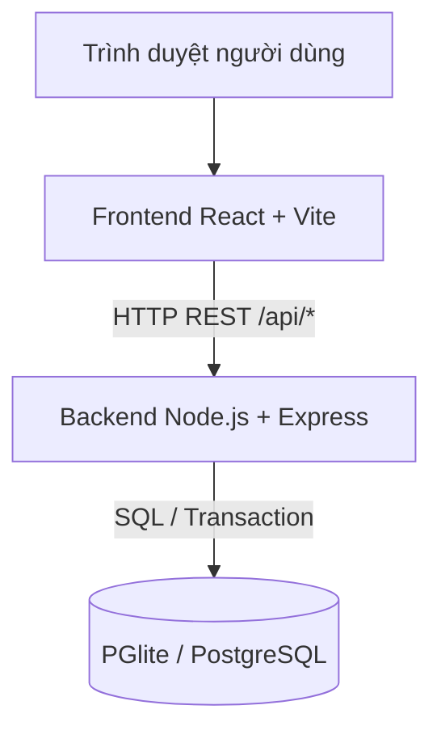
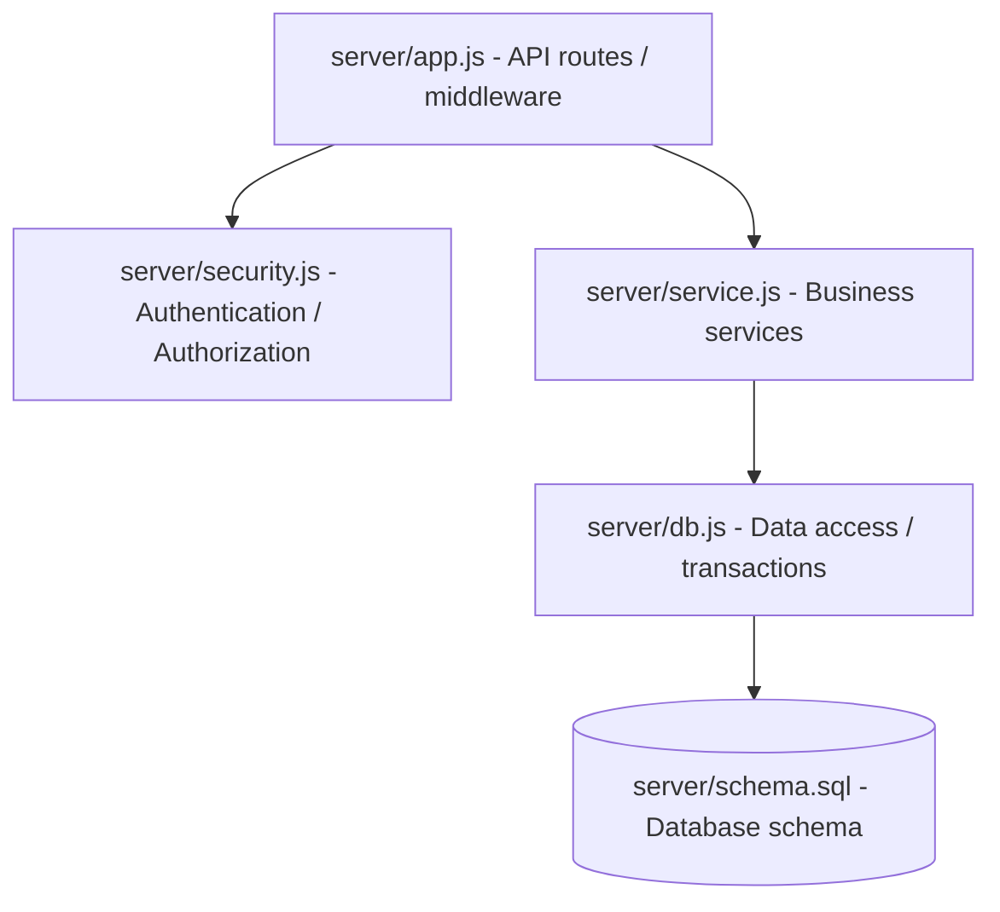

# C4 Model – PinkBook Manager

## Level 1 – System Context

PinkBook Manager là hệ thống trung tâm phục vụ hoạt động quản lý cửa hàng. Chủ cửa hàng và nhân viên là hai nhóm người dùng chính; thông tin khách hàng được lưu trong hệ thống để phục vụ giao dịch và chăm sóc thành viên.

## Level 2 – Container

- **Frontend:** hiển thị giao diện và thu thập thao tác người dùng.
- **Backend:** cung cấp REST API, xác thực, phân quyền và thực thi nghiệp vụ.
- **Database:** lưu tài khoản, sách, thể loại, kho, khách hàng, hóa đơn, lịch làm và nhật ký.

## Level 3 – Component (Backend)

## Ghi chú
Sơ đồ được mô tả theo cấu trúc mã nguồn hiện tại. Khi chốt phiên bản triển khai, nhóm cần đối chiếu lại các component và endpoint thực tế, đồng thời có thể xuất sơ đồ thành hình để đưa vào báo cáo PDF.
