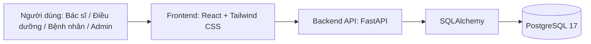

# CardioCare — suy_tim_173820_n07

CardioCare là hệ thống phần mềm hỗ trợ quản lý, theo dõi và phân tích dữ liệu lâm sàng dành cho bệnh nhân suy tim, hướng tới hỗ trợ nhân viên y tế quản lý hồ sơ và theo dõi tình trạng người bệnh.

## 1. Giới thiệu sản phẩm

- **Bài toán / người dùng đích:** Hỗ trợ quản lý thông tin bệnh nhân suy tim, lịch sử khám ngoại trú và các dữ liệu lâm sàng liên quan. Người dùng mục tiêu gồm bác sĩ, điều dưỡng, quản trị viên và bệnh nhân.
- **Tính năng chính của MVP (theo mô tả repository dự án):**
  1. Quản lý hồ sơ bệnh án và lịch sử khám chữa bệnh ngoại trú.
  2. Tiếp nhận, chuẩn hóa dữ liệu lâm sàng từ các hệ thống HIS/EMR, LIS và PACS theo mô hình dữ liệu được dự án mô tả.
  3. Theo dõi các chỉ số sinh hiệu và hỗ trợ cảnh báo khi chỉ số đạt ngưỡng nguy cơ.
  4. Phân quyền truy cập theo vai trò cho bác sĩ, điều dưỡng, quản trị viên và bệnh nhân.


## 2. Phạm vi MVP

Phạm vi dưới đây được tổng hợp từ mô tả hiện có của repository CardioCare. Nhóm cần rà soát lại trạng thái thực tế của từng chức năng trước các mốc nghiệm thu tiếp theo.

| Trạng thái | Nội dung |
|---|---|
| ✅ Đã mô tả trong repository | Quản lý hồ sơ bệnh án, lịch sử khám ngoại trú và phân quyền người dùng. Cần nhóm xác nhận lại mức độ hoàn thiện trên phiên bản chạy được. |
| 🚧 Cần kiểm thử/tích hợp | Luồng tiếp nhận và chuẩn hóa dữ liệu lâm sàng; theo dõi chỉ số và cảnh báo. |
| ⬜ Chưa xác nhận | Các chức năng nâng cao, báo cáo tổng hợp và những tích hợp chưa có bằng chứng kiểm thử trong tài liệu hiện tại. |
| 🚫 Ngoài phạm vi | Sử dụng dữ liệu định danh hoặc hồ sơ bệnh nhân thật trong môi trường phát triển, kiểm thử và trình diễn. |

## 3. Kiến trúc & công nghệ

### Kiến trúc tổng quan

Ứng dụng được tổ chức theo mô hình web client–server: giao diện React gửi yêu cầu tới backend FastAPI; backend xử lý nghiệp vụ và truy cập PostgreSQL thông qua SQLAlchemy. Các chức năng xác thực và phân quyền sử dụng các thư viện được liệt kê trong repository.



### Công nghệ

- **Backend:** Python, FastAPI, SQLAlchemy.
- **Cơ sở dữ liệu:** PostgreSQL 17; công cụ quản trị được mô tả là pgAdmin 4.
- **Xác thực và bảo mật:** PyJWT, bcrypt; mô hình phân quyền RBAC.
- **Frontend:** React, Tailwind CSS, Lucide Icons.
- **Phiên bản runtime:** Repository hiện cung cấp chưa nêu rõ phiên bản Python và Node.js đã được khóa; nhóm cần xác nhận phiên bản tương thích trong môi trường phát triển.


## 4. Cài đặt & cách sử dụng

### Yêu cầu môi trường

- Python và pip tương thích với các thư viện backend.
- Node.js và npm tương thích với ứng dụng React.
- PostgreSQL 17 và pgAdmin 4.
- Mã nguồn CardioCare được tải đầy đủ về máy.

### Cấu hình và khởi chạy

1. Tạo cơ sở dữ liệu PostgreSQL có tên `Cardiocare_db` bằng pgAdmin 4.
2. Kiểm tra cấu hình kết nối database trong backend. Không đưa mật khẩu hoặc thông tin kết nối thật vào Git.
3. Mở terminal tại thư mục backend và cài các thư viện được repository liệt kê:

```bash
pip install fastapi uvicorn sqlalchemy psycopg2-binary pydantic bcrypt python-jose python-multipart
uvicorn main:app --reload
```

4. Mở terminal tại thư mục frontend, cài dependency và chạy ứng dụng:

```bash
npm install
npm start
```

### Kịch bản sử dụng dự kiến

1. Phân hệ Bệnh nhân (Patient Portal)
* **Vai trò:** `PATIENT` (Bệnh nhân ngoại trú)
* **Tên đăng nhập:** minhquantran
* **Mật khẩu:** `Lamvlog06`
* **Chức năng kiểm tra:** Cổng thông tin cá nhân, tự nhập chỉ số sinh hiệu tại nhà (cân nặng, huyết áp), theo dõi lịch sử cảnh báo quá tải dịch và xem lịch hẹn tái khám.

2. Phân hệ Bác sĩ / Lâm sàng (Doctor Dashboard)
* **Vai trò:** `DOCTOR` (Bác sĩ điều trị khoa Tim mạch)
* **Tên đăng nhập:** `minhquantran06`
* **Mật khẩu:** `Lamvlog06`
* **Chức năng kiểm tra:** Quản lý hồ sơ bệnh án, theo dõi chỉ số LVEF, phân độ NYHA, kiểm tra luồng tích hợp ETL (HL7/FHIR), và phê duyệt/điều chỉnh phác đồ 4 trụ cột từ AI-CDSS (*Human-in-the-Loop* với cơ chế lưu vết Audit Log)[cite: 1].

3. Phân hệ Quản trị hệ thống (Admin Dashboard)
* **Vai trò:** `ADMIN` (Quản trị viên hệ thống IT)[cite: 4]
* **Tên đăng nhập:** `minhquantran2006`
* **Mật khẩu:** `Lamvlog06`
* **Chức năng kiểm tra:** Quản lý danh sách tài khoản người dùng, khóa/mở khóa tài khoản, xem ma trận phân quyền RBAC toàn hệ thống, và tra cứu nhật ký kiểm toán y tế (*Audit Logs*)[cite: 1, 4].
## 5. Hướng phát triển Tuần 11–15

| Tuần | Mục tiêu | Đầu việc chính | Phụ trách (MSSV) | Tiêu chí hoàn thành | Trạng thái |
|:---:|---|---|---|---|:---:|
| 11 (từ 18/11) | Chốt MVP và CI | Hoàn thiện README, manifest, cấu trúc nộp bài và kiểm tra CI | MSSV phụ trách tài liệu; nhóm xác nhận | README đủ 6 mục; submission hợp lệ; CI Passed | 🚧 |
| 12 | Kiểm thử và tích hợp | Rà soát luồng chính, kiểm thử API và tích hợp frontend/backend | MSSV phụ trách kiểm thử và tích hợp | Có kết quả kiểm thử, lỗi được ghi nhận và xử lý | ⬜ |
| 13 | Bảo mật, hiệu năng và AI | Rà soát phân quyền, bảo vệ dữ liệu, đánh giá các chức năng hỗ trợ AI nếu có | MSSV phụ trách backend/bảo mật | Có checklist và kết quả kiểm tra | ⬜ |
| 14 | Review chéo và code freeze | Review mã nguồn, sửa lỗi ưu tiên, ổn định phiên bản | Toàn nhóm theo phân công | Các lỗi nghiêm trọng được xử lý; phiên bản được đóng băng | ⬜ |
| 15 | Nghiệm thu và bảo vệ | Chuẩn bị demo, báo cáo, slide và kịch bản trình bày | Toàn nhóm theo phân công | Demo và tài liệu nghiệm thu sẵn sàng | ⬜ |


## 6. Nhóm & tuân thủ

- **Mã lớp:** 173820.
- **STT nhóm:** n07.
- **Thành viên:** danh sách theo định dạng `MSSV `. Danh sách MSSV chính thức được khai báo trong `submission.json`.
- **Zero PII/PHI:** Khi phát triển, kiểm thử và trình diễn, nhóm chỉ sử dụng dữ liệu tổng hợp/giả lập; không commit dữ liệu định danh cá nhân hoặc thông tin sức khỏe của bệnh nhân thật.
- **Công cụ AI đã dùng:** ChatGPT được sử dụng để hỗ trợ soạn thảo tài liệu và xây dựng phần mềm; nhóm chịu trách nhiệm rà soát, xác minh và chỉnh sửa nội dung trước khi nộp.
- **Dữ liệu lớn (>10MB):** Chưa khai báo tệp dữ liệu lớn trong PR đầu tiên. Nếu phát sinh, nhóm sẽ lưu trữ bên ngoài repository và bổ sung liên kết phù hợp.

## Cấu trúc thư mục bài nộp

- `README.md` — mô tả sản phẩm, phạm vi MVP, kiến trúc, hướng dẫn sử dụng và kế hoạch phát triển.
- `submission.json` — thông tin case study, mã nhóm, danh sách MSSV và ngày nộp.
- `report/` — sẽ bổ sung SRS, C4 Model, Test Report và báo cáo cuối kỳ ở các mốc tiếp theo.
- `src/` — sẽ bổ sung mã nguồn theo yêu cầu của các mốc nộp tiếp theo.
- `slides/` — sẽ bổ sung slide thuyết trình ở giai đoạn nghiệm thu.
