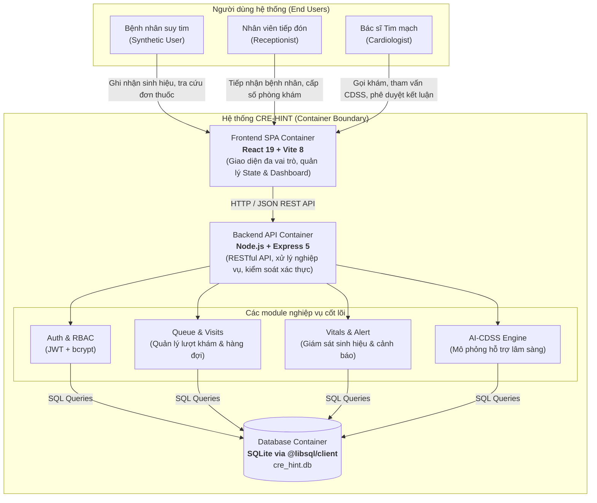

# CRE-HINT — suy_tim_173820_n12

> Hệ thống số hóa quản lý hồ sơ khám, điều phối hàng đợi thông minh và trợ lý lâm sàng (AI-CDSS) hỗ trợ theo dõi điều trị bệnh nhân suy tim ngoại trú.

---

## 1. Giới thiệu sản phẩm

- **Bài toán / người dùng đích:**
  - *Bài toán giải quyết:* Bệnh nhân suy tim mạn tính điều trị ngoại trú có nguy cơ cao rơi vào đợt mất bù cấp nếu không được giám sát chặt chẽ các chỉ số sinh hiệu (cân nặng, huyết áp, khó thở, phù). Đồng thời, quy trình khám tại phòng khám tim mạch thường quá tải và thiếu tính liên kết giữa khâu tiếp đón tại quầy, quản lý hàng đợi và trợ giúp ra quyết định kê đơn lâm sàng. Hệ thống **CRE-HINT** giải quyết bài toán quản lý trọn vẹn vòng đời lượt khám ngoại trú và giám sát chỉ số sinh hiệu từ xa.
  - *Người dùng đích:*
    1. **Bệnh nhân suy tim ngoại trú:** Tự ghi nhận chỉ số sinh hiệu hàng ngày tại nhà, theo dõi tiến triển sức khỏe, nhận cảnh báo bất thường sớm và xem kế hoạch điều trị/đơn thuốc đã được bác sĩ công bố.
    2. **Bác sĩ chuyên khoa Tim mạch:** Điều phối danh sách khám trong ngày, tra cứu lịch sử sinh hiệu bệnh nhân, tham vấn mô phỏng trợ lý AI-CDSS (gợi ý phân loại NYHA, xét nghiệm cận lâm sàng, cảnh báo tương tác thuốc), phê duyệt kết luận và đơn thuốc.
    3. **Nhân viên tiếp đón (Receptionist):** Tiếp nhận bệnh nhân tại quầy, tra cứu mã định danh bệnh nhân, tạo lượt khám mới và cấp số thứ tự vào hàng đợi phòng khám.

- **Tính năng chính của MVP:**
  1. **Xác thực & Phân quyền đa vai trò (RBAC):** Đăng nhập an toàn bằng JWT và mật khẩu mã hóa bcrypt cho 3 nhóm đối tượng riêng biệt (Bác sĩ, Bệnh nhân, Nhân viên tiếp đón).
  2. **Quản lý tiếp đón & Hàng đợi khám bệnh:** Tiếp nhận tại quầy, cấp mã bệnh nhân chuẩn hóa (`BNxxxx`), tự động cấp số thứ tự và cập nhật trạng thái hàng đợi thời gian thực (`registered` $\rightarrow$ `waiting` $\rightarrow$ `in_progress` $\rightarrow$ `waiting_result` $\rightarrow$ `completed`).
  3. **Ghi nhận sinh hiệu & Cảnh báo sớm:** Ghi nhận chuỗi chỉ số (cân nặng, huyết áp tâm thu/tâm trương, SpO2, nhịp tim) kèm triệu chứng phù/khó thở/đau ngực; tự động kích hoạt cảnh báo nguy cơ vượt ngưỡng lâm sàng.
  4. **Trợ lý hỗ trợ quyết định lâm sàng (AI-CDSS Simulator):** Phân tích dữ liệu cận lâm sàng/sinh hiệu để đưa ra gợi ý chẩn đoán phân độ NYHA, đề xuất danh mục xét nghiệm và cảnh báo tương tác thuốc dựa trên guideline điều trị.
  5. **Quản lý mẫu kết luận & Lịch sử bệnh án:** Cung cấp sẵn các mẫu bệnh án chuẩn (khám định kỳ, đợt mất bù cấp, tăng huyết áp kết hợp), lưu vết các phiên bản kết luận khám (Audit Versioning) và công bố đơn thuốc cho bệnh nhân.

- **Web Demo:** [https://cre-hint.onrender.com](https://cre-hint.onrender.com) · **Ảnh chụp:** `docs/screenshot-01.png`

---

## 2. Phạm vi MVP

| Trạng thái | Nội dung |
|---|---|
| ✅ **Đã làm** | Xác thực người dùng, bảo mật mật khẩu `bcrypt` và phiên làm việc `JWT` cho 3 vai trò (Bác sĩ, Bệnh nhân, Tiếp đón). |
| ✅ **Đã làm** | Module Tiếp đón: Tìm kiếm bệnh nhân theo mã `BNxxxx`, đăng ký lượt khám và cấp số thứ tự hàng đợi. |
| ✅ **Đã làm** | Module Bác sĩ: Quản lý hàng đợi phòng khám, gọi khám, cập nhật trạng thái lượt khám theo thời gian thực. |
| ✅ **Đã làm** | Module Theo dõi sinh hiệu: Bệnh nhân tự nhập số đo tại nhà, thuật toán kiểm tra ngưỡng cảnh báo nguy cơ suy tim mất bù. |
| ✅ **Đã làm** | Module AI-CDSS Simulator: Gợi ý chẩn đoán NYHA, khuyến nghị cận lâm sàng và cảnh báo an toàn dùng thuốc. |
| ✅ **Đã làm** | Module Kê đơn & Mẫu kết luận: Thư viện 4 mẫu kết luận chuẩn hóa, hỗ trợ kê đơn nhanh và lưu lịch sử phiên bản (`visit_versions`). |
| ✅ **Đã làm** | Bộ dữ liệu thử nghiệm chuẩn Synthetic Data đảm bảo nguyên tắc Zero PII/PHI. |
| 🚧 **Đang làm** | Bộ kiểm thử tự động (Unit Test / Integration Test) bao phủ $\ge 60\%$ module nghiệp vụ cốt lõi. |
| 🚧 **Đang làm** | Bổ sung nhật ký kiểm toán (Audit Trail Logging) chi tiết cho các hành động thay đổi bệnh án và kết quả khám. |
| ⬜ **Chưa làm** | Tích hợp cổng chuẩn hóa trao đổi dữ liệu y tế quốc tế HL7/FHIR với hệ thống HIS/LIS bệnh viện. |
| ⬜ **Chưa làm** | Tối ưu hóa hiệu năng chịu tải cao (Stress/Load testing) và cơ chế bộ đệm dữ liệu Redis. |
| ⬜ **Chưa làm** | Tích hợp mô hình Deep Learning phân tích tự động hình ảnh X-quang phổi và điện tâm đồ (ECG). |
| 🚫 **Ngoài phạm vi** | Tự động ra y lệnh và kê đơn thay thế bác sĩ (hệ thống tuân thủ nguyên tắc Human-in-the-loop, AI chỉ giữ vai trò hỗ trợ tham vấn). |
| 🚫 **Ngoài phạm vi** | Kết nối trực tiếp với thiết bị phần cứng đo sinh hiệu liên tục qua giao thức Bluetooth/BLE hoặc IoT y tế tại giường bệnh cấp cứu. |

---

## 3. Kiến trúc & công nghệ

### 3.1. Sơ đồ kiến trúc Container (C4 Model)



### 3.2. Công nghệ sử dụng & Phiên bản

- **Frontend:**
  - `react`: `^19.2.8` (Thư viện xây dựng giao diện người dùng SPA)
  - `react-dom`: `^19.2.8`
  - `vite`: `^8.3.0` (Công cụ đóng gói và máy chủ phát triển frontend tốc độ cao)
  - `oxlint`: `^1.81.0` (Linter siêu nhanh kiểm tra chất lượng mã nguồn)
- **Backend:**
  - `node`: `>= 20.x` (Môi trường thực thi JavaScript phía máy chủ)
  - `express`: `^5.2.1` (Framework xây dựng REST API)
  - `@libsql/client`: `^0.14.0` (Driver giao tiếp cơ sở dữ liệu SQLite/Turso nhúng)
  - `bcryptjs`: `^3.0.3` (Thuật toán băm một chiều bảo mật mật khẩu người dùng)
  - `jsonwebtoken`: `^9.0.3` (Xác thực và cấp quyền qua JWT Token)
  - `cors`: `^2.8.6` (Cấu hình Cross-Origin Resource Sharing)
- **Cơ sở dữ liệu:**
  - `SQLite 3` qua LibSQL Client (chế độ tệp nhúng cục bộ `cre_hint.db`, hỗ trợ chuyển đổi sang đám mây Turso Database).

### 3.3. Cấu trúc thư mục mã nguồn

```text
submissions/suy_tim_173820_n12/
├── README.md                           # Tài liệu chính của dự án (cửa trước MVP)
├── submission.json                     # Định danh case study, mã nhóm, MSSV
├── docs/                               # Ảnh chụp giao diện minh họa kịch bản
│   └── screenshot-01.png               # Ảnh chụp màn hình giao diện chính
├── report/                             # Báo cáo kỹ thuật, SRS, C4 model
│   └── BaoCao_KTPMUD_CRE_HINT.docx     # Báo cáo tổng thể đồ án
├── slides/                             # Thư mục slide bảo vệ (bổ sung ở Tuần 15)
└── src/                                # Toàn bộ mã nguồn dự án
    ├── package.json                    # Cấu hình scripts khởi chạy toàn dự án
    ├── .env.example                    # Mẫu cấu hình biến môi trường an toàn
    ├── backend/                        # Mã nguồn máy chủ Node.js & Express
    │   ├── server.js                   # Điểm khởi động ứng dụng, định tuyến REST API
    │   ├── database.js                 # Schema CSDL, migration và seeding mẫu
    │   ├── test.js                     # Bộ test kiểm tra tự động backend
    │   └── package.json                # Dependencies backend
    └── frontend/                       # Mã nguồn giao diện React SPA
        ├── index.html                  # Khung HTML gốc
        ├── vite.config.js              # Cấu hình máy chủ Vite & Reverse Proxy
        ├── package.json                # Dependencies frontend
        └── src/                        # Các trang & thành phần giao diện
            ├── App.jsx                 # Điều hướng chính và quản lý phiên
            ├── pages/                  # Các màn hình nghiệp vụ (Doctor, Patient, Reception, CDSS)
            └── components/             # Các thành phần UI dùng chung
```

---

## 4. Cài đặt & cách sử dụng

### 4.1. Yêu cầu môi trường

- **Node.js**: Phiên bản `20.x` hoặc mới hơn (khuyến nghị Node 20 LTS hoặc Node 22).
- **npm**: Phiên bản `9.x` hoặc `10.x`.
- **Git**: Đã cài đặt trên hệ thống.

### 4.2. Các bước cài đặt và khởi chạy

Chạy lần lượt các lệnh sau từ terminal (hỗ trợ cả Windows PowerShell, macOS và Linux):

```bash
# 1. Clone fork repository và điều hướng vào thư mục mã nguồn bài nộp
git clone https://github.com/nguyentungf/ktpmud-project.git
cd ktpmud-project/submissions/suy_tim_173820_n12/src

# 2. (Tùy chọn) Thiết lập biến môi trường từ tệp mẫu (tuyệt đối KHÔNG commit tệp .env)
cp .env.example .env

# 3. Cài đặt dependencies cho root, Backend và Frontend
npm run install:all

# 4. Chạy kiểm thử tự động cục bộ
npm test

# 5. Khởi chạy ứng dụng
# Cách A - Chạy chế độ phát triển đầy đủ (chạy song song backend và frontend):
npm run dev

# Cách B - Hoặc build frontend rồi chạy backend phục vụ trọn gói tại port 3000:
npm run build && npm start
```

Sau khi chạy lệnh, truy cập ứng dụng trên trình duyệt tại:
- **Giao diện người dùng (Frontend):** `http://localhost:5173` (hoặc `http://localhost:3000`)
- **Điểm cuối API (Backend):** `http://localhost:3000/api`

### 4.3. Lệnh chạy kiểm thử (Test)

```bash
# Chạy kiểm thử tự động backend (Database schema, thuật toán băm mật khẩu, dữ liệu mẫu)
npm test

# Kiểm tra cú pháp và quy chuẩn mã nguồn frontend
cd frontend && npm run lint
```

### 4.4. Dữ liệu & Tài khoản mẫu (Synthetic Accounts)

Toàn bộ tài khoản thử nghiệm dùng dữ liệu mô phỏng, mật khẩu chung là `123456`:

| Vai trò | Định danh đăng nhập (Identifier) | Mật khẩu | Mục đích kiểm thử |
| :--- | :--- | :--- | :--- |
| **Bác sĩ Tim mạch** | `doctor@demo.vn` | `123456` | Khám bệnh, điều phối hàng đợi, thử nghiệm gợi ý AI-CDSS, kê đơn. |
| **Nhân viên tiếp đón** | `reception@demo.vn` | `123456` | Tiếp nhận bệnh nhân tại quầy, cấp số hàng đợi phòng khám. |
| **Bệnh nhân mẫu 1** | `BN0001` | `123456` | Nhập chỉ số sinh hiệu (cảnh báo nguy cơ cao), xem kết quả khám. |
| **Bệnh nhân mẫu 2** | `BN0002` | `123456` | Theo dõi tiến trình điều trị ổn định. |

*(Trên giao diện đăng nhập có sẵn 3 nút "Tài khoản demo nhanh" để đăng nhập bằng 1 cú nhấp chuột).*

### 4.5. Kịch bản sử dụng mẫu (≥ 3 kịch bản)

#### Kịch bản 1: Tiếp nhận bệnh nhân tại quầy & Cấp số thứ tự khám
- **Bước 1:** Truy cập `http://localhost:5173`, bấm nút demo **Nhân viên YT** (hoặc nhập `reception@demo.vn` / `123456`) $\rightarrow$ Bấm **Đăng nhập hệ thống**.
- **Bước 2:** Tại màn hình *Tiếp đón bệnh nhân*, nhập mã bệnh nhân `BN0001` (hoặc tạo hồ sơ mới cho bệnh nhân vãng lai).
- **Bước 3:** Chọn chuyên khoa `Khám Tim mạch`, phòng khám `P.201`, nhập lý do đến khám (ví dụ: *"Tái khám định kỳ suy tim, gần đây thấy nặng chân"*).
- **Bước 4:** Bấm **Cấp số & Chuyển vào hàng đợi**.
- **Kết quả mong đợi:** Hệ thống cấp số thứ tự tự động (ví dụ: `Số khám #01`), tạo một lượt khám mới ở trạng thái `waiting` và hiển thị xác nhận tiếp nhận thành công.

#### Kịch bản 2: Bác sĩ điều phối khám, tham vấn AI-CDSS & Kê đơn hoàn thành
- **Bước 1:** Đăng nhập bằng tài khoản **Bác sĩ** (`doctor@demo.vn` / `123456`).
- **Bước 2:** Trên bảng điều khiển, vào mục **Hàng đợi phòng khám**. Nhìn thấy bệnh nhân `BN0001` đang ở trạng thái `Chờ khám`.
- **Bước 3:** Nhấn nút **Gọi vào khám** $\rightarrow$ Trạng thái chuyển thành `Đang khám` (`in_progress`).
- **Bước 4:** Nhấp chọn tab **Hỗ trợ lâm sàng (AI-CDSS)**:
  - Xem tóm tắt dữ liệu lâm sàng: Cân nặng tăng, Huyết áp $165/95\text{ mmHg}$, SpO2 $92\%$.
  - Tham vấn khối gợi ý: Hệ thống đề xuất *"Theo dõi đợt mất bù cấp suy tim (NYHA III)"*, khuyến nghị xét nghiệm BNP và cảnh báo tương tác thuốc nếu phối hợp liều cao.
- **Bước 5:** Bác sĩ chọn áp dụng mẫu kết luận *"Suy tim mất bù cấp"*, điều chỉnh đơn thuốc và bấm **Lưu kết luận & Hoàn thành lượt khám**.
- **Kết quả mong đợi:** Lượt khám chuyển trạng thái sang `completed`. Bệnh án được lưu phiên bản (`version_no: 1`) và đồng bộ sẵn sàng cho bệnh nhân tra cứu.

#### Kịch bản 3: Bệnh nhân tự theo dõi chỉ số sinh hiệu tại nhà & Kích hoạt cảnh báo sớm
- **Bước 1:** Đăng nhập bằng tài khoản **Bệnh nhân** (`BN0001` / `123456`).
- **Bước 2:** Tại màn hình tổng quan bệnh nhân, chọn mục **Nhập chỉ số sinh hiệu hôm nay**.
- **Bước 3:** Nhập các thông số thực nghiệm:
  - Cân nặng: `69.5` kg (tăng $\ge 1.5\text{ kg}$ trong 2 ngày).
  - Huyết áp: `165 / 100` mmHg.
  - Nhịp tim: `105` lần/phút.
  - SpO2: `92` %.
  - Đánh dấu triệu chứng: Tích chọn ô *"Khó thở khi nằm"* và *"Phù mắt cá chân"*.
- **Bước 4:** Nhấn nút **Lưu chỉ số sức khỏe**.
- **Kết quả mong đợi:** Hệ thống ghi nhận dữ liệu vào cơ sở dữ liệu, ngay lập tức hiển thị bảng cảnh báo màu đỏ: *"CẢNH BÁO NGUY CƠ: Các chỉ số sinh hiệu vượt ngưỡng an toàn!"*, đồng thời hướng dẫn bệnh nhân liên hệ cơ sở y tế hoặc đặt lịch khám ưu tiên.

---

## 5. Hướng phát triển Tuần 11–15

| Tuần | Mốc thời gian | Mục tiêu trọng tâm | Đầu việc chính | Phụ trách (MSSV) | Tiêu chí hoàn thành | Trạng thái |
|:---:|:---:|---|---|:---:|---|:---:|
| **11** | 18/11 – 23/11 | Chốt MVP & Nền tảng chất lượng | • Đóng băng phạm vi tính năng MVP cốt lõi.<br/>• Chuẩn hóa cấu trúc thư mục repo theo chuẩn submission.<br/>• Hoàn thiện README.md mục 1–4 và tài khoản synthetic.<br/>• Bổ sung script test cơ bản và `submission.json`.<br/>• Kiểm tra cục bộ đạt `[PASSED]`. | `202414396`<br/>`202414224`<br/>`202414443` | • PR #1 mở thành công vào nhánh main `ktpmud-project`.<br/>• CI pipeline chạy xanh ✅.<br/>• Người lạ cài đặt & chạy MVP trong $\le 15$ phút. | ✅ Hoàn thành |
| **12** | 24/11 – 30/11 | Kiểm thử & Tích hợp hệ thống | • Viết bộ kiểm thử Unit Test cho các API cốt lõi (Auth, Queue, Vitals).<br/>• Viết Integration Test kiểm tra luồng từ Tiếp đón $\rightarrow$ Bác sĩ khám $\rightarrow$ Hoàn tất.<br/>• Thiết lập Audit Trail Logging ghi nhận thời gian thực mọi thay đổi kết quả khám.<br/>• Chạy thử nghiệm toàn bộ README trên máy ảo sạch. | `202414224` | • Test Coverage đạt $\ge 60\%$ code nghiệp vụ.<br/>• Xuất bản tệp Test Report v1 trong thư mục `report/`.<br/>• Không còn lỗi crash luồng chính. | ⬜ Chưa bắt đầu |
| **13** | 01/12 – 07/12 | An toàn bảo mật, Hiệu năng & Đánh giá AI | • Rà soát kiểm soát quyền (RBAC bypass check), chống SQL Injection và XSS.<br/>• Kiểm tra an toàn secret, đảm bảo không rò rỉ token hay API key.<br/>• Đo đạc độ trễ truy vấn SQLite, tối ưu index cho bảng `visits` và `vitals`.<br/>• Đánh giá mô hình/quy tắc AI-CDSS, lập bảng phân tích giới hạn lâm sàng và rủi ro. | `202414443` | • Báo cáo An toàn bảo mật & Đánh giá AI-CDSS trong `report/`.<br/>• 0 lỗi bảo mật mức High/Critical.<br/>• Thời gian phản hồi API trung bình $< 150\text{ ms}$. | ⬜ Chưa bắt đầu |
| **14** | 08/12 – 14/12 | Review chéo (Peer Review) & Hoàn thiện | • Thực hiện đánh giá chéo mã nguồn (peer review) cho 1 nhóm bạn trên GitHub PR.<br/>• Tiếp nhận phản hồi từ nhóm bạn và giảng viên, sửa đổi mã nguồn.<br/>• Đóng băng toàn bộ mã nguồn (Code Freeze).<br/>• Quay video demo sản phẩm hoàn chỉnh (3–5 phút) tải lên Drive/YouTube. | `202414396` | • Biên bản review chéo trên GitHub PR/Issue.<br/>• Video demo hoàn chỉnh có thuyết minh.<br/>• README và tài liệu được hoàn thiện lần cuối. | ⬜ Chưa bắt đầu |
| **15** | 15/12 – 21/12 | Nghiệm thu sản phẩm & Bảo vệ đồ án | • Gắn tag phiên bản chính thức `v1.0`.<br/>• Hoàn thiện báo cáo kỹ thuật tổng kết (SRS, C4, Architecture).<br/>• Chuẩn bị slide trình chiếu và kịch bản demo trực tiếp trước hội đồng. | Cả nhóm | • PR bản cuối hợp nhất đầy đủ code, report, slide.<br/>• Bảo vệ thành công trước giảng viên môn học. | ⬜ Chưa bắt đầu |

---

## 6. Nhóm & tuân thủ

- **Mã nhóm:** `173820_n12`
- **Danh sách thành viên (Chỉ sử dụng MSSV theo quy định bảo mật):**
  - `202414396` — Trưởng nhóm / Product Owner, Phụ trách Phân tích yêu cầu (BA), Kiểm thử chất lượng (QA) & Báo cáo.
  - `202414224` — Thành viên / Backend Developer, Phụ trách Thiết kế kiến trúc hệ thống (System Design) & Cơ sở dữ liệu.
  - `202414443` — Thành viên / Frontend Developer, Phụ trách Giao diện người dùng (UI/UX), Slide & Tích hợp mô phỏng AI-CDSS.

- **Cam kết Zero PII/PHI (Dữ liệu y tế riêng tư):**
  - ✅ **Xác nhận 100%:** Toàn bộ dữ liệu bệnh nhân, chỉ số sinh hiệu, hồ sơ lượt khám và đơn thuốc trong dự án đều là **dữ liệu tổng hợp mô phỏng (Synthetic Data)** được sinh ngẫu nhiên phục vụ mục đích học thuật.
  - Dự án tuyệt đối không chứa, không thu thập và không liên kết với bất kỳ thông tin nhận dạng cá nhân (PII) hoặc thông tin sức khỏe được bảo vệ (PHI) thực tế nào của người bệnh.

- **Công cụ AI hỗ trợ & Phạm vi sử dụng:**
  - *Google Gemini / Antigravity AI:* Hỗ trợ rà soát cấu trúc mã nguồn, chuẩn hóa đặc tả tài liệu markdown theo tiêu chuẩn môn học, và thiết kế sơ đồ C4 Container Mermaid.
  - *GitHub Copilot:* Hỗ trợ gợi ý cú pháp boilerplate code cho các hàm tiện ích và routing Express.
  - Toàn bộ logic nghiệp vụ điều phối hàng đợi và quy tắc lâm sàng AI-CDSS do nhóm tự nghiên cứu, phát triển và chịu trách nhiệm.

- **Liên kết dữ liệu lớn (> 10MB):**
  - *Không áp dụng:* Toàn bộ cơ sở dữ liệu mẫu SQLite (`backend/cre_hint.db`) cùng 4 tài khoản demo synthetic được tự động khởi tạo và nạp dữ liệu ngay khi chạy ứng dụng (`npm start` hoặc `npm run dev`), có dung lượng nhẹ ($< 1\text{ MB}$), không cần tải bộ dữ liệu ngoài.
