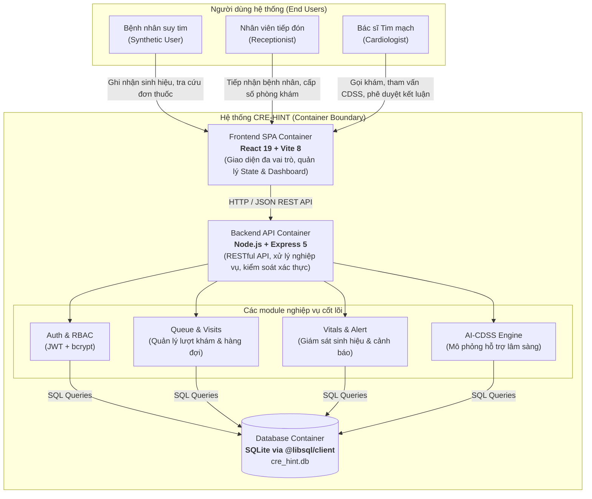

# CRE-HINT — suy_tim_173820_n12

> Hệ thống số hóa quản lý hồ sơ khám, điều phối hàng đợi thông minh và trợ lý lâm sàng (AI-CDSS) hỗ trợ theo dõi điều trị bệnh nhân suy tim ngoại trú.

---

## 1. Giới thiệu sản phẩm

- **Bài toán / người dùng đích:**
  - *Bài toán giải quyết:* Bệnh nhân suy tim mạn tính điều trị ngoại trú có nguy cơ cao rơi vào đợt mất bù cấp nếu không được giám sát chặt chẽ các chỉ số sinh hiệu (cân nặng, huyết áp, khó thở, phù). Đồng thời, quy trình khám tại phòng khám tim mạch thường quá tải và thiếu tính liên kết giữa khâu tiếp đón tại quầy, quản lý hàng đợi và trợ giúp ra quyết định kê đơn lâm sàng. Hệ thống **CRE-HINT** giải quyết bài toán quản lý trọn vẹn vòng đời lượt khám ngoại trú và giám sát chỉ số sinh hiệu từ xa.
  - *Người dùng đích:*
    1. **Bệnh nhân suy tim ngoại trú:** Tự ghi nhận chỉ số sinh hiệu hàng ngày tại nhà, theo dõi tiến triển sức khỏe, nhận cảnh báo bất thường sớm và xem kế hoạch điều trị/đơn thuốc đã được bác sĩ công bố.
    2. **Bác sĩ chuyên khoa Tim mạch:** Điều phối danh sách khám trong ngày, tra cứu lịch sử sinh hiệu bệnh nhân, tham vấn mô phỏng trợ lý AI-CDSS (gợi ý phân loại NYHA, xét nghiệm cận lâm sàng, cảnh báo tương tác thuốc), phê duyệt kết luận và đơn thuốc.
    3. **Nhân viên tiếp đón (Receptionist):** Tiếp nhận bệnh nhân tại quầy, tra cứu mã định danh bệnh nhân, tạo lượt khám mới và cấp số thứ tự vào hàng đợi phòng khám.

- **Tính năng chính của MVP:**
  1. **Xác thực & Phân quyền đa vai trò (RBAC):** Đăng nhập an toàn bằng JWT và mật khẩu mã hóa bcrypt cho 3 nhóm đối tượng riêng biệt (Bác sĩ, Bệnh nhân, Nhân viên tiếp đón/y tế).
  2. **Tiếp đón, Đo sinh hiệu check-in & Hàng đợi khám bệnh:** Bệnh nhân đặt lịch trước hoặc đăng ký trực tiếp; nhân viên y tế kiểm tra thông tin, nhập chỉ số sinh hiệu tại quầy (cân nặng, huyết áp, nhịp tim, SpO2, triệu chứng) rồi cấp số thứ tự và phân công bác sĩ theo thời gian thực (`registered` $\rightarrow$ `waiting` $\rightarrow$ `called` $\rightarrow$ `in_progress` $\rightarrow$ `waiting_result` $\rightarrow$ `completed`).
  3. **Theo dõi sinh hiệu, Số thứ tự & Cảnh báo sớm:** Bệnh nhân xem số thứ tự khám hiện tại, diễn tiến lịch sử sinh hiệu, cảnh báo nguy cơ mất bù vượt ngưỡng lâm sàng, đơn thuốc đã công bố và lịch tái khám.
  4. **Trợ lý hỗ trợ quyết định lâm sàng (AI-CDSS Simulator):** Phân tích dữ liệu HIS/EMR và sinh hiệu để gợi ý chẩn đoán phân độ NYHA, đề xuất xét nghiệm, phác đồ điều trị và cảnh báo an toàn thuốc; bác sĩ có thể duyệt/phản hồi độc lập từng khối gợi ý (`ai_block_reviews`).
  5. **Kê đơn, Kiểm tra tương tác thuốc, Mẫu kết luận & Ký xác nhận:** Cung cấp 4 mẫu kết luận chuẩn hóa, kiểm tra tương tác cặp thuốc, lưu vết phiên bản bệnh án (`visit_versions`), quản lý lịch làm việc bác sĩ và ký xác nhận điện tử kết quả đã công bố.

- **Web Demo:** [https://cre-hint.onrender.com](https://cre-hint.onrender.com) · **Ảnh chụp:** `docs/screenshot-01.png`

---

## 2. Phạm vi MVP

| Trạng thái | Nội dung |
|---|---|
| ✅ **Đã làm** | Xác thực người dùng, bảo mật mật khẩu `bcrypt` và phiên làm việc `JWT` cho 3 vai trò (Bác sĩ, Bệnh nhân, Nhân viên y tế). |
| ✅ **Đã làm** | Module Tiếp đón & Sinh hiệu check-in: Tra cứu mã `BNxxxx`, tiếp nhận lượt khám, nhập sinh hiệu tại quầy, chọn bác sĩ và cấp số thứ tự hàng đợi. |
| ✅ **Đã làm** | Module Bác sĩ: Quản lý hàng đợi phòng khám theo mức ưu tiên, lịch làm việc (`DoctorSchedule`), gọi khám, chỉ định xét nghiệm (`lab_orders`). |
| ✅ **Đã làm** | Module Bệnh nhân: Theo dõi tổng quan sức khỏe, số thứ tự khám, lịch sử sinh hiệu, cảnh báo ngưỡng nguy cơ và đơn thuốc đã công bố. |
| ✅ **Đã làm** | Module AI-CDSS Simulator: Gợi ý chẩn đoán NYHA, xét nghiệm, điều trị, cảnh báo an toàn thuốc kèm đánh giá từng khối (`ai_block_reviews`). |
| ✅ **Đã làm** | Module Kê đơn & Mẫu kết luận: 4 mẫu kết luận chuẩn hóa, kiểm tra tương tác thuốc, lưu lịch sử phiên bản (`visit_versions`) và ký xác nhận điện tử. |
| ✅ **Đã làm** | Script nạp dữ liệu thử nghiệm chuẩn Synthetic Data (`backend/seed.js`) đảm bảo nguyên tắc Zero PII/PHI. |
| 🚧 **Đang làm** | Bộ kiểm thử tự động (Unit Test / Integration Test) bao phủ $\ge 60\%$ module nghiệp vụ cốt lõi. |
| 🚧 **Đang làm** | Bổ sung nhật ký kiểm toán (Audit Trail Logging) chi tiết cho các hành động thay đổi bệnh án và kết quả khám. |
| ⬜ **Chưa làm** | Tích hợp cổng chuẩn hóa trao đổi dữ liệu y tế quốc tế HL7/FHIR với hệ thống HIS/LIS bệnh viện. |
| ⬜ **Chưa làm** | Tối ưu hóa hiệu năng chịu tải cao (Stress/Load testing) và cơ chế bộ đệm dữ liệu Redis. |
| ⬜ **Chưa làm** | Tích hợp mô hình Deep Learning phân tích tự động hình ảnh X-quang phổi và điện tâm đồ (ECG). |
| 🚫 **Ngoài phạm vi** | Tự động ra y lệnh và kê đơn thay thế bác sĩ (hệ thống tuân thủ nguyên tắc Human-in-the-loop, AI chỉ giữ vai trò hỗ trợ tham vấn). |
| 🚫 **Ngoài phạm vi** | Kết nối trực tiếp với thiết bị phần cứng đo sinh hiệu liên tục qua giao thức Bluetooth/BLE hoặc IoT y tế tại giường bệnh cấp cứu. |

---

## 3. Kiến trúc & công nghệ

### 3.1. Sơ đồ kiến trúc Container (C4 Model)



### 3.2. Công nghệ sử dụng & Phiên bản

- **Frontend:**
  - `react`: `^19.2.8` (Thư viện xây dựng giao diện người dùng SPA)
  - `react-dom`: `^19.2.8`
  - `vite`: `^8.3.0` (Công cụ đóng gói và máy chủ phát triển frontend tốc độ cao)
  - `oxlint`: `^1.81.0` (Linter siêu nhanh kiểm tra chất lượng mã nguồn)
- **Backend:**
  - `node`: `>= 20.x` (Môi trường thực thi JavaScript phía máy chủ)
  - `express`: `^5.2.1` (Framework xây dựng REST API)
  - `@libsql/client`: `^0.14.0` (Driver giao tiếp cơ sở dữ liệu SQLite/Turso nhúng)
  - `bcryptjs`: `^3.0.3` (Thuật toán băm một chiều bảo mật mật khẩu người dùng)
  - `jsonwebtoken`: `^9.0.3` (Xác thực và cấp quyền qua JWT Token)
  - `cors`: `^2.8.6` (Cấu hình Cross-Origin Resource Sharing)
- **Cơ sở dữ liệu:**
  - `SQLite 3` qua LibSQL Client (chế độ tệp nhúng cục bộ `cre_hint.db`, hỗ trợ chuyển đổi sang đám mây Turso Database).

### 3.3. Cấu trúc thư mục mã nguồn

```text
submissions/suy_tim_173820_n12/
├── README.md                           # Tài liệu chính của dự án (cửa trước MVP)
├── submission.json                     # Định danh case study, mã nhóm, MSSV
├── docs/                               # Ảnh chụp giao diện minh họa kịch bản
│   └── screenshot-01.png               # Ảnh chụp màn hình giao diện chính
├── report/                             # Báo cáo kỹ thuật, SRS, C4 model
│   └── BaoCao_KTPMUD_CRE_HINT.docx     # Báo cáo tổng thể đồ án
├── slides/                             # Thư mục slide bảo vệ (bổ sung ở Tuần 15)
└── src/                                # Toàn bộ mã nguồn dự án
    ├── package.json                    # Cấu hình scripts khởi chạy toàn dự án
    ├── .env.example                    # Mẫu cấu hình biến môi trường an toàn
    ├── backend/                        # Mã nguồn máy chủ Node.js & Express
    │   ├── server.js                   # Điểm khởi động ứng dụng, định tuyến REST API
    │   ├── database.js                 # Schema CSDL và migration
    │   ├── seed.js                     # Script nạp dữ liệu demo synthetic đầy đủ
    │   ├── test.js                     # Bộ test kiểm tra tự động backend
    │   └── package.json                # Dependencies backend
    └── frontend/                       # Mã nguồn giao diện React SPA
        ├── index.html                  # Khung HTML gốc
        ├── vite.config.js              # Cấu hình máy chủ Vite & Reverse Proxy
        ├── package.json                # Dependencies frontend
        └── src/                        # Các trang & thành phần giao diện
            ├── App.jsx                 # Điều hướng chính và quản lý phiên
            ├── pages/                  # Các màn hình nghiệp vụ (Doctor, Patient, Reception, CDSS, DoctorSchedule...)
            └── components/             # Các thành phần UI dùng chung
```

---

## 4. Cài đặt & cách sử dụng

### 4.1. Yêu cầu môi trường

- **Node.js**: Phiên bản `20.x` hoặc mới hơn (khuyến nghị Node 20 LTS hoặc Node 22).
- **npm**: Phiên bản `9.x` hoặc `10.x`.
- **Git**: Đã cài đặt trên hệ thống.

### 4.2. Các bước cài đặt và khởi chạy

Chạy lần lượt các lệnh sau từ terminal (hỗ trợ cả Windows PowerShell, macOS và Linux):

```bash
# 1. Clone fork repository và điều hướng vào thư mục mã nguồn bài nộp
git clone https://github.com/nguyentungf/ktpmud-project.git
cd ktpmud-project/submissions/suy_tim_173820_n12/src

# 2. (Tùy chọn) Thiết lập biến môi trường từ tệp mẫu (tuyệt đối KHÔNG commit tệp .env)
cp .env.example .env

# 3. Cài đặt dependencies cho root, Backend và Frontend
npm run install:all

# 4. Nạp dữ liệu demo synthetic đầy đủ (hàng đợi hôm nay, HIS/EMR, AI-CDSS, BN0001..BN0009)
npm run seed

# 5. Chạy kiểm thử tự động cục bộ
npm test

# 6. Khởi chạy ứng dụng
# Cách A - Chạy chế độ phát triển đầy đủ (chạy song song backend và frontend):
npm run dev

# Cách B - Hoặc build frontend rồi chạy backend phục vụ trọn gói tại port 3000:
npm run build && npm start
```

Sau khi chạy lệnh, truy cập ứng dụng trên trình duyệt tại:
- **Giao diện người dùng (Frontend):** `http://localhost:5173` (hoặc `http://localhost:3000`)
- **Điểm cuối API (Backend):** `http://localhost:3000/api`

### 4.3. Lệnh chạy kiểm thử (Test)

```bash
# Chạy kiểm thử tự động backend (Database schema, thuật toán băm mật khẩu, dữ liệu mẫu)
npm test

# Kiểm tra cú pháp và quy chuẩn mã nguồn frontend
cd frontend && npm run lint
```

### 4.4. Dữ liệu & Tài khoản mẫu (Synthetic Accounts)

Toàn bộ tài khoản thử nghiệm dùng dữ liệu mô phỏng (nạp đầy đủ qua `npm run seed`), mật khẩu chung là `123456`:

| Vai trò | Định danh đăng nhập (Identifier) | Mật khẩu | Mục đích kiểm thử |
| :--- | :--- | :--- | :--- |
| **Bác sĩ Tim mạch** | `doctor@demo.vn` | `123456` | Điều phối hàng đợi, duyệt từng khối AI-CDSS, kê đơn, kiểm tra tương tác thuốc, ký xác nhận. |
| **Nhân viên y tế / Tiếp đón** | `reception@demo.vn` | `123456` | Tiếp nhận bệnh nhân tại quầy, nhập sinh hiệu check-in, cấp số thứ tự và chuyển bác sĩ. |
| **Bệnh nhân mẫu 1 (có dữ liệu đầy đủ)** | `BN0001` | `123456` | Xem số thứ tự khám, lịch sử sinh hiệu có cảnh báo nguy cơ, dữ liệu AI-CDSS & kết quả đã công bố. |
| **Bệnh nhân mẫu 9 (demo từ đầu)** | `BN0009` | `123456` | Bệnh nhân chưa có lượt khám để thử luồng đặt lịch $\rightarrow$ tiếp đón $\rightarrow$ khám hoàn chỉnh. |

*(Trên giao diện đăng nhập có sẵn 3 nút "Tài khoản demo nhanh" để đăng nhập bằng 1 cú nhấp chuột).*

### 4.5. Kịch bản sử dụng mẫu (≥ 3 kịch bản)

#### Kịch bản 1: Đặt lịch khám, Tiếp đón đo sinh hiệu check-in & Cấp số thứ tự
- **Bước 1:** Đăng nhập bằng tài khoản bệnh nhân chưa có lượt khám `BN0009` / `123456` $\rightarrow$ Vào mục đặt lịch khám chọn ngày hôm nay, chuyên khoa `Tim mạch`, lý do khám và gửi đăng ký.
- **Bước 2:** Đăng xuất, đăng nhập bằng **Nhân viên YT** (`reception@demo.vn` / `123456`).
- **Bước 3:** Trên màn hình *Tiếp đón bệnh nhân*, chọn lượt khám đang chờ tiếp nhận của `BN0009` (hoặc tạo lượt khám trực tiếp), nhập các chỉ số sinh hiệu check-in (cân nặng, huyết áp, nhịp tim, SpO2, triệu chứng) và chọn bác sĩ phụ trách.
- **Bước 4:** Bấm xác nhận tiếp nhận & cấp số.
- **Kết quả mong đợi:** Hệ thống ghi nhận sinh hiệu gắn với lượt khám, cấp số thứ tự tự động (`waiting`) và chuyển lượt khám vào hàng đợi của bác sĩ.

#### Kịch bản 2: Bác sĩ điều phối hàng đợi, đánh giá từng khối AI-CDSS & Kê đơn công bố
- **Bước 1:** Đăng nhập bằng tài khoản **Bác sĩ** (`doctor@demo.vn` / `123456`).
- **Bước 2:** Trên **Hàng đợi phòng khám**, chọn bệnh nhân `BN0001` và nhấn **Gọi vào khám** / **Bắt đầu khám** (`in_progress`).
- **Bước 3:** Mở tab **Hỗ trợ lâm sàng (AI-CDSS)**:
  - Xem tóm tắt sinh hiệu + dữ liệu bệnh viện (`hospital_data`), tạo/xem gợi ý AI-CDSS (chẩn đoán NYHA, xét nghiệm, phác đồ điều trị, an toàn thuốc).
  - Đánh giá độc lập từng khối gợi ý AI (đồng ý/chỉnh sửa/ghi phản hồi) và kiểm tra tương tác thuốc nếu kê phối hợp.
- **Bước 4:** Chọn mẫu kết luận (ví dụ *"Suy tim mất bù cấp"*), hoàn thiện đơn thuốc, lưu/công bố kết quả khám và nhập mật khẩu để ký xác nhận điện tử.
- **Kết quả mong đợi:** Lượt khám chuyển trạng thái `completed`, tạo phiên bản lưu trữ (`visit_versions`), sinh mã băm chữ ký và đồng bộ kết quả sang phía bệnh nhân.

#### Kịch bản 3: Bệnh nhân theo dõi tổng quan sức khỏe, số thứ tự & cảnh báo sinh hiệu
- **Bước 1:** Đăng nhập bằng tài khoản **Bệnh nhân** (`BN0001` / `123456`).
- **Bước 2:** Tại màn hình **Tổng quan sức khỏe**, kiểm tra thẻ số thứ tự khám hiện tại, chỉ số sinh hiệu gần nhất và banner cảnh báo nguy cơ (nếu có vượt ngưỡng huyết áp, SpO2 hoặc triệu chứng khó thở/phù).
- **Bước 3:** Chuyển qua các tab **Lịch sử đo sinh hiệu**, **Đơn thuốc chỉ định** và **Lượt khám & thông báo** để đối chiếu kết luận và đơn thuốc bác sĩ vừa công bố.
- **Kết quả mong đợi:** Hiển thị nhất quán chuỗi sinh hiệu đã được nhân viên y tế ghi nhận, cảnh báo trực quan khi vượt ngưỡng và đầy đủ đơn thuốc/lịch tái khám mới nhất.

---

## 5. Hướng phát triển Tuần 11–15

| Tuần | Mốc thời gian | Mục tiêu trọng tâm | Đầu việc chính | Phụ trách (MSSV) | Tiêu chí hoàn thành | Trạng thái |
|:---:|:---:|---|---|:---:|---|:---:|
| **11** | 18/11 – 23/11 | Chốt MVP & Nền tảng chất lượng | • Đóng băng phạm vi tính năng MVP cốt lõi.<br/>• Chuẩn hóa cấu trúc thư mục repo theo chuẩn submission.<br/>• Hoàn thiện README.md mục 1–4 và tài khoản synthetic.<br/>• Bổ sung script test cơ bản và `submission.json`.<br/>• Kiểm tra cục bộ đạt `[PASSED]`. | `202414396`<br/>`202414224`<br/>`202414443` | • PR #1 mở thành công vào nhánh main `ktpmud-project`.<br/>• CI pipeline chạy xanh ✅.<br/>• Người lạ cài đặt & chạy MVP trong $\le 15$ phút. | ✅ Hoàn thành |
| **12** | 24/11 – 30/11 | Kiểm thử & Tích hợp hệ thống | • Viết bộ kiểm thử Unit Test cho các API cốt lõi (Auth, Queue, Vitals).<br/>• Viết Integration Test kiểm tra luồng từ Tiếp đón $\rightarrow$ Bác sĩ khám $\rightarrow$ Hoàn tất.<br/>• Thiết lập Audit Trail Logging ghi nhận thời gian thực mọi thay đổi kết quả khám.<br/>• Chạy thử nghiệm toàn bộ README trên máy ảo sạch. | `202414224` | • Test Coverage đạt $\ge 60\%$ code nghiệp vụ.<br/>• Xuất bản tệp Test Report v1 trong thư mục `report/`.<br/>• Không còn lỗi crash luồng chính. | ⬜ Chưa bắt đầu |
| **13** | 01/12 – 07/12 | An toàn bảo mật, Hiệu năng & Đánh giá AI | • Rà soát kiểm soát quyền (RBAC bypass check), chống SQL Injection và XSS.<br/>• Kiểm tra an toàn secret, đảm bảo không rò rỉ token hay API key.<br/>• Đo đạc độ trễ truy vấn SQLite, tối ưu index cho bảng `visits` và `vitals`.<br/>• Đánh giá mô hình/quy tắc AI-CDSS, lập bảng phân tích giới hạn lâm sàng và rủi ro. | `202414443` | • Báo cáo An toàn bảo mật & Đánh giá AI-CDSS trong `report/`.<br/>• 0 lỗi bảo mật mức High/Critical.<br/>• Thời gian phản hồi API trung bình $< 150\text{ ms}$. | ⬜ Chưa bắt đầu |
| **14** | 08/12 – 14/12 | Review chéo (Peer Review) & Hoàn thiện | • Thực hiện đánh giá chéo mã nguồn (peer review) cho 1 nhóm bạn trên GitHub PR.<br/>• Tiếp nhận phản hồi từ nhóm bạn và giảng viên, sửa đổi mã nguồn.<br/>• Đóng băng toàn bộ mã nguồn (Code Freeze).<br/>• Quay video demo sản phẩm hoàn chỉnh (3–5 phút) tải lên Drive/YouTube. | `202414396` | • Biên bản review chéo trên GitHub PR/Issue.<br/>• Video demo hoàn chỉnh có thuyết minh.<br/>• README và tài liệu được hoàn thiện lần cuối. | ⬜ Chưa bắt đầu |
| **15** | 15/12 – 21/12 | Nghiệm thu sản phẩm & Bảo vệ đồ án | • Gắn tag phiên bản chính thức `v1.0`.<br/>• Hoàn thiện báo cáo kỹ thuật tổng kết (SRS, C4, Architecture).<br/>• Chuẩn bị slide trình chiếu và kịch bản demo trực tiếp trước hội đồng. | Cả nhóm | • PR bản cuối hợp nhất đầy đủ code, report, slide.<br/>• Bảo vệ thành công trước giảng viên môn học. | ⬜ Chưa bắt đầu |

---

## 6. Nhóm & tuân thủ

- **Mã nhóm:** `173820_n12`
- **Danh sách thành viên (Chỉ sử dụng MSSV theo quy định bảo mật):**
  - `202414396` — Trưởng nhóm / Product Owner, Phụ trách Phân tích yêu cầu (BA), Kiểm thử chất lượng (QA) & Báo cáo.
  - `202414224` — Thành viên / Backend Developer, Phụ trách Thiết kế kiến trúc hệ thống (System Design) & Cơ sở dữ liệu.
  - `202414443` — Thành viên / Frontend Developer, Phụ trách Giao diện người dùng (UI/UX), Slide & Tích hợp mô phỏng AI-CDSS.

- **Cam kết Zero PII/PHI (Dữ liệu y tế riêng tư):**
  - ✅ **Xác nhận 100%:** Toàn bộ dữ liệu bệnh nhân, chỉ số sinh hiệu, hồ sơ lượt khám và đơn thuốc trong dự án đều là **dữ liệu tổng hợp mô phỏng (Synthetic Data)** được sinh ngẫu nhiên phục vụ mục đích học thuật.
  - Dự án tuyệt đối không chứa, không thu thập và không liên kết với bất kỳ thông tin nhận dạng cá nhân (PII) hoặc thông tin sức khỏe được bảo vệ (PHI) thực tế nào của người bệnh.

- **Công cụ AI hỗ trợ & Phạm vi sử dụng:**
  - *Google Gemini / Antigravity AI:* Hỗ trợ rà soát cấu trúc mã nguồn, chuẩn hóa đặc tả tài liệu markdown theo tiêu chuẩn môn học, và thiết kế sơ đồ C4 Container Mermaid.
  - *GitHub Copilot:* Hỗ trợ gợi ý cú pháp boilerplate code cho các hàm tiện ích và routing Express.
  - Toàn bộ logic nghiệp vụ điều phối hàng đợi và quy tắc lâm sàng AI-CDSS do nhóm tự nghiên cứu, phát triển và chịu trách nhiệm.

- **Liên kết dữ liệu lớn (> 10MB):**
  - *Không áp dụng:* Toàn bộ cơ sở dữ liệu mẫu SQLite (`backend/cre_hint.db`) cùng 4 tài khoản demo synthetic được tự động khởi tạo và nạp dữ liệu ngay khi chạy ứng dụng (`npm start` hoặc `npm run dev`), có dung lượng nhẹ ($< 1\text{ MB}$), không cần tải bộ dữ liệu ngoài.
