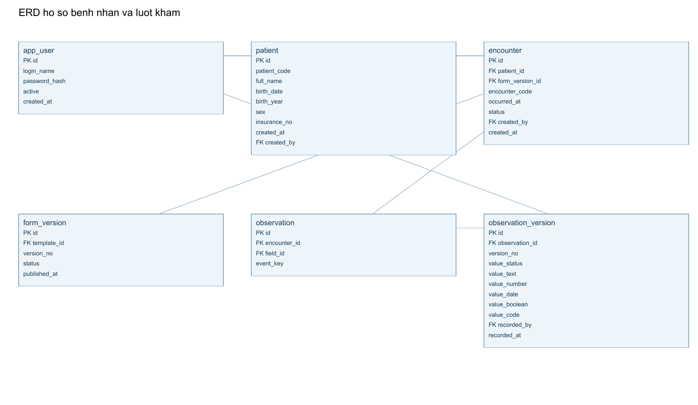
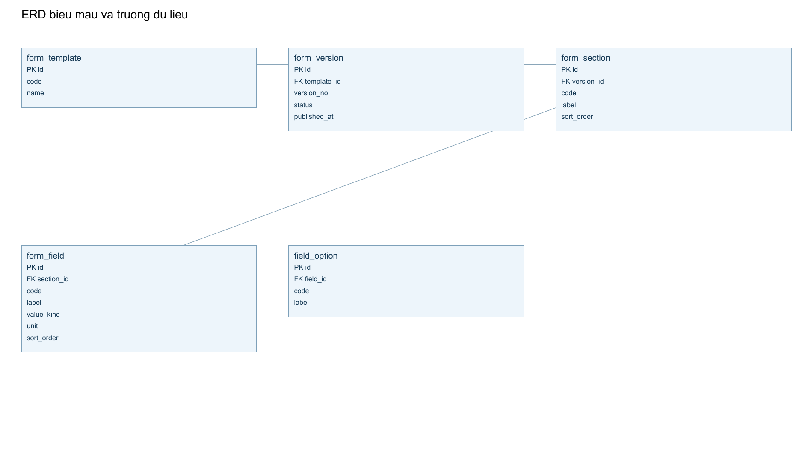
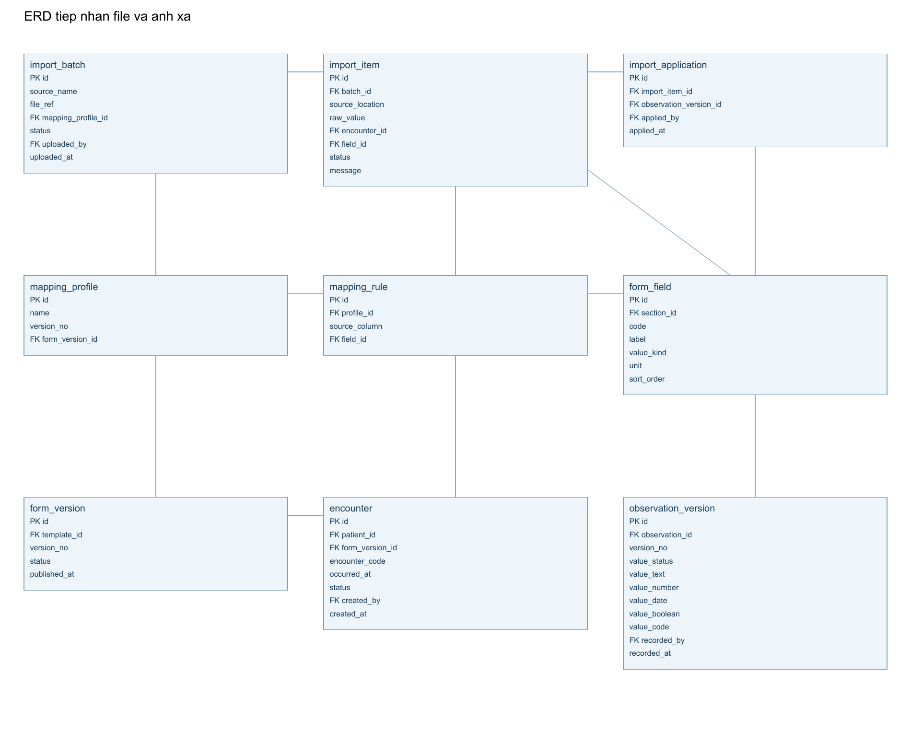
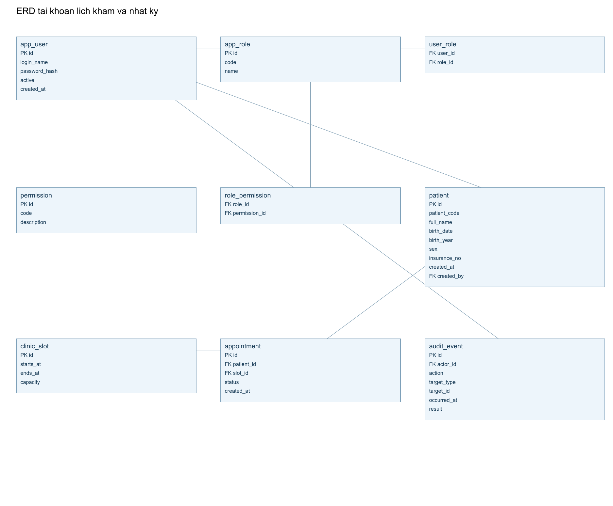

# 5.3 Thiết kế dữ liệu cho MVP

**Trạng thái:** bản dự thảo thiết kế, cần kiểm tra trước khi triển khai. Phạm vi gồm quản lý hồ sơ và lượt khám, tiếp nhận file, tài khoản và quản trị; các chức năng AI và cổng bệnh nhân thuộc hướng mở rộng.

## Các nhóm dữ liệu

| Nhóm | Bảng đề xuất | Mục đích |
| --- | --- | --- |
| Tài khoản | app_user, app_role, user_role, permission, role_permission | Xác thực và phân quyền |
| Hồ sơ | patient, encounter | Quản lý người bệnh và các lượt khám |
| Biểu mẫu | form_template, form_version, form_section, form_field, field_option | Thiết kế phiên bản mẫu và các trường |
| Dữ liệu khám | observation, observation_version | Giá trị theo lượt, trường và các phiên bản sửa đổi |
| Nhập file | mapping_profile, mapping_rule, import_batch, import_item, import_application | Ánh xạ, tiếp nhận, đối chiếu và kết quả ghi |
| Lịch khám | clinic_slot, appointment | Khung giờ và lịch hẹn |
| Nhật ký | audit_event | Ghi nhận thao tác |

Hồ sơ có nhiều lượt khám; mỗi lượt gắn một phiên bản mẫu. Một mẫu có nhiều phiên bản; phiên bản có nhiều nhóm, mỗi nhóm chứa các trường. Bản ghi khám gắn với lượt và trường, và có thể có nhiều phiên bản giá trị. File được tiếp nhận thành lần nhập, gồm nhiều phần dữ liệu để kiểm tra và đối chiếu. Khung giờ có thể có nhiều lịch hẹn.

## 3NF và những điều kiện cần tiếp tục kiểm tra

Thiết kế tách tài khoản và vai trò, biểu mẫu và phiên bản, trường và lựa chọn, bản ghi và phiên bản giá trị. Mỗi trường biểu mẫu xác định phiên bản thông qua nhóm trường để giảm dữ liệu lặp. Cần kiểm tra đầy đủ các khóa ứng viên và phụ thuộc hàm theo nghiệp vụ đã chốt trước khi kết luận toàn bộ schema đạt 3NF.

Quy tắc liên bảng cần được thực thi bổ sung: trường của observation phải thuộc phiên bản mẫu của lượt khám; tùy chọn phải thuộc đúng trường; số lịch hẹn không vượt sức chứa; giá trị 0 của file mẫu phải chờ bác sĩ kiểm tra. Các ràng buộc này chưa được bảo đảm chỉ bằng schema.sql. Phiên bản mẫu đã sử dụng cần được bảo vệ khỏi sửa trực tiếp bằng logic ứng dụng và quyền phù hợp.

## Chỉ mục và ràng buộc

DDL có khóa chính và khóa ngoại, ràng buộc duy nhất cho mã và phiên bản, kiểm tra trạng thái, số phiên bản, khoảng thời gian và số lượng giá trị; chỉ mục hỗ trợ tra lượt theo hồ sơ, bản ghi theo lượt, trạng thái nhập, lịch hẹn và nhật ký. Đã chạy tạo 22 bảng và 5 chỉ mục trên PostgreSQL thử riêng. Các thử nghiệm về mã hồ sơ trùng, khóa ngoại, số phiên bản, giá trị thiếu và số 0 do người dùng nhập cho kết quả mong đợi.

## Lưu ý triển khai

DDL dự kiến dùng cho PostgreSQL trên cơ sở dữ liệu trống, chưa là migration cho bản demo cũ và chưa có quy trình chuyển dữ liệu. Các mô tả trạng thái, dữ liệu nhập và quy tắc lâm sàng phải được nhóm xác nhận; không dùng dữ liệu bệnh nhân thật trong bộ tài liệu.

## Sơ đồ chi tiết

### ERD ho so benh nhan va luot kham

[Sửa sơ đồ trong draw.io](architecture/ERD-ho-so-benh-nhan-va-luot-kham.drawio)

### ERD bieu mau va truong du lieu

[Sửa sơ đồ trong draw.io](architecture/ERD-bieu-mau-va-truong-du-lieu.drawio)

### ERD tiep nhan file va anh xa

[Sửa sơ đồ trong draw.io](architecture/ERD-tiep-nhan-file-va-anh-xa.drawio)

### ERD tai khoan lich kham va nhat ky

[Sửa sơ đồ trong draw.io](architecture/ERD-tai-khoan-lich-kham-va-nhat-ky.drawio)

[Từ điển dữ liệu](tu-dien-du-lieu-MVP.md) · [Kịch bản tạo bảng](../database/schema-MVP.sql)

[Phân tích khóa và chuẩn hóa 3NF](kiem-tra-chuan-hoa-3NF-MVP.md)

## Căn cứ thiết kế

Đối chiếu sáu nguồn nhóm cung cấp: hướng dẫn suy tim của Bộ Y tế; tài liệu suy tim người cao tuổi; tài liệu SUY TIM; schema tối thiểu năm bệnh; bảng biến bác sĩ AI-CDSS; từ điển dữ liệu suy tim. Các nguồn chuyên môn làm căn cứ chọn trường biểu mẫu và không tự tạo yêu cầu kết nối trực tiếp bệnh viện. Tham khảo [bài giảng kỹ thuật yêu cầu và thiết kế hệ thống](https://fossbk-spec.github.io/ktpmud-book/ch02_yeu_cau_thiet_ke_c4).
