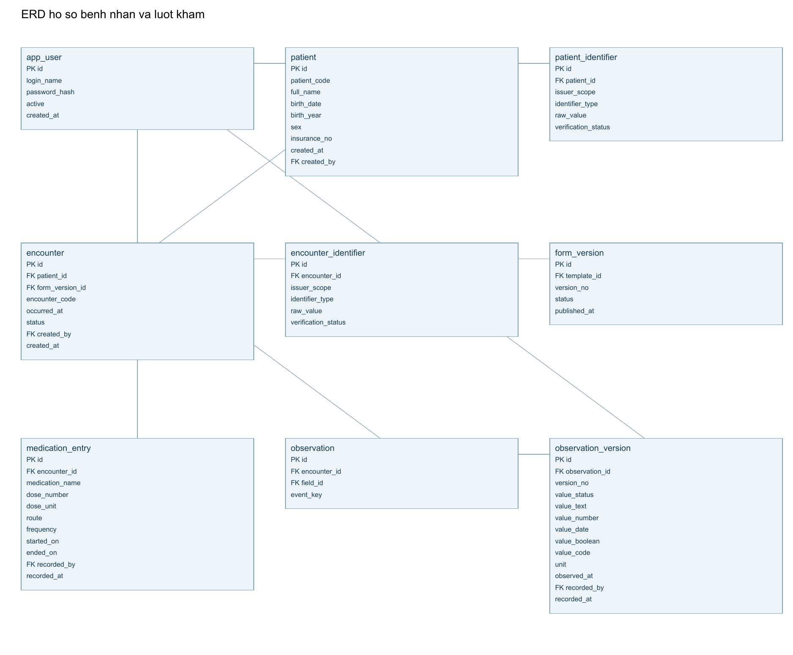
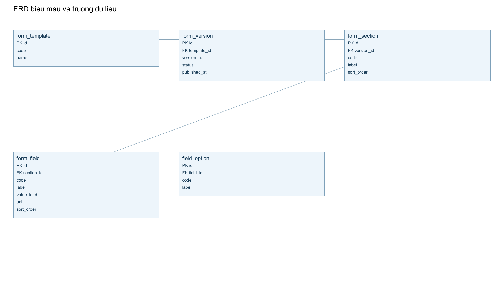
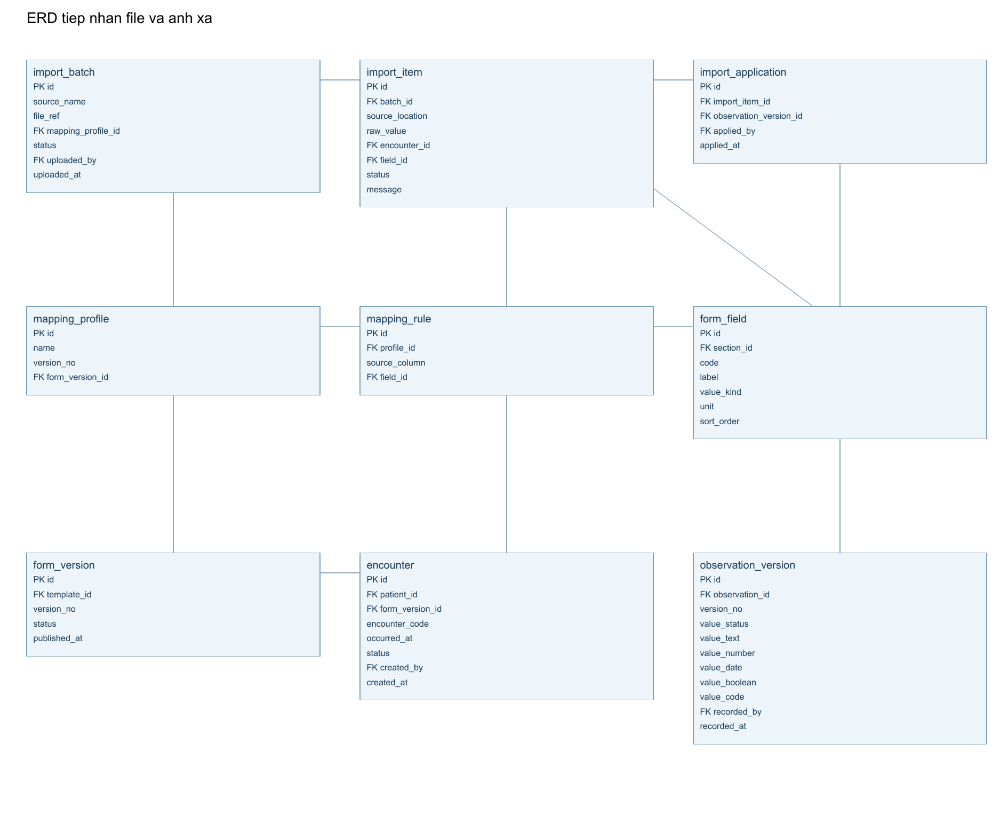
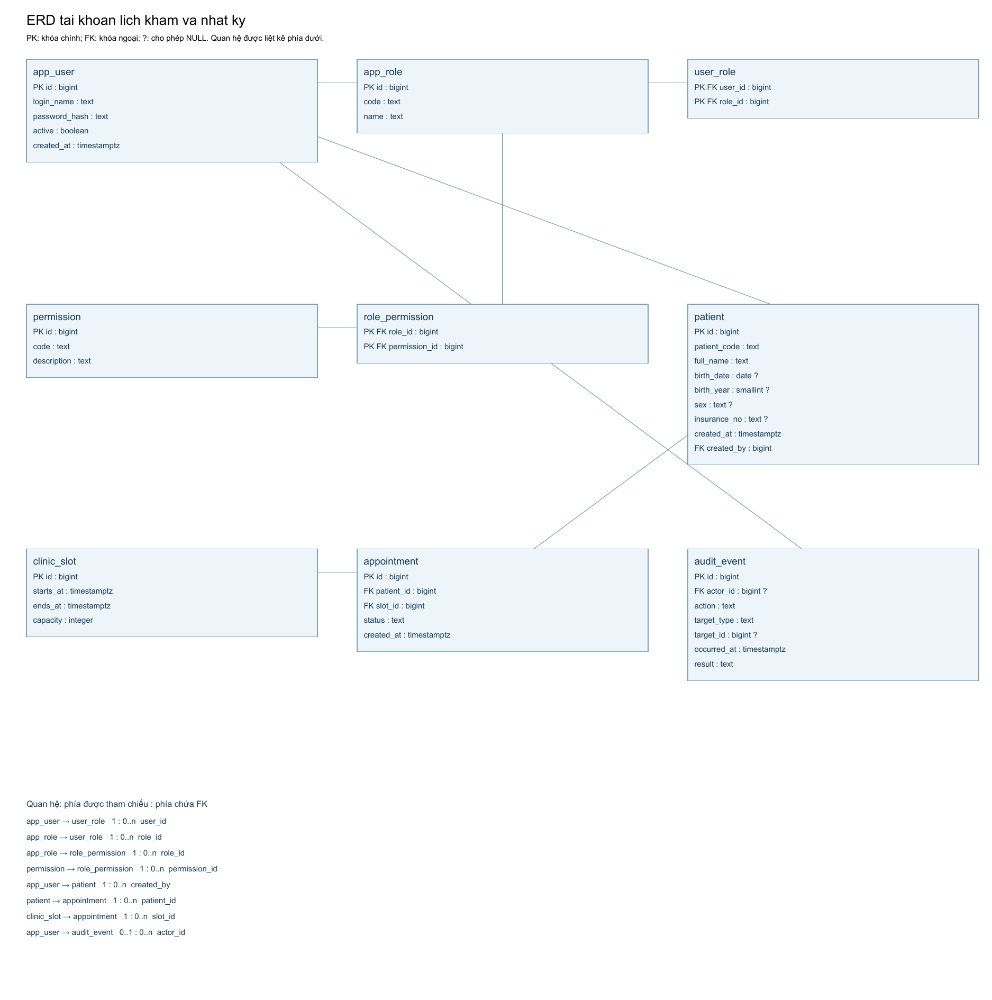

# Thiết kế dữ liệu

Hệ thống quản lý bệnh nhân suy tim — phạm vi MVP

Tài liệu này trình bày lần lượt phạm vi dữ liệu, sơ đồ quan hệ, từ điển dữ liệu, phân tích 3NF, biểu mẫu và truy vết nguồn, ràng buộc cùng cách kiểm tra. Dữ liệu đầu vào có thể được bác sĩ nhập tay hoặc tiếp nhận từ file sau khi đối chiếu; các module AI và cổng bệnh nhân thuộc giai đoạn sau.

## Mục lục

- [1 Phạm vi và các nhóm dữ liệu](#pham-vi)
- [2 Sơ đồ thực thể liên kết](#so-do-erd)
- [3 Từ điển dữ liệu](#tu-dien)
- [4 Phân tích chuẩn hóa 3NF](#chuan-hoa)
- [5 Biểu mẫu và truy vết nguồn](#bieu-mau)
- [6 Ràng buộc, kịch bản tạo bảng và kiểm thử](#rang-buoc)
- [7 Mở rộng và giới hạn triển khai](#mo-rong)
- [8 Căn cứ thiết kế](#can-cu)

## 1 Phạm vi và các nhóm dữ liệu

**Phạm vi duyệt công việc 3.2:** lược đồ quan hệ 25 bảng, danh mục khởi tạo 66 trường lâm sàng và các trường hành chính. Các biến còn lại được quản lý trong bảng truy vết và bổ sung qua phiên bản biểu mẫu sau. Phạm vi gồm quản lý hồ sơ và lượt khám, tiếp nhận file, tài khoản và quản trị; các chức năng AI và cổng bệnh nhân thuộc hướng mở rộng.

| Nhóm | Bảng đề xuất | Mục đích |
| --- | --- | --- |
| Tài khoản | app_user, app_role, user_role, permission, role_permission | Xác thực và phân quyền |
| Hồ sơ | patient, patient_identifier, encounter, encounter_identifier | Quản lý người bệnh, định danh nguồn và các lượt khám |
| Biểu mẫu | form_template, form_version, form_section, form_field, field_option | Thiết kế phiên bản mẫu và các trường |
| Dữ liệu khám | observation, observation_version, medication_entry | Giá trị theo lượt, trường, thời điểm; các bản sửa đổi và nhiều thuốc |
| Nhập file | mapping_profile, mapping_rule, import_batch, import_item, import_application | Ánh xạ, tiếp nhận, đối chiếu và kết quả ghi |
| Lịch khám | clinic_slot, appointment | Khung giờ và lịch hẹn |
| Nhật ký | audit_event | Ghi nhận thao tác |

Hồ sơ có nhiều lượt khám; mỗi lượt gắn một phiên bản mẫu. Một mẫu có nhiều phiên bản; phiên bản có nhiều nhóm, mỗi nhóm chứa các trường. Bản ghi khám gắn với lượt và trường, và có thể có nhiều phiên bản giá trị. File được tiếp nhận thành lần nhập, gồm nhiều phần dữ liệu để kiểm tra và đối chiếu. Khung giờ có thể có nhiều lịch hẹn.

Sau khi đối chiếu repo demo, mẫu khởi tạo có thêm tư thế đo huyết áp, LVEF, báo cáo siêu âm tim, BNP và eGFR. Tâm thu, tâm trương và tư thế cùng một lần đo dùng cùng `event_key`; thời điểm đo nằm ở bản giá trị. BNP và NT-proBNP là hai trường riêng. Bản giá trị giữ được tên chỉ số trên phiếu và ghi chú nguồn; thuốc giữ hoạt chất, hàm lượng, liều nguyên văn, trạng thái và nguồn. Đây là khả năng ghi nhận dữ liệu, chưa phải quy tắc chẩn đoán hay xác nhận cấu trúc file bệnh viện.

## 2 Sơ đồ thực thể liên kết

Bốn sơ đồ ERD thể hiện các nhóm bảng và quan hệ của thiết kế.

### 2.1 Hồ sơ bệnh nhân và lượt khám

### 2.2 Biểu mẫu và trường dữ liệu

### 2.3 Tiếp nhận file và ánh xạ

### 2.4 Tài khoản, lịch khám và nhật ký

## 3 Từ điển dữ liệu

Tài liệu được tạo từ schema PostgreSQL; PK là khóa chính, FK là khóa ngoại. NOT NULL: bắt buộc; các trường khác được phép để trống. GENERATED AS IDENTITY: mã tự tăng.

### 3.1 Tài khoản và phân quyền

#### app_user

| Trường | Ý nghĩa | Kiểu và ràng buộc |
| --- | --- | --- |
| id | Khóa tài khoản | `bigint GENERATED ALWAYS AS IDENTITY PRIMARY KEY` |
| login_name | Tên đăng nhập | `text NOT NULL UNIQUE` |
| password_hash | Giá trị băm mật khẩu | `text NOT NULL` |
| active | Trạng thái hoạt động | `boolean NOT NULL DEFAULT true` |
| created_at | Thời điểm tạo | `timestamptz NOT NULL DEFAULT now()` |

Ràng buộc của bảng: không có ràng buộc bổ sung.

#### app_role

| Trường | Ý nghĩa | Kiểu và ràng buộc |
| --- | --- | --- |
| id | Định danh nội bộ | `bigint GENERATED ALWAYS AS IDENTITY PRIMARY KEY` |
| code | Mã nhận diện | `text NOT NULL UNIQUE` |
| name | Tên hiển thị | `text NOT NULL` |

Ràng buộc của bảng: không có ràng buộc bổ sung.

#### user_role

| Trường | Ý nghĩa | Kiểu và ràng buộc |
| --- | --- | --- |
| user_id | Tài khoản | `bigint NOT NULL REFERENCES app_user(id)` |
| role_id | Vai trò | `bigint NOT NULL REFERENCES app_role(id)` |

Ràng buộc của bảng: `PRIMARY KEY(user_id,role_id)`

#### permission

| Trường | Ý nghĩa | Kiểu và ràng buộc |
| --- | --- | --- |
| id | Định danh nội bộ | `bigint GENERATED ALWAYS AS IDENTITY PRIMARY KEY` |
| code | Mã nhận diện | `text NOT NULL UNIQUE` |
| description | Mô tả | `text NOT NULL` |

Ràng buộc của bảng: không có ràng buộc bổ sung.

#### role_permission

| Trường | Ý nghĩa | Kiểu và ràng buộc |
| --- | --- | --- |
| role_id | Vai trò | `bigint NOT NULL REFERENCES app_role(id)` |
| permission_id | Quyền truy cập | `bigint NOT NULL REFERENCES permission(id)` |

Ràng buộc của bảng: `PRIMARY KEY(role_id,permission_id)`

### 3.2 Hồ sơ bệnh nhân và lượt khám

#### patient

| Trường | Ý nghĩa | Kiểu và ràng buộc |
| --- | --- | --- |
| id | Khóa nội bộ | `bigint GENERATED ALWAYS AS IDENTITY PRIMARY KEY` |
| patient_code | Mã hiển thị BN-xxxxx | `text NOT NULL UNIQUE CHECK(patient_code ~ '^BN-[0-9]{5}$')` |
| full_name | Họ tên người bệnh | `text NOT NULL` |
| birth_date | Thuộc tính birth_date | `date` |
| birth_year | Thuộc tính birth_year | `smallint CHECK (birth_year BETWEEN 1850 AND 2100)` |
| sex | Thuộc tính sex | `text` |
| insurance_no | Thuộc tính insurance_no | `text` |
| created_at | Thời điểm tạo | `timestamptz NOT NULL DEFAULT now()` |
| created_by | Người tạo | `bigint NOT NULL REFERENCES app_user(id)` |

Ràng buộc của bảng: `CHECK (birth_date IS NULL OR birth_year IS NULL)`

#### patient_identifier

| Trường | Ý nghĩa | Kiểu và ràng buộc |
| --- | --- | --- |
| id | Khóa liên kết | `bigint GENERATED ALWAYS AS IDENTITY PRIMARY KEY` |
| patient_id | Hồ sơ được liên kết | `bigint NOT NULL REFERENCES patient(id)` |
| issuer_scope | Nơi cấp và phạm vi mã | `text NOT NULL` |
| identifier_type | Loại mã nguồn | `text NOT NULL` |
| raw_value | Mã nguyên dạng | `text NOT NULL` |
| verification_status | Trạng thái đối chiếu | `text NOT NULL CHECK(verification_status IN ('pending','verified','rejected'))` |

Ràng buộc của bảng: `UNIQUE(issuer_scope,identifier_type,raw_value)`

#### encounter

| Trường | Ý nghĩa | Kiểu và ràng buộc |
| --- | --- | --- |
| id | Khóa lượt | `bigint GENERATED ALWAYS AS IDENTITY PRIMARY KEY` |
| patient_id | Hồ sơ chủ | `bigint NOT NULL REFERENCES patient(id)` |
| form_version_id | Mẫu được dùng | `bigint NOT NULL REFERENCES form_version(id)` |
| encounter_code | Mã lượt nội bộ | `text NOT NULL UNIQUE` |
| occurred_at | Thời điểm khám nếu biết | `timestamptz` |
| status | Trạng thái lượt | `text NOT NULL CHECK(status IN ('draft','in_progress','completed'))` |
| created_by | Người mở lượt | `bigint NOT NULL REFERENCES app_user(id)` |
| created_at | Thời điểm mở lượt | `timestamptz NOT NULL DEFAULT now()` |

Ràng buộc của bảng: không có ràng buộc bổ sung.

Chỉ mục bổ sung: `ix_encounter_patient_time (patient_id,occurred_at)`.

#### encounter_identifier

| Trường | Ý nghĩa | Kiểu và ràng buộc |
| --- | --- | --- |
| id | Khóa liên kết | `bigint GENERATED ALWAYS AS IDENTITY PRIMARY KEY` |
| encounter_id | Lượt được liên kết | `bigint NOT NULL REFERENCES encounter(id)` |
| issuer_scope | Nơi cấp và phạm vi mã | `text NOT NULL` |
| identifier_type | Loại mã nguồn | `text NOT NULL` |
| raw_value | Mã nguyên dạng | `text NOT NULL` |
| verification_status | Trạng thái đối chiếu | `text NOT NULL CHECK(verification_status IN ('pending','verified','rejected'))` |

Ràng buộc của bảng: `UNIQUE(issuer_scope,identifier_type,raw_value)`

### 3.3 Biểu mẫu và phiên bản

#### form_template

| Trường | Ý nghĩa | Kiểu và ràng buộc |
| --- | --- | --- |
| id | Khóa mẫu | `bigint GENERATED ALWAYS AS IDENTITY PRIMARY KEY` |
| code | Mã mẫu | `text NOT NULL UNIQUE` |
| name | Tên mẫu | `text NOT NULL` |

Ràng buộc của bảng: không có ràng buộc bổ sung.

#### form_version

| Trường | Ý nghĩa | Kiểu và ràng buộc |
| --- | --- | --- |
| id | Khóa phiên bản | `bigint GENERATED ALWAYS AS IDENTITY PRIMARY KEY` |
| template_id | Mẫu gốc | `bigint NOT NULL REFERENCES form_template(id)` |
| version_no | Số phiên bản theo mẫu | `integer NOT NULL CHECK (version_no > 0)` |
| status | Nháp hoặc được áp dụng | `text NOT NULL CHECK (status IN ('draft','published','retired'))` |
| published_at | Thời điểm áp dụng | `timestamptz` |

Ràng buộc của bảng: `UNIQUE(template_id,version_no)`

#### form_section

| Trường | Ý nghĩa | Kiểu và ràng buộc |
| --- | --- | --- |
| id | Khóa nhóm | `bigint GENERATED ALWAYS AS IDENTITY PRIMARY KEY` |
| version_id | Thuộc tính version_id | `bigint NOT NULL REFERENCES form_version(id)` |
| code | Mã nhận diện | `text NOT NULL` |
| label | Tên nhóm | `text NOT NULL` |
| sort_order | Thứ tự hiển thị | `integer NOT NULL CHECK(sort_order >= 0)` |

Ràng buộc của bảng: `UNIQUE(version_id,code)`

#### form_field

| Trường | Ý nghĩa | Kiểu và ràng buộc |
| --- | --- | --- |
| id | Khóa trường theo phiên bản | `bigint GENERATED ALWAYS AS IDENTITY PRIMARY KEY` |
| section_id | Nhóm chứa trường | `bigint NOT NULL REFERENCES form_section(id)` |
| code | Mã nhận diện | `text NOT NULL` |
| label | Tên hiển thị | `text NOT NULL` |
| value_kind | Kiểu giá trị | `text NOT NULL CHECK(value_kind IN ('text','number','date','boolean','choice'))` |
| unit | Thuộc tính unit | `text` |
| required | Thuộc tính required | `boolean NOT NULL DEFAULT false` |
| source_reference | Thuộc tính source_reference | `text` |
| validation_note | Thuộc tính validation_note | `text` |
| sort_order | Thứ tự | `integer NOT NULL CHECK(sort_order >= 0)` |

Ràng buộc của bảng: `UNIQUE(section_id,code)`

#### field_option

| Trường | Ý nghĩa | Kiểu và ràng buộc |
| --- | --- | --- |
| id | Khóa lựa chọn | `bigint GENERATED ALWAYS AS IDENTITY PRIMARY KEY` |
| field_id | Trường chủ | `bigint NOT NULL REFERENCES form_field(id)` |
| code | Mã nhận diện | `text NOT NULL` |
| label | Nội dung | `text NOT NULL` |

Ràng buộc của bảng: `UNIQUE(field_id,code)`

### 3.4 Dữ liệu khám và thuốc

#### observation

| Trường | Ý nghĩa | Kiểu và ràng buộc |
| --- | --- | --- |
| id | Định danh nội bộ | `bigint GENERATED ALWAYS AS IDENTITY PRIMARY KEY` |
| encounter_id | Lượt khám | `bigint NOT NULL REFERENCES encounter(id)` |
| field_id | Trường biểu mẫu | `bigint NOT NULL REFERENCES form_field(id)` |
| event_key | Định danh lần ghi trong lượt | `text NOT NULL DEFAULT 'default'` |

Ràng buộc của bảng: `UNIQUE(encounter_id,field_id,event_key)`

Chỉ mục bổ sung: `ix_observation_encounter (encounter_id)`.

#### observation_version

| Trường | Ý nghĩa | Kiểu và ràng buộc |
| --- | --- | --- |
| id | Định danh nội bộ | `bigint GENERATED ALWAYS AS IDENTITY PRIMARY KEY` |
| observation_id | Thuộc tính observation_id | `bigint NOT NULL REFERENCES observation(id)` |
| version_no | Số phiên bản | `integer NOT NULL CHECK(version_no > 0)` |
| value_status | Tình trạng giá trị | `text NOT NULL CHECK(value_status IN ('known','unknown','not_applicable'))` |
| value_text | Giá trị văn bản | `text` |
| value_number | Giá trị số | `numeric` |
| value_date | Giá trị ngày | `date` |
| value_boolean | Giá trị đúng sai | `boolean` |
| reported_name | Tên chỉ số gốc trên phiếu | `text` |
| source_note | Nguồn kết quả được ghi nhận | `text` |
| value_code | Mã lựa chọn | `text` |
| unit | Thuộc tính unit | `text` |
| observed_at | Thuộc tính observed_at | `timestamptz` |
| recorded_by | Thuộc tính recorded_by | `bigint NOT NULL REFERENCES app_user(id)` |
| recorded_at | Thuộc tính recorded_at | `timestamptz NOT NULL DEFAULT now()` |

Ràng buộc của bảng: `UNIQUE(observation_id,version_no)`; `CHECK ((value_status = 'known' AND num_nonnulls(value_text,value_number,value_date,value_boolean,value_code) = 1) OR (value_status <> 'known' AND num_nonnulls(value_text,value_number,value_date,value_boolean,value_code) = 0))`

#### medication_entry

| Trường | Ý nghĩa | Kiểu và ràng buộc |
| --- | --- | --- |
| id | Định danh nội bộ | `bigint GENERATED ALWAYS AS IDENTITY PRIMARY KEY` |
| encounter_id | Lượt khám | `bigint NOT NULL REFERENCES encounter(id)` |
| medication_name | Thuộc tính medication_name | `text NOT NULL` |
| dose_number | Thuộc tính dose_number | `numeric CHECK(dose_number >= 0)` |
| dose_text | Mô tả liều nguyên văn | `text` |
| ingredient | Hoạt chất ghi nhận | `text` |
| strength | Hàm lượng ghi nhận | `text` |
| dose_unit | Thuộc tính dose_unit | `text` |
| route | Thuộc tính route | `text` |
| frequency | Thuộc tính frequency | `text` |
| medication_status | Trạng thái thuốc, có thể chưa biết | `text CHECK(medication_status IN ('current','planned','stopped'))` |
| medication_category | Loại sản phẩm | `text CHECK(medication_category IN ('prescription','otc','supplement','traditional'))` |
| source_note | Nguồn thông tin do người dùng ghi | `text` |
| observed_at | Thời điểm thông tin thuốc | `timestamptz` |
| started_on | Thuộc tính started_on | `date` |
| ended_on | Thuộc tính ended_on | `date` |
| recorded_by | Thuộc tính recorded_by | `bigint NOT NULL REFERENCES app_user(id)` |
| recorded_at | Thuộc tính recorded_at | `timestamptz NOT NULL DEFAULT now()` |

Ràng buộc của bảng: `CHECK(started_on IS NULL OR ended_on IS NULL OR ended_on >= started_on)`; `CHECK(dose_number IS NULL OR dose_unit IS NOT NULL)`. Trạng thái để NULL khi chưa xác nhận thuốc đang dùng, dự kiến hay đã ngừng.

Chỉ mục bổ sung: `ix_medication_encounter (encounter_id)`.

### 3.5 Tiếp nhận và ánh xạ file

#### mapping_profile

| Trường | Ý nghĩa | Kiểu và ràng buộc |
| --- | --- | --- |
| id | Định danh nội bộ | `bigint GENERATED ALWAYS AS IDENTITY PRIMARY KEY` |
| name | Tên hiển thị | `text NOT NULL` |
| version_no | Số phiên bản | `integer NOT NULL CHECK(version_no > 0)` |
| form_version_id | Phiên bản biểu mẫu | `bigint NOT NULL REFERENCES form_version(id)` |

Ràng buộc của bảng: `UNIQUE(name,version_no)`

#### mapping_rule

| Trường | Ý nghĩa | Kiểu và ràng buộc |
| --- | --- | --- |
| id | Định danh nội bộ | `bigint GENERATED ALWAYS AS IDENTITY PRIMARY KEY` |
| profile_id | Cấu hình ánh xạ | `bigint NOT NULL REFERENCES mapping_profile(id)` |
| source_column | Tên cột nguồn | `text NOT NULL` |
| field_id | Trường biểu mẫu | `bigint NOT NULL REFERENCES form_field(id)` |

Ràng buộc của bảng: `UNIQUE(profile_id,source_column)`

#### import_batch

| Trường | Ý nghĩa | Kiểu và ràng buộc |
| --- | --- | --- |
| id | Khóa lần nhập | `bigint GENERATED ALWAYS AS IDENTITY PRIMARY KEY` |
| source_name | Nguồn file | `text NOT NULL` |
| file_ref | Tham chiếu tệp được lưu | `text` |
| mapping_profile_id | Cấu hình ánh xạ được chọn | `bigint REFERENCES mapping_profile(id)` |
| zero_requires_review | Thuộc tính zero_requires_review | `boolean NOT NULL DEFAULT true` |
| status | Trạng thái tổng hợp | `text NOT NULL CHECK(status IN ('received','review','applied','failed'))` |
| uploaded_by | Người tải file | `bigint NOT NULL REFERENCES app_user(id)` |
| uploaded_at | Thời điểm tải file | `timestamptz NOT NULL DEFAULT now()` |

Ràng buộc của bảng: không có ràng buộc bổ sung.

#### import_item

| Trường | Ý nghĩa | Kiểu và ràng buộc |
| --- | --- | --- |
| id | Khóa phần dữ liệu | `bigint GENERATED ALWAYS AS IDENTITY PRIMARY KEY` |
| batch_id | Lần nhập chứa phần này | `bigint NOT NULL REFERENCES import_batch(id)` |
| source_location | Vị trí nguồn | `text NOT NULL` |
| mapping_rule_id | Thuộc tính mapping_rule_id | `bigint REFERENCES mapping_rule(id)` |
| raw_value | Giá trị nguyên dạng | `text` |
| encounter_id | Lượt khám | `bigint REFERENCES encounter(id)` |
| status | Hợp lệ hoặc chờ hoặc lỗi | `text NOT NULL CHECK(status IN ('pending','valid','review','applied','error'))` |
| message | Lý do và cảnh báo | `text` |

Ràng buộc của bảng: `UNIQUE(batch_id,source_location)`; `CHECK(status NOT IN ('valid','applied') OR (mapping_rule_id IS NOT NULL AND encounter_id IS NOT NULL))`

Chỉ mục bổ sung: `ix_import_item_batch_status (batch_id,status)`.

#### import_application

| Trường | Ý nghĩa | Kiểu và ràng buộc |
| --- | --- | --- |
| id | Khóa áp dụng | `bigint GENERATED ALWAYS AS IDENTITY PRIMARY KEY` |
| import_item_id | Phần nguồn | `bigint NOT NULL REFERENCES import_item(id)` |
| observation_version_id | Bản giá trị đã ghi | `bigint NOT NULL REFERENCES observation_version(id)` |
| applied_by | Người xác nhận | `bigint NOT NULL REFERENCES app_user(id)` |
| applied_at | Thời điểm ghi | `timestamptz NOT NULL DEFAULT now()` |

Ràng buộc của bảng: `UNIQUE(import_item_id,observation_version_id)`

### 3.6 Lịch khám

#### clinic_slot

| Trường | Ý nghĩa | Kiểu và ràng buộc |
| --- | --- | --- |
| id | Định danh nội bộ | `bigint GENERATED ALWAYS AS IDENTITY PRIMARY KEY` |
| starts_at | Thời điểm bắt đầu | `timestamptz NOT NULL` |
| ends_at | Thời điểm kết thúc | `timestamptz NOT NULL` |
| capacity | Sức chứa khung giờ | `integer NOT NULL CHECK(capacity > 0)` |

Ràng buộc của bảng: `CHECK(ends_at > starts_at)`

#### appointment

| Trường | Ý nghĩa | Kiểu và ràng buộc |
| --- | --- | --- |
| id | Khóa lịch | `bigint GENERATED ALWAYS AS IDENTITY PRIMARY KEY` |
| patient_id | Người bệnh | `bigint NOT NULL REFERENCES patient(id)` |
| slot_id | Khung giờ khám | `bigint NOT NULL REFERENCES clinic_slot(id)` |
| status | Trạng thái lịch | `text NOT NULL CHECK(status IN ('booked','cancelled','completed'))` |
| created_at | Thời điểm tạo | `timestamptz NOT NULL DEFAULT now()` |

Ràng buộc của bảng: không có ràng buộc bổ sung.

Chỉ mục bổ sung: `ix_appointment_patient (patient_id)`.

### 3.7 Nhật ký

#### audit_event

| Trường | Ý nghĩa | Kiểu và ràng buộc |
| --- | --- | --- |
| id | Khóa sự kiện | `bigint GENERATED ALWAYS AS IDENTITY PRIMARY KEY` |
| actor_id | Người thực hiện nếu có | `bigint REFERENCES app_user(id)` |
| action | Thao tác | `text NOT NULL` |
| target_type | Loại đối tượng | `text NOT NULL` |
| target_id | Đối tượng nếu có | `bigint` |
| occurred_at | Thời điểm | `timestamptz NOT NULL DEFAULT now()` |
| result | Kết quả | `text NOT NULL` |

Ràng buộc của bảng: không có ràng buộc bổ sung.

Chỉ mục bổ sung: `ix_audit_actor_time (actor_id,occurred_at)`.

## 4 Phân tích chuẩn hóa 3NF

Thiết kế tách tài khoản và vai trò, biểu mẫu và phiên bản, trường và lựa chọn, bản ghi và phiên bản giá trị. Mỗi trường biểu mẫu xác định phiên bản thông qua nhóm trường để giảm dữ liệu lặp. Phân tích chuẩn hóa dưới đây xác định khóa, phụ thuộc hàm và giả định của lược đồ trong phạm vi hiện tại; không dùng số lượng trường để kết luận 3NF.

Trigger kiểm tra trường thuộc mẫu của lượt, kiểu và lựa chọn, kết quả nhập đúng lượt/trường, bảo vệ mẫu đã phát hành, giữ nguồn 0 ở trạng thái cần kiểm tra, và khóa khung giờ khi nhận lịch. Mặc định kiểm tra 0 được bật cho lần nhập; quyền thay đổi thiết lập và việc bác sĩ xác nhận phải được ứng dụng quản lý. Không coi điều này thay thế xác nhận định danh người bệnh: bước đối chiếu mã nguồn và quyết định của bác sĩ vẫn do ứng dụng thực hiện. Chưa kiểm chứng đầy đủ mọi đường cập nhật dữ liệu liên bảng hoặc các giao dịch đồng thời. Tính bắt buộc theo từng thao tác, chuẩn hóa đơn vị và xử lý lâm sàng chưa được DDL kiểm chứng.

### 4.1 Khóa và phụ thuộc hàm của từng bảng

Bảng dưới đây liệt kê các phụ thuộc hàm theo giả định nghiệp vụ: mỗi khóa nhận diện duy nhất một bản ghi; mã được đánh dấu UNIQUE là duy nhất trong phạm vi ràng buộc. Các khóa UNIQUE có cột nullable không tự được coi là khóa ứng viên. Các ràng buộc CHECK và trigger không tự chứng minh toàn bộ tập phụ thuộc hàm.

| Bảng | Khóa chính | Khóa ứng viên khác | Thuộc tính không thuộc khóa ứng viên | Phụ thuộc và kiểm tra |
| --- | --- | --- | --- | --- |
| `app_user` | `id` | `login_name` | `password_hash`, `active`, `created_at` | Khóa chính xác định các thuộc tính còn lại; cần xác nhận không có phụ thuộc bắc cầu ngoài các giả định nghiệp vụ. |
| `app_role` | `id` | `code` | `name` | Khóa chính xác định các thuộc tính còn lại; cần xác nhận không có phụ thuộc bắc cầu ngoài các giả định nghiệp vụ. |
| `user_role` | `user_id`, `role_id` | — | — | Khóa chính xác định các thuộc tính còn lại; khóa ghép chỉ chứa thuộc tính khóa, không có phụ thuộc bộ phận. |
| `permission` | `id` | `code` | `description` | Khóa chính xác định các thuộc tính còn lại; cần xác nhận không có phụ thuộc bắc cầu ngoài các giả định nghiệp vụ. |
| `role_permission` | `role_id`, `permission_id` | — | — | Khóa chính xác định các thuộc tính còn lại; khóa ghép chỉ chứa thuộc tính khóa, không có phụ thuộc bộ phận. |
| `patient` | `id` | `patient_code` | `full_name`, `birth_date`, `birth_year`, `sex`, `insurance_no`, `created_at`, `created_by` | Khóa chính xác định các thuộc tính còn lại; cần xác nhận không có phụ thuộc bắc cầu ngoài các giả định nghiệp vụ. |
| `patient_identifier` | `id` | `issuer_scope`, `identifier_type`, `raw_value` | `patient_id`, `verification_status` | Khóa chính xác định các thuộc tính còn lại; cần xác nhận không có phụ thuộc bắc cầu ngoài các giả định nghiệp vụ. |
| `form_template` | `id` | `code` | `name` | Khóa chính xác định các thuộc tính còn lại; cần xác nhận không có phụ thuộc bắc cầu ngoài các giả định nghiệp vụ. |
| `form_version` | `id` | `template_id`, `version_no` | `status`, `published_at` | Khóa chính xác định các thuộc tính còn lại; cần xác nhận không có phụ thuộc bắc cầu ngoài các giả định nghiệp vụ. |
| `form_section` | `id` | `version_id`, `code` | `label`, `sort_order` | Khóa chính xác định các thuộc tính còn lại; cần xác nhận không có phụ thuộc bắc cầu ngoài các giả định nghiệp vụ. |
| `form_field` | `id` | `section_id`, `code` | `label`, `value_kind`, `unit`, `required`, `source_reference`, `validation_note`, `sort_order` | Khóa chính xác định các thuộc tính còn lại; cần xác nhận không có phụ thuộc bắc cầu ngoài các giả định nghiệp vụ. |
| `field_option` | `id` | `field_id`, `code` | `label` | Khóa chính xác định các thuộc tính còn lại; cần xác nhận không có phụ thuộc bắc cầu ngoài các giả định nghiệp vụ. |
| `encounter` | `id` | `encounter_code` | `patient_id`, `form_version_id`, `occurred_at`, `status`, `created_by`, `created_at` | Khóa chính xác định các thuộc tính còn lại; cần xác nhận không có phụ thuộc bắc cầu ngoài các giả định nghiệp vụ. |
| `encounter_identifier` | `id` | `issuer_scope`, `identifier_type`, `raw_value` | `encounter_id`, `verification_status` | Khóa chính xác định các thuộc tính còn lại; cần xác nhận không có phụ thuộc bắc cầu ngoài các giả định nghiệp vụ. |
| `medication_entry` | `id` | — | `encounter_id`, `medication_name`, `ingredient`, `strength`, `dose_number`, `dose_unit`, `dose_text`, `route`, `frequency`, `started_on`, `ended_on`, `medication_status`, `medication_category`, `source_note`, `observed_at`, `recorded_by`, `recorded_at` | Khóa chính xác định các thuộc tính còn lại; tên thuốc không được dùng để suy trạng thái, hoạt chất hoặc liều. |
| `observation` | `id` | `encounter_id`, `field_id`, `event_key` | — | Khóa chính xác định các thuộc tính còn lại; cần xác nhận không có phụ thuộc bắc cầu ngoài các giả định nghiệp vụ. |
| `observation_version` | `id` | `observation_id`, `version_no` | `value_status`, `value_text`, `value_number`, `value_date`, `value_boolean`, `value_code`, `unit`, `observed_at`, `reported_name`, `source_note`, `recorded_by`, `recorded_at` | Tên trên phiếu và nguồn thuộc bản kết quả, không suy từ định nghĩa trường. |
| `mapping_profile` | `id` | `name`, `version_no` | `form_version_id` | Khóa chính xác định các thuộc tính còn lại; cần xác nhận không có phụ thuộc bắc cầu ngoài các giả định nghiệp vụ. |
| `mapping_rule` | `id` | `profile_id`, `source_column` | `field_id` | Khóa chính xác định các thuộc tính còn lại; cần xác nhận không có phụ thuộc bắc cầu ngoài các giả định nghiệp vụ. |
| `import_batch` | `id` | — | `source_name`, `file_ref`, `mapping_profile_id`, `zero_requires_review`, `status`, `uploaded_by`, `uploaded_at` | Khóa chính xác định các thuộc tính còn lại; cần xác nhận không có phụ thuộc bắc cầu ngoài các giả định nghiệp vụ. |
| `import_item` | `id` | `batch_id`, `source_location` | `mapping_rule_id`, `raw_value`, `encounter_id`, `status`, `message` | Khóa chính xác định các thuộc tính còn lại; cần xác nhận không có phụ thuộc bắc cầu ngoài các giả định nghiệp vụ. |
| `import_application` | `id` | `import_item_id`, `observation_version_id` | `applied_by`, `applied_at` | Khóa chính xác định các thuộc tính còn lại; cần xác nhận không có phụ thuộc bắc cầu ngoài các giả định nghiệp vụ. |
| `clinic_slot` | `id` | — | `starts_at`, `ends_at`, `capacity` | Khóa chính xác định các thuộc tính còn lại; cần xác nhận không có phụ thuộc bắc cầu ngoài các giả định nghiệp vụ. |
| `appointment` | `id` | — | `patient_id`, `slot_id`, `status`, `created_at` | Khóa chính xác định các thuộc tính còn lại; cần xác nhận không có phụ thuộc bắc cầu ngoài các giả định nghiệp vụ. |
| `audit_event` | `id` | — | `actor_id`, `action`, `target_type`, `target_id`, `occurred_at`, `result` | Khóa chính xác định các thuộc tính còn lại; cần xác nhận không có phụ thuộc bắc cầu ngoài các giả định nghiệp vụ. |

### 4.2 Các giả định và giới hạn

- **Ngày/năm sinh:** chỉ một trong hai được lưu. Không coi năm sinh suy ra từ ngày sinh là một cột được lưu đồng thời.
- **Tên mã danh mục:** mã và nhãn lựa chọn nằm cùng bảng định nghĩa; cần xác nhận tính ổn định của mã và phạm vi duy nhất khi triển khai.
- **Nguồn file:** vị trí và giá trị nguyên dạng thuộc lần nhập; kết quả ghi truy về phần nguồn. Dữ liệu từ file mẫu có 0 phải đưa vào diện kiểm tra.
- **Phiên bản:** trường thuộc nhóm, nhóm thuộc phiên bản; bảng trường không lưu lặp mã phiên bản. Một số quy tắc phiên bản được bảo vệ bằng trigger.
- **Đơn vị:** đơn vị mặc định của trường và đơn vị thực ghi của từng kết quả là hai sự kiện khác nhau; chưa có danh mục chuẩn hay quy tắc chuyển đổi.
- **Trạng thái và giá trị:** trạng thái chưa biết/không áp dụng không suy thành giá trị 0 hoặc false. Cần xác nhận quan hệ nghiệp vụ giữa các trạng thái và thuộc tính giá trị.
- **Dữ liệu lặp:** event_key cho phép nhiều quan sát của cùng trường trong lượt và mỗi phiên bản có thời điểm, đơn vị; medication_entry cho phép nhiều dòng thuốc. Chưa chứng minh cấu trúc biểu mẫu hỗ trợ đầy đủ mọi tình huống thuốc hoặc tập dữ liệu có cấu trúc.

### 4.3 Tập phụ thuộc và phép kiểm tra

Với mỗi bảng R trong bảng phân tích trên, lấy tập F gồm: PK → mọi thuộc tính còn lại, và mỗi khóa ứng viên K → mọi thuộc tính còn lại. Khóa nhiều cột được hiểu là cả bộ, không phải từng thành phần độc lập. Các thuộc tính không khóa được liệt kê theo hợp của tất cả khóa ứng viên.

Giả định nghiệp vụ dùng trong phép kiểm tra: mã và nhãn chỉ có nghĩa trong đúng phạm vi khóa khai báo; mã ICD, tên thuốc và dữ liệu văn bản trong bản ghi là thông tin ghi nhận tại thời điểm đó, không là danh mục toàn cục suy ra duy nhất từ một mã khác; thời gian, người ghi và nguồn là sự kiện của bản ghi, không suy từ cột không khóa. Tên mẫu/vai trò không được giả định duy nhất. file_ref không được coi là định danh duy nhất của nguồn hoặc lần nhập. Một cột có thể chứa giá trị chưa biết; không sử dụng NULL như một khóa ứng viên hay một giá trị có thể suy ra thông tin khác.

1. **1NF:** các cột lưu một giá trị của miền đã định; dữ liệu nhiều thuốc được tách dòng medication_entry, nhiều lần đo tách observation theo event_key, nhiều phiên bản tách observation_version. Các trường văn bản không được dùng để nhét danh sách thay cho các quan hệ đã định. Các cấu trúc chưa hỗ trợ nằm ngoài phạm vi kết luận.
2. **2NF:** bảng liên kết user_role và role_permission chỉ có thuộc tính khóa. Với khóa tự nhiên ghép của các bảng còn lại, sự kiện/định nghĩa được nhận diện bởi cả bộ; không giả định một thành phần của bộ xác định thuộc tính không khóa. Khóa id một cột không có phụ thuộc bộ phận.
3. **3NF:** trong F, mọi định thức của phụ thuộc không tầm thường đều là siêu khóa. Bởi vậy các quan hệ thỏa điều kiện 3NF đối với F. Không có chuỗi X → Y → A với Y không là siêu khóa và A là thuộc tính không khóa trong cùng quan hệ theo các giả định trên.

Đã sửa trường hợp bắc cầu cụ thể: trước đây import_item lưu mapping_rule_id và lặp field_id/source_column; vì mapping_rule_id xác định hai thuộc tính này nên đã bỏ chúng khỏi import_item. Trường đích và cột ánh xạ được suy qua mapping_rule; tọa độ nguồn thực giữ ở source_location. Phiên bản trường được suy qua form_section, không lưu lặp ở form_field. Ngày sinh đầy đủ và năm sinh riêng không lưu đồng thời; tuổi tính toán không lưu lặp ở patient.

**Kết luận:** lược đồ 25 bảng đạt 3NF đối với tập phụ thuộc F và giả định nghiệp vụ được nêu cho phạm vi hiện tại. Đây là kết luận thiết kế có điều kiện, không là chứng nhận mọi dữ liệu lâm sàng có thể được đưa vào hoặc các biến giai đoạn sau đã được mô hình hóa. Khi bổ sung danh mục mã chuẩn, quy tắc suy diễn hoặc cấu trúc lặp mới, phải kiểm tra lại các phụ thuộc và cập nhật schema nếu cần. Kết quả chạy SQL được báo cáo riêng và không dùng làm chứng minh chuẩn hóa.

### 4.4 Các thuộc tính bổ sung sau đối chiếu demo

`medication_entry` ghi thêm hoạt chất, hàm lượng, liều nguyên văn, trạng thái, loại sản phẩm, nguồn và thời điểm; các thuộc tính này phụ thuộc vào chính dòng thuốc `id`, không suy từ tên thuốc. `observation_version` ghi tên chỉ số trên phiếu và nguồn do người dùng khai báo; hai thuộc tính phụ thuộc vào bản giá trị `id`, không lấy từ định nghĩa trường. Đơn vị và thời điểm tiếp tục thuộc bản giá trị, nên hai lần xét nghiệm cùng loại không ghi đè nhau. Kết luận 3NF vẫn giới hạn trong các giả định nghiệp vụ đã nêu; chưa chứng minh chuẩn hóa danh mục thuốc và thuật ngữ xét nghiệm.

## 5 Biểu mẫu và truy vết nguồn

- [Cấu hình biểu mẫu JSON](cau-hinh-bieu-mau-suy-tim-v1.json) và [seed nạp biểu mẫu](../database/mvp/seed-form-v1.sql): 66 trường lâm sàng, cận lâm sàng và thông tin theo nguồn; trường hành chính được lưu riêng. Các trường đều cho phép chưa biết; nội dung, đơn vị và lựa chọn cần được bác sĩ rà soát.
- [Phụ lục truy vết và đối chiếu dữ liệu](internal/phu-luc-truy-vet-va-doi-chieu-du-lieu.md): 206 biến TL06, 42 cột file mẫu, 95 mục TL04–TL05 và bản rà repo demo-web-3. Trong bảng TL06, 47 dòng thuộc MVP, 65 dòng đầu ra giai đoạn sau và 94 dòng cần xác nhận; các mục ghi cấu trúc hỗ trợ một phần chưa được tính là hoàn tất.
- [Kiểm thử và cách chạy](internal/kiem-thu-co-so-du-lieu-MVP.md).

Nhóm tài liệu TL01–TL03 đã dùng làm căn cứ phạm vi lâm sàng nhưng chưa có bảng truy vết đầy đủ từng thông tin sang trường biểu mẫu. Các cột nguồn chưa rõ, đơn vị chưa chốt, trường dữ liệu tính toán, thuốc và dữ liệu nhiều lựa chọn cần tiếp tục xác nhận trước khi coi danh mục trường hoàn chỉnh.

Ảnh PNG ghi kiểu, PK/FK và bảng bội số dưới mỗi hình; file draw.io ghi nhãn bội số trên liên kết. Các bảng liên kết có ký hiệu PK/FK trên từng cột của khóa ghép.

## 6 Ràng buộc, kịch bản tạo bảng và kiểm thử

### 6.1 Ràng buộc trong lược đồ

Khóa chính và UNIQUE tạo chỉ mục duy nhất trong PostgreSQL.

Các điều kiện liên bảng sau được thực hiện bằng trigger, không phải CHECK tham chiếu bảng khác:

| Quy tắc | Cơ chế trong schema |
| --- | --- |
| Trường và lượt cùng phiên bản mẫu | observation_field_version; encounter_form_valid |
| Kiểu giá trị và lựa chọn đúng trường | observation_value_valid; CHECK một ô giá trị |
| Lịch sử giá trị không bị ghi đè | observation_version_immutable; observation_identity_locked |
| Dữ liệu nguồn và giá trị áp dụng cùng lượt/trường | import_application_match; import_mapping_valid |
| Nguồn 0 phải chờ rà soát khi chính sách được bật | import_zero_review |
| Không đổi phần nguồn sau khi ghi | import_item_locked |
| Không sửa cấu hình ánh xạ đã dùng | used_mapping_profile; used_mapping_rule |
| Không sửa mẫu đã phát hành hoặc dùng | protect_version; protect_section; protect_field; protect_option |
| Lịch hẹn không vượt sức chứa | appointment_capacity; slot_capacity_valid; khóa hàng khung giờ trong giao dịch |

Ứng dụng chịu trách nhiệm phân quyền, xác minh mã nguồn đúng người bệnh, đọc file, trình bày xem trước, kiểm tra bắt buộc theo thao tác và ghi nhật ký. Các quy tắc chuyển đơn vị, suy diễn lâm sàng và danh mục chưa chốt không được tuyên bố là đã được DDL thực thi. Các phép kiểm thử đã chạy được nêu riêng tại [kết quả kiểm thử](internal/kiem-thu-co-so-du-lieu-MVP.md).

---

DDL có khóa chính và khóa ngoại, ràng buộc duy nhất, kiểm tra và chỉ mục. Đã tạo 25 bảng trên PostgreSQL thử riêng, nạp 66 trường và chạy các ca mô tả tại [kết quả kiểm thử](internal/kiem-thu-co-so-du-lieu-MVP.md).

### 6.2 Kịch bản tạo bảng và biểu mẫu

[Kịch bản tạo bảng PostgreSQL](../database/mvp/schema.sql) · [Seed biểu mẫu suy tim](../database/mvp/seed-form-v1.sql).

### 6.3 Kiểm thử

[Ca kiểm thử và kết quả thực chạy](internal/kiem-thu-co-so-du-lieu-MVP.md).

## 7 Mở rộng và giới hạn triển khai

### 7.1 Giới hạn hiện tại

DDL dự kiến dùng cho PostgreSQL trên cơ sở dữ liệu trống, chưa là migration cho bản demo cũ và chưa có quy trình chuyển dữ liệu. Các mô tả trạng thái, dữ liệu nhập và quy tắc lâm sàng phải được nhóm xác nhận; không dùng dữ liệu bệnh nhân thật trong bộ tài liệu.

Sao lưu/khôi phục thuộc quy trình vận hành PostgreSQL và kho tệp, không cần tạo một bản sao các bảng nghiệp vụ trong schema. Kiểm thử khôi phục không nằm trong các kết quả SQL đã nêu ở đợt này.

### 7.2 Cách thêm trường sau này

1. Chọn biến từ bảng truy vết; xác định nhãn, mã ổn định, nhóm, kiểu, đơn vị, lựa chọn, quy tắc và nguồn.
2. Tạo phiên bản nháp mới của mẫu, sao chép các nhóm/trường/lựa chọn cần giữ với ID mới; giữ mã logic của trường cũ. Thêm trường mới vào bản nháp.
3. Kiểm tra và phát hành bản mới. Lượt mới dùng bản mới; lượt cũ giữ form_version_id cũ. Không tự chuyển dữ liệu giữa mẫu.
4. Cập nhật cấu hình JSON, seed phiên bản mới, bảng truy vết và kiểm thử. Khi trường chỉ dùng các kiểu hiện có, không cần thêm cột SQL.
5. Kiểu nghiệp vụ mới hoặc cấu trúc mới (ví dụ bảng thuốc chuyên biệt hơn) có thể cần migration riêng. Không sửa schema rồi chạy lại trên CSDL có dữ liệu.

Đã chạy ca thêm trường ở bản mới, ghi giá trị cho lượt mới và xác minh mẫu/giá trị lượt cũ còn nguyên. Cách này cho phép chốt nền dữ liệu trước khi hoàn thiện toàn bộ danh mục lâm sàng. Không gọi danh mục 66 trường là đầy đủ toàn bộ dữ liệu suy tim.

---

## 8 Căn cứ thiết kế

Đối chiếu sáu nguồn nhóm cung cấp: hướng dẫn suy tim của Bộ Y tế; tài liệu suy tim người cao tuổi; tài liệu SUY TIM; schema tối thiểu năm bệnh; bảng biến bác sĩ AI-CDSS; từ điển dữ liệu suy tim. Các nguồn chuyên môn làm căn cứ chọn trường biểu mẫu và không tự tạo yêu cầu kết nối trực tiếp bệnh viện. Tham khảo [bài giảng kỹ thuật yêu cầu và thiết kế hệ thống](https://fossbk-spec.github.io/ktpmud-book/ch02_yeu_cau_thiet_ke_c4).
