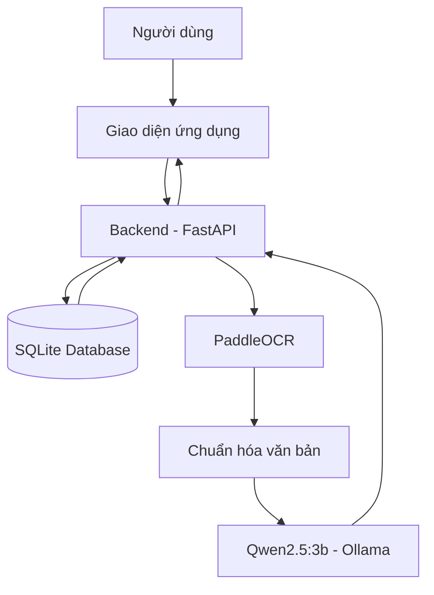

# Hệ thống hỗ trợ tra cứu & phân tích thuốc — tra_cuu_thuoc_173820_n06

> Ứng dụng hỗ trợ mọi đối tượng có nhu cầu tra cứu thông tin thuốc, đọc đơn thuốc và kiểm tra tương tác giữa các thuốc dựa trên cơ sở dữ liệu tham chiếu.

## 1. Giới thiệu sản phẩm

- **Bài toán / người dùng đích:** Việc tra cứu thông tin thuốc, đọc nội dung đơn thuốc và kiểm tra tương tác giữa nhiều loại thuốc có thể mất thời gian và khó tiếp cận với người không có chuyên môn. Sản phẩm hướng đến tất cả những ai có nhu cầu tìm hiểu thông tin thuốc, bao gồm người dân, bệnh nhân, người chăm sóc, sinh viên và nhân viên y tế.
- **Tính năng chính của MVP (3–5):**
  1. Tra cứu thông tin thuốc theo tên thuốc.
  2. Nhận dạng và trích xuất thông tin từ hình ảnh đơn thuốc bằng OCR.
  3. Hỗ trợ chuẩn hóa nội dung nhận dạng để hạn chế lỗi văn bản OCR.
  4. Kiểm tra tương tác giữa các thuốc dựa trên cơ sở dữ liệu có nguồn tham chiếu.
  5. Hỗ trợ kiểm tra tương tác giữa đơn thuốc hiện tại và lịch sử đơn thuốc.
- **Demo:** Chưa có · **Ảnh chụp:** `report/screenshot-01.png`

## 2. Phạm vi MVP

| **Trạng thái** | **Nội dung** |
|---|---|
| ✅ Đã làm | Xây dựng backend bằng Python/FastAPI; thiết lập cơ sở dữ liệu SQLite; tích hợp dữ liệu thuốc và dữ liệu tương tác thuốc ban đầu; thử nghiệm quy trình nhận dạng văn bản từ hình ảnh đơn thuốc. |
| 🚧 Đang làm | Hoàn thiện xử lý OCR bằng PaddleOCR; thử nghiệm chuẩn hóa văn bản bằng Qwen2.5:3b; hoàn thiện chức năng kiểm tra tương tác thuốc và xử lý lịch sử đơn thuốc. |
| ⬜ Chưa làm | Hoàn thiện giao diện người dùng; tích hợp toàn bộ frontend và backend; kiểm thử tích hợp; hoàn thiện báo cáo kiểm thử, bảo mật và hiệu năng; triển khai demo. |
| 🚫 Ngoài phạm vi | Chẩn đoán bệnh; tự động kê đơn; đề xuất hoặc quyết định phác đồ điều trị; thay thế tư vấn và quyết định chuyên môn của bác sĩ, dược sĩ. |

## 3. Kiến trúc & công nghệ



- Ngôn ngữ/framework + phiên bản: Python 3.12.5, FastAPI, SQLite; PaddleOCR 3.7.0; Ollama 0.40.15; Qwen2.5:3b; Git và GitHub.
- Cấu trúc thư mục `src/`:

```text
src/
├── backend/
│   ├── app/
│   ├── database/
│   ├── models/
│   ├── routers/
│   ├── services/
│   └── main.py
└── README.md
```

*Cấu trúc trên cần được đối chiếu và cập nhật theo mã nguồn thực tế trước khi hoàn thiện bài nộp.*

## 4. Cài đặt & cách sử dụng

**Yêu cầu môi trường:** Windows 10/11; Python 3.12.5; pip; SQLite; Ollama và Qwen2.5:3b nếu sử dụng chức năng hỗ trợ chuẩn hóa văn bản bằng AI.

```powershell
# Di chuyển vào thư mục backend
cd src/backend

# Tạo và kích hoạt môi trường ảo
python -m venv .venv
.venv\Scripts\activate

# Cài đặt thư viện
pip install -r requirements.txt
```

Lệnh khởi chạy backend và chạy test sẽ được cập nhật theo entry point, cấu hình và cấu trúc kiểm thử thực tế của mã nguồn.

**Dữ liệu/tài khoản mẫu (synthetic):** Sử dụng dữ liệu thuốc và dữ liệu tương tác thuốc có nguồn tham chiếu; dữ liệu đơn thuốc và thông tin người dùng phục vụ kiểm thử, trình diễn phải là dữ liệu tổng hợp. Không sử dụng thông tin định danh cá nhân hoặc hồ sơ sức khỏe thật.

**Kịch bản sử dụng (≥ 3):**

1. **Tra cứu thuốc:** Người dùng nhập tên thuốc → hệ thống tìm kiếm trong cơ sở dữ liệu → hiển thị thông tin thuốc tương ứng.
2. **Đọc đơn thuốc:** Người dùng tải lên hình ảnh đơn thuốc → hệ thống sử dụng OCR để nhận dạng và xử lý văn bản → hiển thị nội dung trích xuất để người dùng kiểm tra.
3. **Kiểm tra tương tác thuốc:** Người dùng cung cấp danh sách thuốc → hệ thống đối chiếu các cặp thuốc với cơ sở dữ liệu tương tác → hiển thị cảnh báo và thông tin tham chiếu nếu có dữ liệu phù hợp.

## 5. Hướng phát triển Tuần 11–15

| **Tuần** | **Mục tiêu** | **Đầu việc chính** | **Phụ trách (MSSV)** | **Tiêu chí hoàn thành** | **Trạng thái** |
|---|---|---|---|---|---|
| 11 (từ 18/11) | Chốt MVP & CI | Xác định phạm vi MVP; hoàn thiện cấu trúc dự án; chuẩn bị README, submission.json và CI. | 202414030, 202414334 | Xác định được chức năng MVP; cấu trúc bài nộp đúng yêu cầu; CI hoạt động. | 🚧 |
| 12 | Kiểm thử & tích hợp | Hoàn thiện các chức năng chính; tích hợp các thành phần; kiểm thử API và luồng sử dụng. | 202414030, 202414334 | Các luồng chính hoạt động; có báo cáo kiểm thử và ghi nhận lỗi. | ⬜ |
| 13 | Bảo mật, hiệu năng & AI | Kiểm tra bảo mật; đánh giá hiệu năng; đánh giá OCR và khả năng hỗ trợ chuẩn hóa văn bản của AI. | 202414030, 202414334 | Có báo cáo đánh giá; kiểm soát dữ liệu đầu vào và đầu ra; AI không tự tạo kết luận tương tác thuốc. | ⬜ |
| 14 | Review chéo & code freeze | Rà soát mã nguồn; sửa lỗi; cập nhật tài liệu; đóng băng phiên bản mã nguồn. | 202414030, 202414334 | Hoàn thành review; xử lý lỗi quan trọng; mã nguồn và tài liệu thống nhất. | ⬜ |
| 15 | Nghiệm thu & bảo vệ | Hoàn thiện sản phẩm; chuẩn bị slide, video demo và tài liệu nghiệm thu. | 202414030, 202414334 | Có sản phẩm demo; đầy đủ tài liệu; sẵn sàng trình bày và bảo vệ. | ⬜ |

Cập nhật cột *Trạng thái* (⬜ chưa / 🚧 đang / ✅ xong) vào cuối mỗi tuần.

## 6. Nhóm & tuân thủ

- Mã nhóm: `173820_n06` · Thành viên: `202414030 – Phát triển sản phẩm`, `202414334 – Phát triển sản phẩm`.
- Zero PII/PHI: Cam kết sử dụng dữ liệu tổng hợp cho kiểm thử và trình diễn; không đưa thông tin định danh cá nhân hoặc hồ sơ sức khỏe thật vào bài nộp.
- Công cụ AI đã dùng & phạm vi: ChatGPT hỗ trợ phân tích yêu cầu, thiết kế và phát triển; Qwen2.5:3b được thử nghiệm để hỗ trợ chuẩn hóa văn bản OCR. Kết quả AI cần được kiểm tra, không dùng AI làm nguồn tự quyết định tương tác thuốc.
- Dữ liệu lớn (>10MB): Chưa có liên kết dữ liệu lớn riêng.

## Cấu trúc thư mục bài nộp

- `report/` — SRS, C4 Model, Test Report, báo cáo cuối kỳ
- `src/` — mã nguồn
- `slides/` — slide thuyết trình
