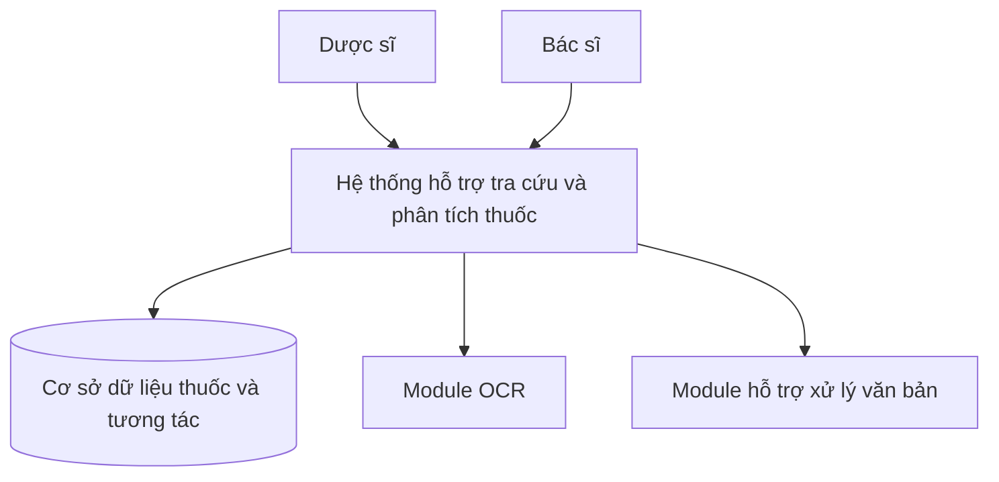
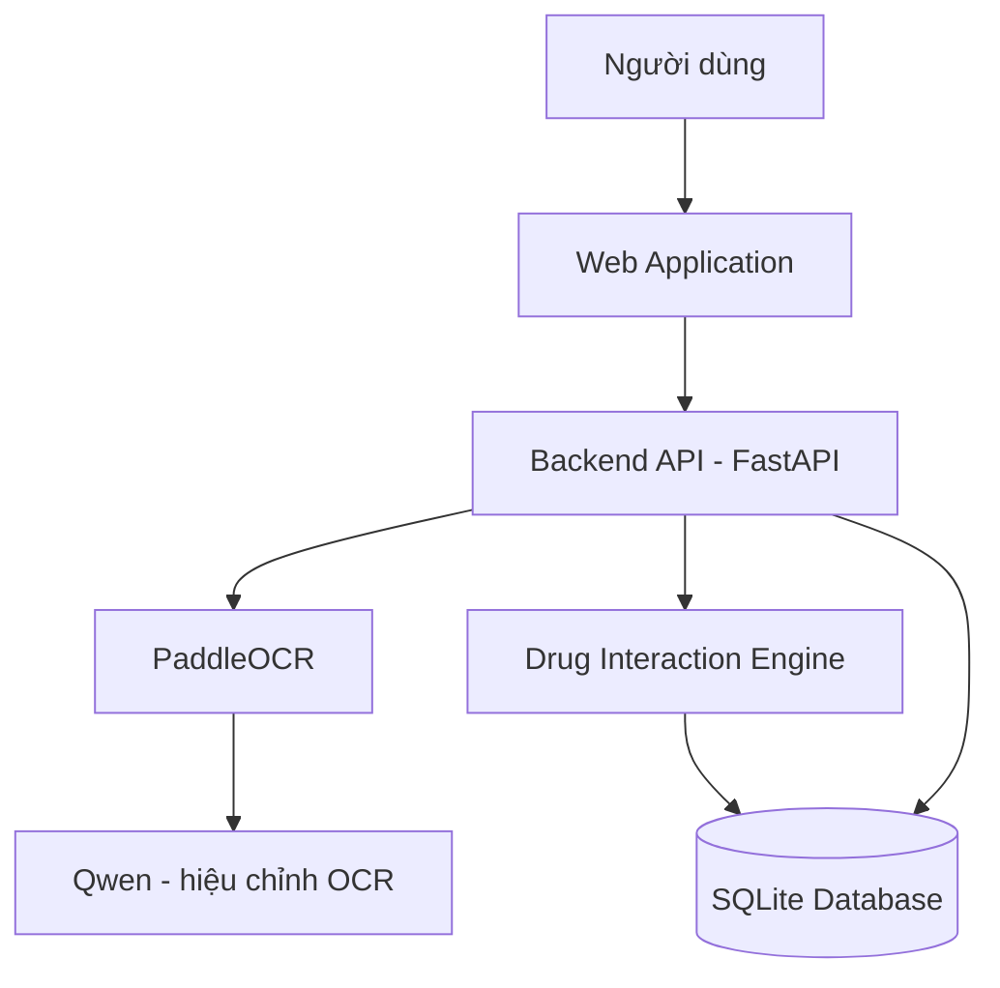

# Hệ thống hỗ trợ tra cứu & phân tích thuốc — tra_cuu_thuoc_173820_n06

> Hệ thống hỗ trợ dược sĩ tra cứu thông tin thuốc, xử lý đơn thuốc và rà soát tương tác giữa các hoạt chất dựa trên cơ sở dữ liệu có nguồn tham khảo.

## 1. Giới thiệu sản phẩm

- **Bài toán / người dùng đích:** Hỗ trợ dược sĩ trong việc tra cứu thông tin thuốc, tiếp nhận đơn thuốc dưới dạng hình ảnh và kiểm tra tương tác thuốc. Bác sĩ là người dùng phụ có thể tham khảo kết quả phân tích. Bệnh nhân là đối tượng hưởng lợi từ hệ thống.
- **Tính năng chính của MVP:**
  1. Tra cứu thuốc và thông tin hoạt chất từ cơ sở dữ liệu.
  2. Nhận diện nội dung đơn thuốc từ hình ảnh bằng OCR.
  3. Chuẩn hóa văn bản OCR thành danh sách thuốc.
  4. Kiểm tra tương tác thuốc (DDI) dựa trên cơ sở dữ liệu đã xác minh.
  5. Lưu trữ lịch sử đơn thuốc và hỗ trợ rà soát tương tác giữa các đơn.
- **Demo:** Chưa triển khai công khai.
- **Ảnh chụp:** `report/screenshot-01.png` (sẽ bổ sung).

## 2. Phạm vi MVP

| **Trạng thái** | **Nội dung** |
|---|---|
| ✅ Đã làm | Xây dựng backend Python/FastAPI; thiết lập cơ sở dữ liệu SQLite; xây dựng dữ liệu thuốc và dữ liệu tương tác thuốc ban đầu; thử nghiệm quy trình nhận diện văn bản đơn thuốc. |
| 🚧 Đang làm | Hoàn thiện luồng OCR và chuẩn hóa văn bản bằng PaddleOCR; đánh giá Qwen trong việc hiệu chỉnh lỗi OCR; hoàn thiện kiểm tra tương tác thuốc và rà soát lịch sử đơn thuốc. |
| ⬜ Chưa làm | Hoàn thiện giao diện người dùng; hoàn thiện kiểm thử tích hợp; triển khai demo; hoàn thiện báo cáo đánh giá hiệu năng và bảo mật. |
| 🚫 Ngoài phạm vi | Chẩn đoán bệnh; tự động kê đơn; thay thế quyết định chuyên môn của bác sĩ hoặc dược sĩ. |

## 3. Kiến trúc & công nghệ

### 3.1. Kiến trúc hệ thống

**C4 Context:**



**C4 Container (mô hình dự kiến):**



### 3.2. Công nghệ sử dụng

| Thành phần | Công nghệ / phiên bản |
|---|---|
| Ngôn ngữ backend | Python 3.12.5 |
| Backend framework | FastAPI |
| Database | SQLite |
| OCR | PaddleOCR 3.7.0 |
| Xử lý văn bản | Ollama 0.40.15, Qwen2.5:3b (thử nghiệm) |
| Kiểm thử | Python testing framework |
| Quản lý mã nguồn | Git, GitHub |

### 3.3. Cấu trúc thư mục `src/`

```text
src/
├── backend/
│   ├── app/
│   ├── database/
│   ├── models/
│   ├── routers/
│   ├── services/
│   └── main.py
└── README.md
```

Cấu trúc trên là cấu trúc tổ chức dự kiến cho mã nguồn được đưa vào bài nộp và sẽ được đồng bộ với mã nguồn thực tế.

## 4. Cài đặt & cách sử dụng

### 4.1. Yêu cầu môi trường

- Windows 10/11 hoặc hệ điều hành tương thích.
- Python 3.12.5.
- pip và môi trường ảo Python.
- SQLite.
- Ollama và Qwen2.5:3b nếu sử dụng module hiệu chỉnh OCR.

### 4.2. Cài đặt và chạy

Các lệnh dưới đây là quy trình cài đặt dự kiến. Đường dẫn module chạy và tên file requirements sẽ được xác nhận theo mã nguồn thực tế trước khi phát hành bản README cuối.

```powershell
cd src/backend

python -m venv .venv

.venv\Scripts\activate

pip install -r requirements.txt
```

Lệnh khởi chạy backend và chạy kiểm thử sẽ được cập nhật sau khi chốt cấu trúc mã nguồn trong thư mục `src/`.

### 4.3. Dữ liệu và tài khoản mẫu

- Sử dụng dữ liệu thuốc và tương tác thuốc phục vụ tra cứu.
- Dữ liệu đơn thuốc kiểm thử được tạo dưới dạng synthetic.
- Không sử dụng thông tin bệnh nhân thật.
- Tài khoản thử nghiệm sẽ được bổ sung khi hoàn thiện chức năng xác thực và phân quyền.

### 4.4. Kịch bản sử dụng

**Kịch bản 1: Tra cứu thuốc**

1. Dược sĩ truy cập chức năng tra cứu.
2. Nhập tên thuốc hoặc hoạt chất.
3. Hệ thống tìm kiếm trong cơ sở dữ liệu.
4. Hiển thị thông tin thuốc phù hợp.

**Kịch bản 2: Phân tích đơn thuốc bằng OCR**

1. Dược sĩ tải ảnh đơn thuốc lên hệ thống.
2. Backend tiếp nhận hình ảnh.
3. PaddleOCR thực hiện nhận diện văn bản.
4. Hệ thống chuẩn hóa danh sách thuốc.
5. Dược sĩ kiểm tra và xác nhận kết quả nhận diện.

**Kịch bản 3: Kiểm tra tương tác thuốc**

1. Dược sĩ cung cấp danh sách thuốc cần kiểm tra.
2. Hệ thống xác định các hoạt chất tương ứng.
3. Drug Interaction Engine đối chiếu các cặp hoạt chất với cơ sở dữ liệu.
4. Hệ thống hiển thị tương tác tìm thấy, mức độ nghiêm trọng và thông tin tham khảo.

## 5. Hướng phát triển Tuần 11–15

| **Tuần** | **Mục tiêu** | **Đầu việc chính** | **Phụ trách (MSSV)** | **Tiêu chí hoàn thành** | **Trạng thái** |
|---|---|---|---|
